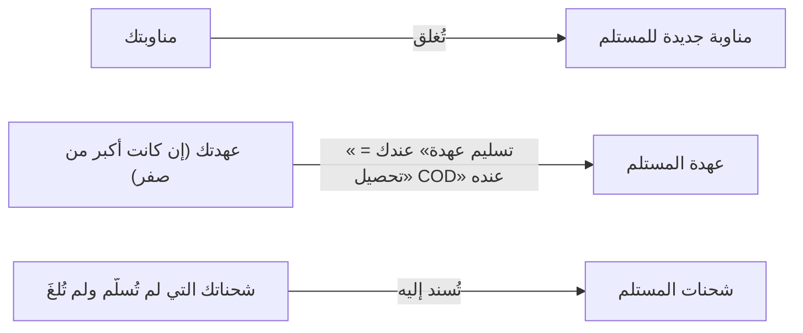

# بدء المناوبة وإنهاؤها وتسليمها لمندوب آخر

> **المصدر**: DOC-384 · INT-046 (M38) · الجرد: المجال 11 · آخر مراجعة على الكود: 2026-10-28 (الخطوة 34)

المناوبة هي فترة عملك. تبدأها قبل أن تستلم الشحنات، وتنهيها في آخر اليوم، أو تسلّمها لزميل مع شحناتك والنقد الذي معك. المصطلحات في [مسرد الأدلة](../../_glossary.md).

## لمن هذه الصفحة؟

| | |
|---|---|
| **الجمهور** | المندوب |
| **الصلاحية المطلوبة** | حساب موظف مربوط بملف مندوب نشط ([الدخول](sign-in-and-home.md)) |
| **ميزة الباقة** | لا توجد |
| **لمالك المتجر فقط؟** | لا |
| **مكانها** | تطبيق المندوب ← تبويب «المناوبة» (`/agent`) |

## قبل أن تبدأ

بلا مناوبة مفتوحة لا تظهر شحناتك: «ابدأ مناوبتك أولاً» «تظهر الشحنات والإجراءات بعد بدء المناوبة.» وزر «إلى المناوبة».

## الخطوات

### بدء المناوبة

1. افتح تبويب «المناوبة». يظهر «لا مناوبة مفتوحة».
2. اكتب «مرجع المركبة (اختياري)»، مثل رقم اللوحة أو اسم الدراجة.
3. اضغط «ابدأ المناوبة». يظهر «بدأت المناوبة.»

إن كانت لك مناوبة قديمة لم تُغلق، يغلقها المتجر أولاً: «أُغلقت المناوبة السابقة تلقائياً وبدأت مناوبة جديدة.» إغلاقها لا ينقل شحناتك ولا عهدتك لأحد.

### إنهاء المناوبة

1. اضغط «إنهاء المناوبة».
2. يظهر «انتهت المناوبة (الوقت).»

الإنهاء وحده لا ينقل شيئاً: شحناتك تبقى مسندة إليك، والنقد يبقى في عهدتك حتى تسلّمه.

### تسليم المناوبة لمندوب آخر

1. اضغط «تسليم إلى مندوب آخر».
2. اكتب «رقم المندوب المستلم».
3. اضغط «تسليم» (أو «رجوع» للتراجع).
4. يظهر «سُلِّمت المناوبة إلى «(الاسم)» (مناوبة #(الرقم)) — العهدة المنقولة (المبلغ).»

 <!-- capture: /agent → «تسليم إلى مندوب آخر», mobile, mock mode (staff session, agent 1 has an open shift; nothing is sent) -->

## ما ينتقل عند التسليم

- تُغلق مناوبتك، وتُفتح للمستلم مناوبة جديدة.
- **النقد:** إن كان معك نقد تُكتب حركتان بالمبلغ نفسه: عندك «تسليم عهدة» بملاحظة «تسليم مناوبة إلى (الاسم)»، وعنده «تحصيل COD» بملاحظة «استلام عهدة من (الاسم)». يصبح رصيدك صفراً.
- **الشحنات:** كل شحنة مسندة إليك لم تُسلَّم ولم تُلغَ تنتقل إليه، وتختفي من «شحناتي» عندك.
- يرى مالك المتجر التسليم في «مناوبات المندوبين».

## الحقول

| الحقل | إلزامي؟ | القيود |
|---|---|---|
| «مرجع المركبة (اختياري)» | لا | حتى 50 حرفاً في التطبيق |
| «رقم المندوب المستلم» | عند التسليم | رقم ملف المندوب الذي يستلم، أرقام فقط |

## الرسائل التي قد تظهر لك

| الرسالة | السبب | ماذا تفعل |
|---|---|---|
| «أدخل رقم المندوب المستلم.» | الحقل فارغ | اكتب الرقم. |
| «لا يمكنك تسليم العهدة لنفسك.» · «اختر مندوباً آخر لتسليم المناوبة.» | كتبت رقمك أنت | اكتب رقم زميلك. |
| «المندوب الجديد غير موجود.» | لا مندوب بهذا الرقم | تحقّق من الرقم مع مالك المتجر. |
| «المندوب الجديد معطّل.» | ملف المستلم مطفأ | اختر مندوباً نشطاً. |
| «new_agent_id غير صالح.» | الرقم ليس عدداً صحيحاً | اكتب أرقاماً فقط. |
| «هذه المناوبة مغلقة مسبقاً.» | أُغلقت المناوبة من قبل (من جهاز آخر أو من مالك المتجر) | حدّث الشاشة؛ ابدأ مناوبة جديدة إن احتجت. |
| «المناوبة غير موجودة.» | المناوبة ليست لك أو لم تعد موجودة | حدّث الشاشة. |
| «بلا شبكة — سيبدأ تسجيل المناوبة عند عودة الاتصال.» · «بلا شبكة — سيُرسل الإنهاء عند عودة الاتصال.» | لا شبكة | يُرسل الإجراء وحده حين تعود الشبكة ([الطابور](sign-in-and-home.md#تبويب-الطابور)). |

## حدود يجب معرفتها

- لك مناوبة مفتوحة واحدة فقط في أي وقت.
- المناوبة المغلقة لا تُنهى مرة أخرى ولا تُسلَّم.
- مالك المتجر يستطيع نقل مناوبتك وعهدتك وشحناتك إلى زميل في حالة طارئة ([إعادة الإسناد الطارئة](../../merchant/11-shipping/courier-supervision.md)). حينها تُفتح مناوبة باسم مركبة «طوارئ».

## قيود معروفة

> **قيد معروف:** التطبيق لا يعرض أرقام زملائك. اطلب «رقم المندوب المستلم» من مالك المتجر قبل التسليم.

> **قيد معروف:** المبلغ بعد «العهدة المنقولة» في رسالة التسليم هو **رصيد المستلم كله بعد التسليم** بلا رمز عملة، وليس المبلغ الذي نقلته وحده. المبلغ الذي نقلته يظهر في [دفتر عهدتك](custody.md).

<!-- ⚠️ Discrepancy — code vs code: shift-screen.tsx shows «… — العهدة المنقولة ${balance}.», but the handover response `balance` is str(get_courier_balance(new_agent)) — the new agent's TOTAL balance after the handover, a raw decimal with no currency (m38 §6.2, §10). Reported in step 34. -->
<!-- Note — vehicle_ref: UI maxLength 50, server cuts at 100 (m38 §6.1). start_shift closes any open shift without handing it over. The handover transfer writes its ledger pair in SAR (m38 §10). The shipments lock without an open shift is UI-only (NoShiftLock); the server does not require a shift. -->

## صفحات ذات صلة

- [الدخول والشاشة الرئيسية](sign-in-and-home.md)
- [شحناتي](shipments.md)
- [العهدة](custody.md)
- [الإشراف على المندوبين (لمالك المتجر)](../../merchant/11-shipping/courier-supervision.md)
- [مسرد الأدلة](../../_glossary.md)

