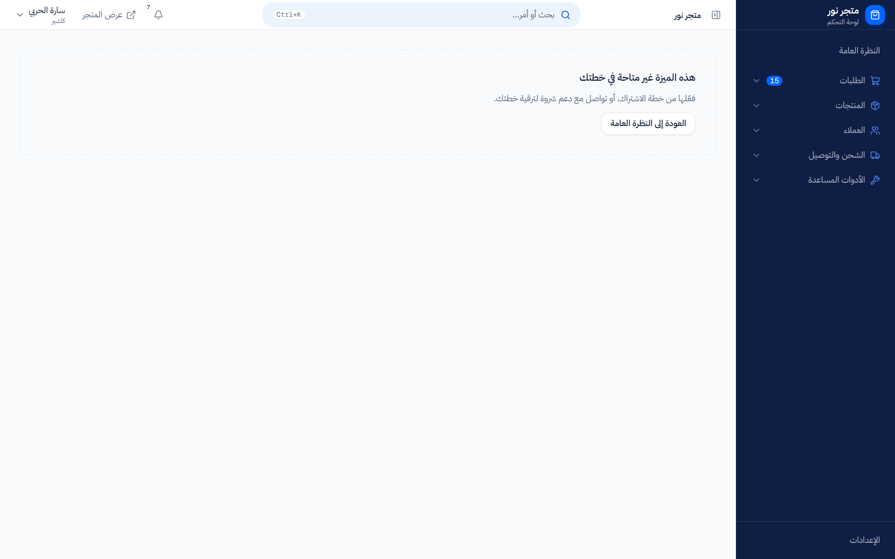

# ما المتاح في باقتي؟

> **المصدر**: DOC-287 · INT-030 (M20) · INT-032 (M46) · INT-033 (M16) · الجرد A.5 · آخر مراجعة على الكود: 2026-10-27 (الخطوة 10)

بعض أقسام لوحة التحكم تفتحها المنصة لمتجرك أو تغلقها: هذه هي **ميزات الباقة**. هذه الصفحة تسرد كل ميزة، والشاشات التي تفتحها، وما تراه حين تكون متوقفة. المصطلحات في [مسرد الأدلة](../../_glossary.md).

## لمن هذه الصفحة؟

| | |
|---|---|
| **الجمهور** | مالك المتجر |
| **الصلاحية المطلوبة** | لا شيء. ميزة الباقة تخص المتجر كله، لا موظفاً بعينه |
| **ميزة الباقة** | — |
| **لمالك المتجر فقط؟** | لا. لكن المالك وحده يستطيع طلب تفعيل ميزة من دعم شروة |
| **مكانها** | لا توجد شاشة لها. الميزات المفعّلة تظهر أقساماً في القائمة الجانبية |

## كيف تعمل الميزات؟

- **المنصة هي التي تقرر**، لا المتجر. لا توجد في لوحتك شاشة لتفعيل ميزة أو شراء باقة. لتفعيل ميزة متوقفة تواصل مع دعم شروة.
- **الميزة تخص المتجر كله.** حين تتوقف ميزة يختفي قسمها من القائمة الجانبية لمالك المتجر ولكل الموظفين معاً. هذا يختلف عن الصلاحية، التي تخص موظفاً واحداً ([من يستطيع ماذا](../12-settings-staff-integrations/permissions-matrix.md)).
- **المنصة قد تستثني متجراً بعينه**: تفتح ميزة لمتجرك وحده وهي متوقفة لغيره، أو تغلقها عن متجرك وحده.
- **أغلب الميزات مفتوحة لكل المتاجر ما لم تُغلق.** خمس ميزات متوقفة افتراضياً لكل متجر حتى تفعّلها المنصة له: «المواقع والفروع»، «الموظفون والصلاحيات»، «قنوات البيع»، «الأسواق الإلكترونية (أمازون، نون)»، «استيراد المنتجات والدروبشيبينغ (مخازن، CJ، وغيرها)».

### نقطة البيع والاشتراكات

«نقطة البيع (الكاشير والورديات)» هي الميزة الوحيدة المرتبطة بالاشتراك. ما دام نظام الباقات متوقفاً على المنصة (وهو الوضع الحالي) فهي مفتوحة لكل المتاجر. حين تفعّل المنصة نظام الباقات تصبح متاحة فقط للباقات التي تشملها.

وعند تفعيل نظام الباقات من لوحة المنصة، يحصل كل متجر جاهز ليس له اشتراك تلقائياً على الباقة المجانية الافتراضية، ويُسجَّل الاشتراك بملاحظة «إسناد تلقائي عند تفعيل الباقات». فلا يُغلق شيء عن متجرك فجأة لأنه بلا باقة، لكن نقطة البيع تبقى متاحة فقط إن كانت الباقة المجانية تشملها.
<!-- ⚠️ Discrepancy — roadmap says stores without a plan are auto-assigned the default free plan when plans are turned on / code does it only through the console route (tenants/console_billing_service.py:311-329, PATCH platform billing settings); switching `subscriptions_enabled` from the legacy Django admin (billing/admin.py PlatformBillingSettingsAdmin) assigns nothing, and the field's own help_text says it is not retroactive. Reported in step 10. -->

## ما تراه حين تكون الميزة متوقفة

1. **في القائمة الجانبية**: لا يظهر القسم إطلاقاً، لا باهتاً ولا بعبارة «قريباً».
2. **إن فتحت رابط الشاشة مباشرة**: تظهر لوحة «هذه الميزة غير متاحة في خطتك» مع «فعّلها من خطة الاشتراك، أو تواصل مع دعم شروة لترقية خطتك.» وزر «العودة إلى النظرة العامة».
3. **إن وصل إجراء إلى الخادم**: يرفضه برسالة الميزة المذكورة في الجداول أدناه. الرسالة العامة هي «هذه الميزة غير متاحة في باقتك الحالية»، ولبعض الأقسام رسالة خاصة.

على الجوال تظهر اللوحة نفسها فوق شريط التنقل السفلي:

## كل الميزات

«الاسم» هو اسم الميزة كما تسجّله المنصة، وهو ما يذكره لك دعم شروة. «الشاشات» بأسمائها في القائمة الجانبية. «الرسالة» ما يرد به الخادم على أي إجراء والميزة متوقفة.

### الطلبات والمخزون والمنتجات

| الميزة | الشاشات | الرسالة | افتراضياً |
|---|---|---|---|
| «سجل الاسترجاعات» `refunds` | «سجل الاسترجاعات»، «المرتجعات»، «المرتجعات (RMA)». استرجاع مبلغ من صفحة الطلب نفسها لا يحتاج هذه الميزة | «ميزة المرتجعات غير مفعّلة في خطتك.» | مفعّلة |
| «المخزون» `inventory` | «المخزون» | «هذه الميزة غير متاحة في باقتك الحالية» | مفعّلة |
| «المواقع والفروع» `multi_location` | «المواقع»، وقسم «المواقع» في الإعدادات | «هذه الميزة غير متاحة في باقتك الحالية» | **متوقفة** |
| «الرفع السريع للمنتجات» `bulk_upload` | «الرفع السريع» | لا رسالة: يختفي العنصر من القائمة فقط | مفعّلة |
| «تقرير المنتج» `product_report` | «تقرير المنتج» | لا رسالة: يختفي العنصر فقط | مفعّلة |
| «الحجوزات» `bookings` | قسم «الحجوزات»: «تقويم الحجوزات»، «الخدمات القابلة للحجز وساعات توفرها»، وحجز المواعيد في واجهة المتجر | «ميزة الحجوزات غير مفعّلة في خطتك.» | مفعّلة |

### التسويق والتصميم

| الميزة | الشاشات | الرسالة | افتراضياً |
|---|---|---|---|
| «مركز التسويق» `marketing` | قسم «التسويق» كله في القائمة الجانبية | لا رسالة: يختفي القسم فقط | مفعّلة |
| «الكوبونات» `coupon` | «الكوبونات» (الكوبونات والعروض)، وقسم «شريط الإعلانات» في الإعدادات | «هذه الميزة غير متاحة في باقتك الحالية» | مفعّلة |
| «العروض الترويجية» `promotions` | «العروض الترويجية» | لا رسالة: يختفي العنصر فقط | مفعّلة |
| «السلات المتروكة» `abandoned_carts` | «السلات المتروكة والاسترداد الآلي» | «هذه الميزة غير متاحة في باقتك الحالية» | مفعّلة |
| «الحملات التسويقية» `campaigns` | «الحملات التسويقية» | «هذه الميزة غير متاحة في باقتك الحالية» | مفعّلة |
| «الخط الزمني» `timeline` | «الجدول الزمني» | «هذه الميزة غير متاحة في باقتك الحالية» | مفعّلة |
| «نقاط الولاء» `loyalty_settings` | «برنامج الولاء»، و«نقاط الولاء» في قسم العملاء | «هذه الميزة غير متاحة في باقتك الحالية» | مفعّلة |
| «الهدايا» `gift_settings` | «الإهداء» | «هذه الميزة غير متاحة في باقتك الحالية» | مفعّلة |
| «المسوقون بالعمولة» `affiliates` | «التسويق بالعمولة» | «ميزة التسويق بالعمولة غير مفعّلة في خطتك.» | مفعّلة |
| «المؤثرون» `influencers` | «المؤثرين» | «ميزة المؤثرين غير مفعّلة في خطتك.» | مفعّلة |
| «تصميم الواجهة» `storefront_design` | «تصميم المتجر»، «ترتيب الأقسام» | «هذه الميزة غير متاحة في باقتك الحالية» | مفعّلة |
| «أدوات التتبع» `tracking_tools` | «أدوات التتبع». حين تتوقف لا تُرسل واجهة المتجر بيانات التتبع | «أدوات التتبع غير مفعّلة في خطتك.» | مفعّلة |

> **ملاحظة:** حين يتوقف «مركز التسويق» يختفي قسم «التسويق» كله من القائمة، بما فيه الكوبونات والمسوقون والمؤثرون، حتى لو بقيت ميزاتها مفعّلة.
<!-- ⚠️ Discrepancy — the sidebar group «التسويق» is gated on the legacy code `marketing` (navigation.ts) / no /api/v1 route checks `marketing` (docs/api/overview/plan-features.md §3.8): with `marketing` off the whole menu group disappears while coupons, affiliates and influencers still work through their own features. Same pattern for `promotions`, `bulk_upload`, `product_report`, `customer_report` (menu only). Reported in step 10. -->

### المدفوعات والمحفظة

| الميزة | الشاشات | الرسالة | افتراضياً |
|---|---|---|---|
| «بوابات الدفع» `payment_gateways` | «ربط بوابات الدفع» (كل البوابات عدا المحافظ المحلية) | «هذه الميزة غير متاحة في باقتك الحالية» | مفعّلة |
| «المحافظ المحلية» `local_wallets` | «المحافظ المحلية» وبوابات المحافظ المحلية (جيب) | «هذه الميزة غير متاحة في باقتك الحالية» | مفعّلة |
| «التحويل البنكي» `bank_transfers` | «التحويل البنكي» (حسابات الاستلام) | «هذه الميزة غير متاحة في باقتك الحالية» | مفعّلة |
| «محفظة المتجر» `merchantwallet` | قسم «محفظة المتجر»: «محفظة المتجر»، «طلبات السحب» | «هذه الميزة غير متاحة في باقتك الحالية» | مفعّلة |

### الشحن

| الميزة | الشاشات | الرسالة | افتراضياً |
|---|---|---|---|
| «رسوم التوصيل» `shipping_settings` | «رسوم التوصيل» (رسوم التوصيل الافتراضية وحد الشحن المجاني)، وقسم «الشحن» في الإعدادات | «هذه الميزة غير متاحة في باقتك الحالية» | مفعّلة |
| «شركات الشحن» `shipping_companies` | قائمة «طرق التوصيل» في شاشة «رسوم التوصيل» (ومنها طريقة «شروة شيب» الرسمية). وفي القائمة الجانبية يُخفي أيضاً «شركات الشحن» و«شركات الشحن الخارجية» | «هذه الميزة غير متاحة في باقتك الحالية» | مفعّلة |
| «مندوبو الشحن» `shipping_providers` | «مندوبو الشحن» والمندوبون وشركات الشحن المضافة يدوياً، وكذلك «مندوبو الشحن (إشراف)» و«مناوبات المندوبين» | «هذه الميزة غير متاحة في باقتك الحالية» | مفعّلة |
| «نقاط الاستلام» `pickuplocation` | «نقاط الاستلام» | «هذه الميزة غير متاحة في باقتك الحالية» | مفعّلة |
| «شروة شيب» `sharwa_ship` | «شروة شيب» (المناطق)، «بوليصات شروة شيب»، وكذلك «مندوبو الشحن (إشراف)» و«مناوبات المندوبين» | «ميزة شروة شيب غير مفعّلة لمتجرك.» | مفعّلة |

<!-- ⚠️ Discrepancy — docs/api/overview/plan-features.md (step 04) said `shipping_settings` gates `shipping/delivery-methods*` and `shipping_companies` gates `shipping/carriers*` / code: delivery methods are gated by `shipping_companies` (api/views_shipping.py:108-111), the external carriers routes (`CarrierListView` and siblings, api/views_shipping.py:151-172) carry no feature at all (owner-only only), and the frontend still hides «شركات الشحن الخارجية» behind `shipping_companies` (AccessGate in carriers-screen.tsx). The step-04 page was corrected in step 10. -->

> **ملاحظة:** الإشراف على المندوبين ومناوباتهم يفتح بإحدى ميزتين: «شروة شيب» **أو** «مندوبو الشحن». متجر يوصّل بمندوبيه المحليين دون شروة شيب يرى شاشات الإشراف أيضاً.

### الإعدادات والعملاء

| الميزة | الشاشات | الرسالة | افتراضياً |
|---|---|---|---|
| «معلومات التواصل» `contact_info` | «معلومات التواصل» (قسم «التواصل» في الإعدادات) | «هذه الميزة غير متاحة في باقتك الحالية» | مفعّلة |
| «الصفحات الإضافية» `store_policies` | «الصفحات الإضافية (سياسة الاسترجاع)» (قسم «السياسات») | «هذه الميزة غير متاحة في باقتك الحالية» | مفعّلة |
| «أسعار الصرف» `currency_settings` | «أسعار الصرف» (قسم «العملات») | «هذه الميزة غير متاحة في باقتك الحالية» | مفعّلة |
| «إعدادات SEO» `seo_settings` | «إعدادات SEO» | «هذه الميزة غير متاحة في باقتك الحالية» | مفعّلة |
| «محافظ العملاء» `customer_wallets` | «محافظ العملاء» | «هذه الميزة غير متاحة في باقتك الحالية» | مفعّلة |
| «تقرير العميل» `customer_report` | «تقرير العميل» | لا رسالة: يختفي العنصر فقط | مفعّلة |
| «التقارير» `reports` | قسم «التقارير»: «مركز التقارير»، «تصديراتي»، «التقارير المجدولة» | «ميزة التقارير غير مفعّلة في خطتك.» | مفعّلة |

### الفريق والقنوات والتطبيقات والعمليات

| الميزة | الشاشات | الرسالة | افتراضياً |
|---|---|---|---|
| «الموظفون والصلاحيات» `staff_rbac` | قسم «الموظفون والصلاحيات» كله | «هذه الميزة غير متاحة في باقتك الحالية» | **متوقفة** |
| «قنوات البيع» `social_channels` | «المحادثات»، «التواصل الاجتماعي والمحادثات» | «ميزة قنوات التواصل غير مفعّلة في خطتك.» | **متوقفة** |
| «الأسواق الإلكترونية (أمازون، نون)» `marketplaces` | «الأسواق الإلكترونية (أمازون، نون)» | «ميزة الأسواق الإلكترونية غير مفعّلة في خطتك.» | **متوقفة** |
| «استيراد المنتجات والدروبشيبينغ (مخازن، CJ، وغيرها)» `dropshipping` | «استيراد المنتجات والدروبشيبينغ» | «ميزة الدروبشيبينغ غير مفعّلة في خطتك.» | **متوقفة** |
| «متجر التطبيقات» `app_marketplace` | «متجر التطبيقات»، ولوحة شروة AI | «متجر التطبيقات غير مفعّل في خطتك.» | مفعّلة |
| «نقطة البيع (الكاشير والورديات)» `pos` | شاشة نقطة البيع. حين تتوقف تظهر «نقطة البيع غير متاحة في خطتك» | «ميزة نقطة البيع غير مفعّلة في خطتك.» | مفعّلة ما دام نظام الباقات متوقفاً |

> **ملاحظة:** في «الأسواق الإلكترونية» و«الدروبشيبينغ» يُفحص صلاحية الموظف قبل الميزة. موظف بلا الصلاحية يرى رسالة الصلاحية حتى لو كانت الميزة متوقفة.

## ما هو متاح دائماً

هذه الأقسام لا ترتبط بأي ميزة باقة، فلا تُغلق عن متجرك:

- الطلبات، والعملاء، والمنتجات وتنظيمها، والحزم والمزادات والتخصيص، والبيع بالجملة، والبحث الشامل، والإشعارات.
- «المستحقات للمنصة» وإعداد «الدفع» (طريقة دفع واحدة على الأقل): المتجر لا يُمنع أبداً من دفع مستحقاته.
- «الموردون وأوامر الشراء» و«أوامر الشراء»: تحكمها الصلاحيات فقط.
- «جلسات الدعم الفني» و«تذاكر الدعم».
- «المصروفات التشغيلية»: تحكمها صلاحية «إدارة المصروفات التشغيلية» فقط.

> **ملاحظة:** «المستحقات للمنصة» و«المصروفات التشغيلية» و«تذاكر الدعم» تقع في القائمة تحت قسم «محفظة المتجر». إن أوقفت المنصة ميزة «محفظة المتجر» يختفي القسم كله من القائمة. «المصروفات التشغيلية» و«تذاكر الدعم» تبقيان تعملان إن فتحت رابطهما، أما شاشة «المستحقات للمنصة» فتعرض لوحة الميزة المتوقفة، مع أن المستحقات نفسها لا ترتبط بأي ميزة.
<!-- ⚠️ Discrepancy — dues, expenses and support tickets carry no plan feature in Django (docs/api/overview/plan-features.md §4) / in the sidebar they live in the «محفظة المتجر» group, which is gated on `merchantwallet` (navigation.ts), and the dues item and the dues screen (`PaymentsGate anyOf={["merchantwallet"]}`, dues-screen.tsx:28) are also gated on it. Reported in step 10. -->

## الرسائل التي قد تظهر لك

| الرسالة | السبب | ماذا تفعل |
|---|---|---|
| «هذه الميزة غير متاحة في خطتك» | فتحت رابط شاشة ميزتها متوقفة لمتجرك | تواصل مع دعم شروة لتفعيلها |
| «هذه الميزة غير متاحة في باقتك الحالية» | إجراء على قسم ميزته متوقفة | كما سبق |
| «ميزة … غير مفعّلة في خطتك.» (اسم القسم مكان النقاط) | رسالة القسم الخاصة، كما في الجداول | كما سبق |
| «ميزة شروة شيب غير مفعّلة لمتجرك.» | شروة شيب متوقفة لمتجرك | كما سبق |
| «نقطة البيع غير متاحة في خطتك» | نقطة البيع ليست في باقتك بعد تفعيل نظام الباقات | للمالك: «نقطة البيع ميزة ضمن باقات الاشتراك. رقِّ خطتك أو تواصل مع دعم شروة لتفعيلها.»؛ للموظف: «نقطة البيع غير مفعّلة لهذا المتجر. اطلب من مالك المتجر تفعيلها في خطة الاشتراك.» |

## قيود معروفة

> **قيد معروف:** لا توجد في لوحة التاجر شاشة تعرض باقتك الحالية أو الميزات المفعّلة لها. تعرف ذلك من الأقسام الظاهرة في القائمة الجانبية، أو من دعم شروة.

> **قيد معروف:** الصفحة الترويجية للمنصة لا تعرض قسم الباقات حالياً.
<!-- ⚠️ Discrepancy — roadmap asks for a screenshot of "the plans section of the landing page" / the landing route renders the hero only ("no plans", owner direction 2026-10-17, src/app/(marketing)/page.tsx); `features/landing/components/pricing.tsx` exists but is not mounted. No screenshot was captured. Reported in step 10. -->

## صفحات ذات صلة

- [من يستطيع ماذا: مصفوفة الأدوار والصلاحيات](../12-settings-staff-integrations/permissions-matrix.md)
- [لماذا تظهر لي رسالة منع؟](troubleshooting-access.md)
- [مسرد الأدلة](../../_glossary.md)

