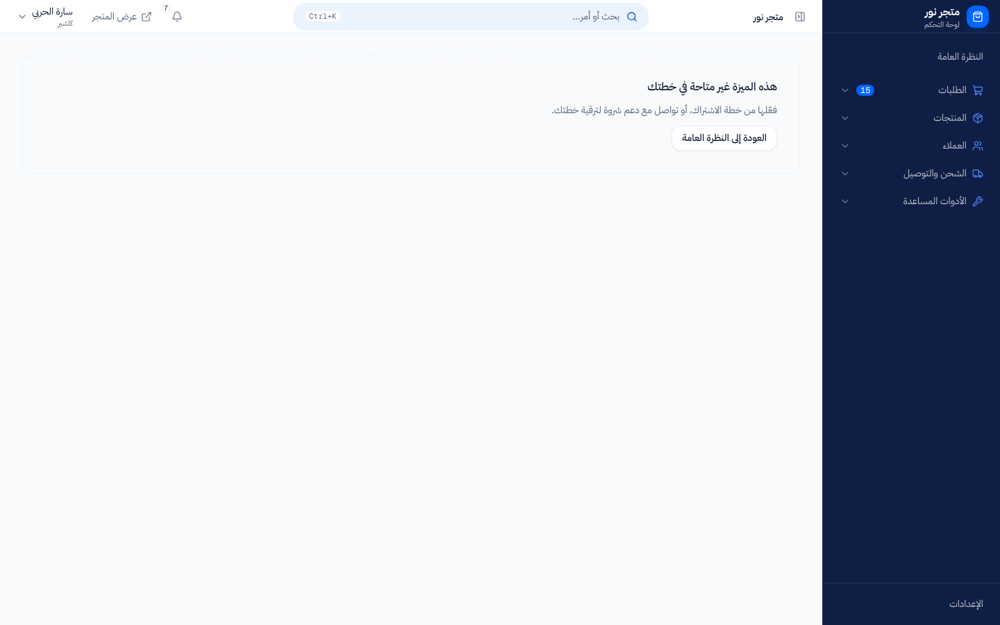
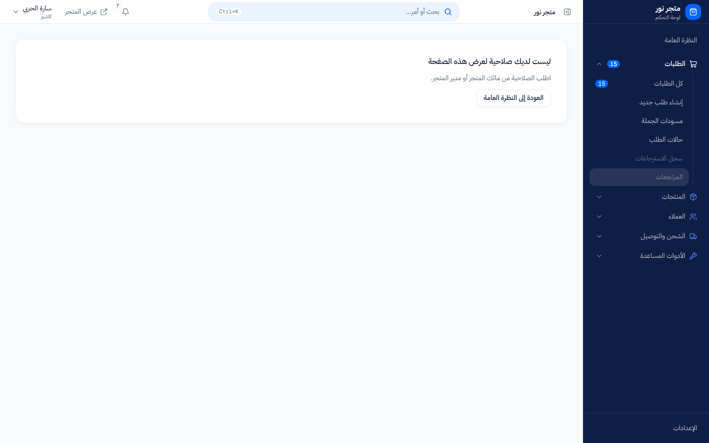
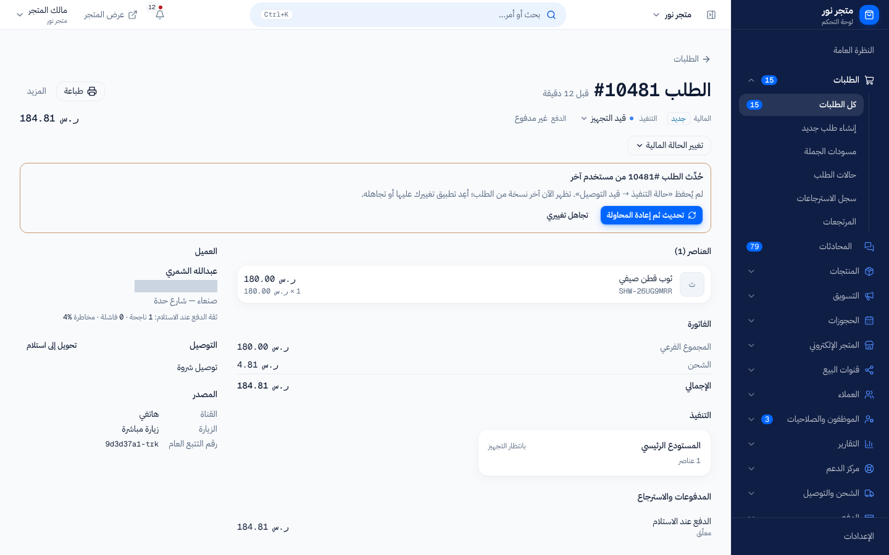

# لماذا تظهر لي رسالة منع؟

> **المصدر**: DOC-288 · INT-003 (M03) · INT-022 (M18) · INT-016 (M44) · INT-029 (M42) · INT-048 (M40) · INT-002 (M47) · الجرد A.4، A.5، A.7 · آخر مراجعة على الكود: 2026-10-27 (الخطوة 10)

حين ترفض المنصة طلبك تظهر رسالة تشرح السبب. هذه الصفحة تساعدك على معرفة نوع المنع من الرسالة، وما تفعله في كل حالة. المصطلحات في [مسرد الأدلة](../../_glossary.md).

## لمن هذه الصفحة؟

| | |
|---|---|
| **الجمهور** | مالك المتجر، والموظفون، والمشتري في واجهة المتجر |
| **الصلاحية المطلوبة** | لا شيء |
| **ميزة الباقة** | — |
| **لمالك المتجر فقط؟** | لا |
| **مكانها** | أي شاشة |

## بأي ترتيب تفحص المنصة طلبك؟

كل طلب يمر بالفحوص التالية بالترتيب، ويتوقف عند أول فحص يفشل. الرسالة التي تراها تخبرك أين توقف:

1. **هل أنت مسجّل الدخول؟** إن انتهت جلستك فلا يُفحص شيء بعدها.
2. **هل الميزة ضمن باقة متجرك؟** إن كانت متوقفة فالمنع للمتجر كله، لا لك وحدك ([ما المتاح في باقتي](plan-features.md)).
3. **هل تملك الصلاحية؟** للموظفين فقط؛ مالك المتجر يملك كل الصلاحيات ([من يستطيع ماذا](../12-settings-staff-integrations/permissions-matrix.md)).
4. **هل هذه المنطقة لمالك المتجر وحده؟** إن كانت كذلك فلا صلاحية تفتحها للموظف.
5. **هل العنصر نفسه ما زال كما رأيته؟** قد يكون حُذف، أو غيّره شخص آخر قبلك.

> **ملاحظة:** في بعض الأقسام (التصميم، الشحن، الدفع، أقسام الإعدادات المالية) يُفحص «لمالك المتجر فقط» قبل الباقة، وفي الأسواق الإلكترونية والدروبشيبينغ تُفحص الصلاحية قبل الباقة. لذلك قد يرى الموظف رسالة المالك أو رسالة الصلاحية حتى لو كانت الميزة متوقفة.

## الحالات: العَرَض ← السبب ← الحل

### 1. انتهت الجلسة أو خرجت (401)

| ما تراه | السبب | ماذا تفعل |
|---|---|---|
| تُنقل إلى شاشة تسجيل الدخول عند فتح صفحة في اللوحة | لا توجد جلسة: خرجت، أو انتهت، أو فتحت الرابط من جهاز آخر | سجّل الدخول. بعد الدخول تعود إلى الصفحة التي كنت تحاول فتحها |
| «انتهت جلستك، سجّل الدخول مجدداً.» عند حفظ أو تنفيذ إجراء | انتهت الجلسة وأنت على الصفحة | سجّل الدخول من جديد ثم أعد الإجراء. ما لم يُحفظ قبل الرسالة لم يُحفظ |
| «تم تجاوز عدد محاولات الدخول المسموح بها. يرجى المحاولة بعد 15 دقيقة.» | 5 محاولات دخول خاطئة لهذا الرقم خلال 15 دقيقة | انتظر 15 دقيقة. حتى كلمة المرور الصحيحة تُرفض أثناء القفل |

**رمز الحماية:** كل حفظ يرسل رمز حماية مع الطلب. إن رُفض الرمز تجلب الصفحة رمزاً جديداً وتعيد المحاولة **مرة واحدة تلقائياً** دون أن تلاحظ. إن ظهرت رسالة تبدأ بـ «CSRF Failed» فأعد تحميل الصفحة ثم كرّر الإجراء. إن تكررت فسجّل الخروج ثم الدخول.

### 2. الميزة ليست في باقتك (403)

| ما تراه | السبب | ماذا تفعل |
|---|---|---|
| القسم غير موجود في القائمة الجانبية أصلاً | الميزة متوقفة لمتجرك، فتختفي للمالك والموظفين معاً | تواصل مع دعم شروة لتفعيلها (المالك) أو أبلغ مالك المتجر (الموظف) |
| «هذه الميزة غير متاحة في خطتك» مكان الشاشة | فتحت رابط شاشة ميزتها متوقفة | كما سبق |
| «هذه الميزة غير متاحة في باقتك الحالية» أو «ميزة … غير مفعّلة في خطتك.» عند إجراء | الخادم رفض الإجراء لأن الميزة متوقفة | كما سبق. الرسالة الخاصة بكل قسم في [ما المتاح في باقتي](plan-features.md) |

### 3. لا تملك الصلاحية (403، للموظفين)

| ما تراه | السبب | ماذا تفعل |
|---|---|---|
| عنصر باهت في القائمة، وعند الوقوف عليه «ليست لديك صلاحية لهذا القسم» | دورك لا يشمل صلاحية هذا القسم | اطلب الصلاحية من مالك المتجر أو من يدير الأدوار |
| «ليست لديك صلاحية لعرض هذه الصفحة» مع «اطلب الصلاحية من مالك المتجر أو مدير المتجر.» | فتحت رابط شاشة لا تملك صلاحيتها | كما سبق |
| «ليست لديك صلاحية لهذا الإجراء.» | إجراء محدد يحتاج صلاحية ليست لديك | كما سبق. لا تكرر المحاولة: النتيجة لن تتغير |
| زر غير قابل للضغط مع تلميح يذكر الصلاحية، مثل «تحتاج صلاحية إدارة الموظفين» | الشاشة مفتوحة لك للقراءة، والتعديل يحتاج صلاحية أخرى | كما سبق |
| قائمة أقصر مما يراه زميلك، أو «غير موجود» لعنصر يراه غيرك | بعض الشاشات تعرض فقط ما يخص مواقعك أو قنواتك | اطلب من المالك إسنادك إلى الموقع أو القناة |

### 4. لمالك المتجر فقط (403، للموظفين)

بعض المناطق لا تفتحها أي صلاحية. لا تظهر للموظفين في القائمة أصلاً، وإن فُتح رابطها أو أُرسل إجراؤها تظهر رسالة المالك. أمثلة:

| الرسالة | أين |
|---|---|
| «هذه الصفحة لمالك المتجر فقط.» | «متاجري» (لوحة المتاجر المتعددة) |
| «تصميم المتجر مقصور على مالك المتجر.» | «تصميم المتجر» و«ترتيب الأقسام» |
| «إعدادات الشحن مقصورة على مالك المتجر.» | رسوم التوصيل، نقاط الاستلام، شركات الشحن، المندوبون |
| «إدارة المواقع مقصورة على مالك المتجر.» | إنشاء المواقع وتعديلها وتعدد المواقع |
| «إعدادات القنوات لمالك المتجر فقط.» | ربط قنوات التواصل وإعداداتها |
| «هذا الإجراء مقصور على مالك المتجر.» | إصدار بوالص شروة شيب والإشراف على المندوبين |

القائمة الكاملة في [من يستطيع ماذا](../12-settings-staff-integrations/permissions-matrix.md#ما-لا-تفتحه-أي-صلاحية-لمالك-المتجر-فقط). **ماذا تفعل:** اطلب من مالك المتجر تنفيذ الإجراء؛ لا يمكن منح هذه المناطق لموظف.

> **ملاحظة:** «تطبيق المندوب» عكس ذلك: مالك المتجر نفسه لا يدخله، لأنه للموظف المربوط بملف مندوب فقط.

### 5. شخص آخر غيّر العنصر قبلك (409)

يحدث حين يعمل شخصان على العنصر نفسه في الوقت نفسه: الطلب، أو تصميم المتجر، أو طلب إرجاع، أو وردية نقطة البيع، أو أمر شراء، أو طلب موافقة، أو جلسة دعم. المنصة لا تكتب تعديلك فوق تعديل غيرك دون أن تخبرك.

| ما تراه | أين | ماذا تفعل |
|---|---|---|
| لوحة «حُدِّث الطلب #(رقم الطلب) من مستخدم آخر» مع زرين: «تحديث ثم إعادة المحاولة» و«تجاهل تغييري» | صفحة الطلب وقائمة الطلبات | تظهر الآن آخر نسخة من الطلب. اختر «تحديث ثم إعادة المحاولة» لتطبيق تغييرك على النسخة الجديدة، أو «تجاهل تغييري» |
| «حُدِّث الثيم من جلسة أخرى. أعد التحميل لترى آخر نسخة منشورة.» | «تصميم المتجر» | أعد تحميل الصفحة ثم أعد تعديلك |
| «حُدِّث طلب الإرجاع من مستخدم آخر.» | «المرتجعات» | أعد التحميل؛ قد يكون القرار قد اتُّخذ |
| «تغيّرت الوردية، أعد التحميل.» أو «حُسم فرق هذه الوردية من مستخدم آخر.» | ورديات نقطة البيع | أعد التحميل وتحقق من حالة الوردية |
| «حُدِّث الأمر من مستخدم آخر.» | «أوامر الشراء» | أعد التحميل ثم أعد التعديل |
| «حُسم الطلب من مستخدم آخر.» | «طلبات الموافقة المعلّقة» | أعد التحميل: الطلب قُبل أو رُفض بالفعل، ولا داعي لتكراره |
| «تغيّرت البيانات من جهة أخرى، أعد التحميل ثم حاول مجدداً.» | أي شاشة أخرى | أعد تحميل الصفحة ثم كرّر الإجراء |

> **ملاحظة:** في الطلبات يظهر التعارض **لوحةً ثابتة في الصفحة** لا رسالة عابرة، حتى لا تفوتك. في بقية الشاشات تظهر الرسالة عادة في إشعار عابر أعلى الشاشة.
<!-- ⚠️ Discrepancy — roadmap asks for a "conflict toast" screenshot / orders show an inline panel, never a toast (src/features/orders/components/conflict-panel.tsx: "inline, never a toast, so it cannot be missed"); the captured image is that panel. Reported in step 10. -->

### 6. محاولات كثيرة (429)

| ما تراه | السبب | ماذا تفعل |
|---|---|---|
| «طلبات كثيرة جداً، حاول لاحقاً.» أو رسالة القسم | تجاوزت عدد المحاولات المسموح به في فترة قصيرة (رموز التحقق، الدخول، التصدير، الطلبات المتكررة) | انتظر ثم حاول. إن عرفت المنصة مدة الانتظار تظهر «حاول بعد (عدد) ثانية.» |
| «تجاوزت حدّ التصدير اليومي، راجع مدير المتجر.» | صدّرت عدداً كبيراً من العملاء اليوم | يتوقف تصديرك بقية اليوم؛ راجع مالك المتجر |

**لماذا الحدود على رقم الهاتف لا على الاتصال؟** في اليمن يشترك آلاف المستخدمين في عنوان إنترنت واحد عبر شبكة الجوال. لو حُدّت المحاولات حسب عنوان الاتصال لمُنع عملاء حقيقيون بسبب غرباء على الشبكة نفسها. لذلك تُحسب الحدود الدقيقة على رقم الهاتف أو الجلسة أو الحساب، وحدود الاتصال واسعة جداً ولا تمس الاستخدام العادي. إن ظهرت لك رسالة محاولات كثيرة فهي تخص رقمك أو جلستك، وتزول بعد المدة.

### 7. المتجر قيد التجهيز أو غير متاح

| ما تراه | السبب | ماذا تفعل |
|---|---|---|
| «جارٍ تجهيز متجرك» مع «نُجهّز قاعدة بيانات متجرك الآن. تستغرق العملية دقيقة أو دقيقتين، وتُفتح لوحة التحكم تلقائياً.» | متجر جديد ما زال يُنشأ بعد التسجيل | انتظر على الصفحة؛ تفتح اللوحة وحدها حين ينتهي التجهيز |
| «المتجر قيد التجهيز، حاول بعد قليل.» | إجراء أُرسل أثناء التجهيز | انتظر دقيقة ثم أعد المحاولة |
| «هذا المتجر غير متاح حالياً» مع «إن كنت صاحب المتجر، تواصل مع دعم شروة لمعرفة السبب.» | أوقفت المنصة المتجر | المالك: تواصل مع دعم شروة من زر واتساب في الصفحة. المشتري: المتجر لا يستقبل طلبات حالياً |

## حدود يجب معرفتها

- 5 محاولات دخول خاطئة لرقم واحد تقفل الدخول 15 دقيقة، من أول محاولة خاطئة، ولا تُمدَّد بمحاولات إضافية.
- رسائل الصلاحية ورسائل المالك نهائية: تكرار المحاولة لا يغيّرها. رسائل التعارض والمحاولات الكثيرة مؤقتة.

## صفحات ذات صلة

- [ما المتاح في باقتي](plan-features.md)
- [من يستطيع ماذا: مصفوفة الأدوار والصلاحيات](../12-settings-staff-integrations/permissions-matrix.md)
- [مسرد الأدلة](../../_glossary.md)

