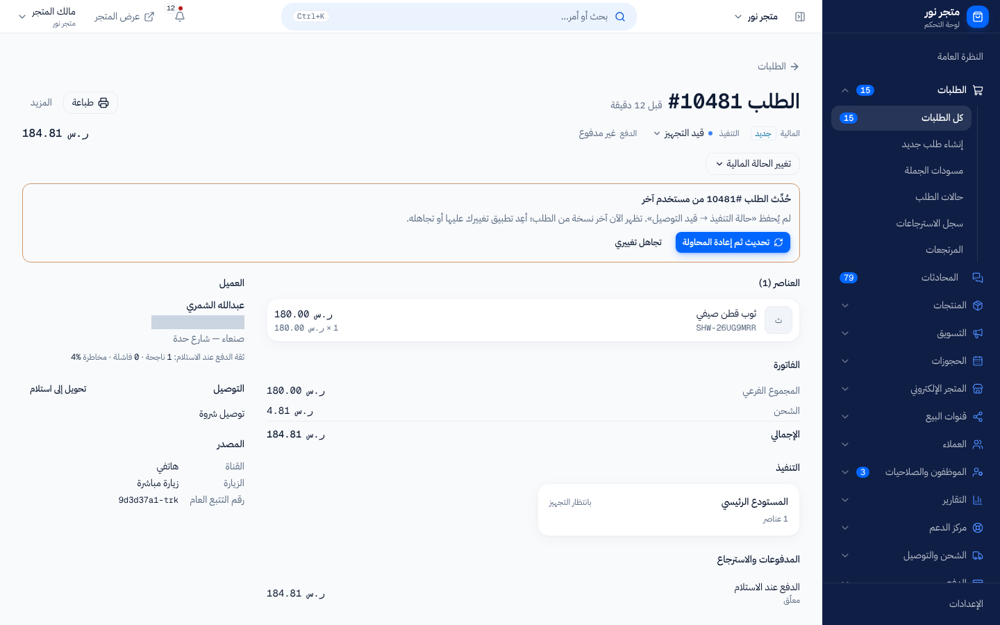

# تفاصيل الطلب وتعديله والجدول الزمني والطباعة

> **المصدر**: DOC-311 · INT-007 (M06) · INT-026 (M24) · الجرد: المجال 4 · آخر مراجعة على الكود: 2026-10-28 (الخطوة 30)

صفحة الطلب تجمع كل ما يخصّه: العميل، والعناصر، والفاتورة، والشحنات، والمدفوعات، وكل ما حدث له منذ إنشائه. المصطلحات في [مسرد الأدلة](../../_glossary.md).

## لمن هذه الصفحة؟

| | |
|---|---|
| **الجمهور** | مالك المتجر وفريقه |
| **الصلاحية المطلوبة** | العرض: «عرض الطلبات» `orders.view`. التعديل وتغيير الحالات: «تحديث حالة الطلب» `orders.update_status` — يملكها افتراضياً «مدير المتجر» و«مدير الفرع» و«كاشير» (مالك المتجر يملك كل الصلاحيات) |
| **ميزة الباقة** | — |
| **لمالك المتجر فقط؟** | لا |
| **مكانها** | «الطلبات» ← اضغط الطلب (لوحة جانبية)، أو «صفحة كاملة» (`/dashboard/orders/<رقم الطلب>`) |

## أعلى الصفحة

- «الطلب #(الرقم)» ووقت إنشائه.
- «طباعة» ([الطباعة](#الطباعة))، و«صفحة كاملة» في اللوحة الجانبية، و«المزيد» (تحويل إلى استلام، ورسالة الهدية).
- سطر الحالات: «المالية»، «التنفيذ» (اضغطها لتغييرها)، «الدفع»، والإجمالي.
- «تغيير الحالة المالية» ([حالات الطلب](order-statuses.md)).
- إن كان الطلب من سوق إلكتروني: سبب القفل، وأزرار التغيير متوقفة.

 <!-- capture: /dashboard/orders/10480, desktop 1440, mock mode -->

## الأقسام

| القسم | ما فيه |
|---|---|
| «العناصر (العدد)» | كل منتج بكميته وسعره. المنتج المحذوف بعد الطلب يظهر من لقطته مع «محذوف» |
| «الفاتورة» | «المجموع الفرعي»، «الخصم»، «العرض الترويجي»، «الكوبون»، «الشحن»، «المحفظة المستخدمة»، «العربون»، «الإجمالي»، «مدفوع مقدماً»، «المستحق عند الاستلام»، «المسترد». البنود الصفرية لا تظهر. وإن اختلفت العملة: «سعر الصرف المثبَّت عند الطلب» |
| «التنفيذ» | الشحنات: من أي موقع، وحالتها، ورقم التتبع. «وصلت كل الشحنات» أو «قيد التنفيذ الجزئي ((العدد) من (العدد) شحنات وصلت)» |
| مراجعة الدفع | إيصال التحويل والمبلغ المطلوب والفرق ([تأكيد الدفع](payment-review.md)) |
| «المدفوعات والاسترجاع» | كل دفعة بطريقتها وحالتها، وكل استرجاع بطريقته وسببه ومن نفّذه، وزر «استرجاع مبلغ» ([الاسترجاع المالي](refunds.md)) |
| «الجدول الزمني» | كل ما حدث للطلب ([الجدول الزمني](#الجدول-الزمني)) |
| «العميل» | الاسم والهاتف والبريد والعنوان، و«ثقة الدفع عند الاستلام» لطلبات الدفع عند الاستلام: عدد الطلبات الناجحة والفاشلة ونسبة المخاطرة |
| «الهدية» | للطلب الهدية: «المستلم (غير المشتري)» ورسالة الهدية |
| «التوصيل» | طريقة التوصيل أو «استلام من «(النقطة)»»، ورقم التتبع، و«طلب مسبق: بعض العناصر غير متوفرة بعد» إن وُجد |
| «موافقة الجملة» | لمسودات الجملة: «بانتظار الموافقة» أو «مُعتمد» أو «مرفوض» |
| «المصدر» | «القناة» و«الزيارة» و«رقم التتبع العام» (رابط تتبّع الطلب للمشتري) |

## ما يمكن تعديله في الطلب

في الطلب المفتوح (ليس «مكتمل» ولا «ملغي» ولا «مسترد») تعدّل شيئين فقط، من «المزيد»:

### تحويل الطلب إلى استلام

1. «المزيد» ← «تحويل إلى استلام» (أو الزر نفسه في قسم «التوصيل»).
2. اختر «نقطة الاستلام».
3. اضغط «تحويل إلى استلام». يظهر «حُوِّل الطلب إلى استلام».

تُلغى بوالص شروة شيب التي لم يستلمها المندوب بعد. **لا يمكن التحويل بعد أن يستلم المندوب الشحنة.**

### رسالة الهدية

1. «المزيد» ← «إضافة ملاحظة هدية» (أو «تعديل رسالة الهدية»).
2. اكتب «الرسالة». «تُطبع مع البوليصة، ولا تظهر قيمة الطلب للمستلم.»
3. اضغط «حفظ». يظهر «حُفظت رسالة الهدية»، ويصبح الطلب هدية.

**رسالة الهدية حتى 300 حرف.**

## الجدول الزمني

قسم «الجدول الزمني» يجمع، الأحدث أولاً:

| الحدث | مثال |
|---|---|
| الإنشاء | «أُنشئ الطلب من المتجر الإلكتروني.» · «أُنشئ الطلب من نقطة البيع.» · «أُنشئ طلب هاتفي يدوياً.» · «أُنشئت مسودة جملة بانتظار الموافقة.» |
| تغيير الحالة المالية | «تغيّرت الحالة من «(الحالة السابقة)» إلى «(الحالة الجديدة)».» |
| تغيير حالة التنفيذ | «تغيّرت حالة التنفيذ من «(السابقة)» إلى «(الجديدة)».» |
| الدفع | «تأكّد استلام الدفع.» · «قُبلت مراجعة الدفع وتحوّل الطلب للتجهيز.» · «أرفق العميل إيصال التحويل.» |
| أحداث الشحن | «البوليصة (رقم البوليصة): (من) ← (إلى)» |
| الاسترجاع المالي | «استرجاع (المبلغ) — (السبب)» |
| المرتجعات | «طلب إرجاع #(الرقم) ((العدد) سطر) — (السبب)» · «إرجاع #(الرقم): اعتُمد — (المبلغ)» · «إرجاع #(الرقم): رُفض» |
| التعديلات | «عُدِّلت رسالة الهدية.» · «حُوِّل الطلب إلى استلام من «(النقطة)»». |

بجانب كل حدث مصدره («شركة الشحن»، «تطبيق المندوب»، «يدوي»، «النظام») واسم من نفّذه إن وُجد («مالك المتجر» أو اسم الموظف). الجدول للقراءة فقط ولا يُحذف منه شيء.

 <!-- capture: /dashboard/orders/10480, desktop 1440, mock mode, element timeline -->

## التعارض: حين يعدّل شخصان الطلب نفسه

كل تعديل على الطلب يُرسل مع رقم النسخة التي رأيتها. إن غيّر شخص آخر الطلب قبلك لا يُحفظ تعديلك، ويظهر فوق الطلب:

- «حُدِّث الطلب #(الرقم) من مستخدم آخر»
- «لم يُحفظ «(تعديلك)». تظهر الآن آخر نسخة من الطلب؛ أعِد تطبيق تغييرك عليها أو تجاهله.»

ماذا تفعل:

1. راجع الطلب كما هو الآن (يُحدَّث تلقائياً).
2. إن كان تعديلك ما زال صحيحاً اضغط «تحديث ثم إعادة المحاولة»: يُعاد إرسال تعديلك على أحدث نسخة.
3. أو اضغط «تجاهل تغييري».

لا يُعاد الإرسال تلقائياً أبداً؛ القرار لك.

## الطباعة

1. اضغط «طباعة» في أعلى الطلب. تُفتح «معاينة الطباعة — A4» في نافذة جديدة (`/dashboard/orders/<رقم الطلب>/print`).
2. اضغط «طباعة».

الورقة «بوليصة شحن» فيها: اسم المتجر، ورقم الطلب وتاريخه، و«إلى» (المستلم وهاتفه وعنوانه أو نقطة الاستلام)، و«الشحن» (طريقة التوصيل ورقم التتبع)، وجدول «المنتج» و«SKU» و«الكمية».

| الطلب | ما يُطبع |
|---|---|
| عادي | جدول «المجموع» لكل سطر، و«الشحن» و«الإجمالي»، و«المبلغ عند الاستلام» إن وُجد |
| هدية | اسم المستلم بدل المشتري، و«هدية» في العنوان، ورسالة الهدية. **لا تُطبع أي أسعار** |

 <!-- capture: /dashboard/orders/10480/print, desktop 1440, mock mode -->

## الرسائل التي قد تظهر لك

| الرسالة | السبب | ماذا تفعل |
|---|---|---|
| «الطلب غير موجود.» | الرقم غير صحيح | ارجع إلى القائمة. |
| «حُدِّث الطلب من مستخدم آخر.» | تعارض | انظر [التعارض](#التعارض-حين-يعدّل-شخصان-الطلب-نفسه). |
| «اختر نقطة الاستلام.» | لا نقطة استلام مفعّلة | فعّل نقطة استلام من إعدادات الشحن. |
| «لا يمكن التحويل إلى استلام بعد أن استلم المندوب الشحنة.» | المندوب استلم الشحنة | لا يمكن التحويل الآن. |
| «300 حرف على الأكثر.» | رسالة الهدية طويلة | اختصرها إلى 300 حرف. |
| «تعذّر الحفظ.» | انقطع الاتصال | أعد المحاولة. |

## حدود يجب معرفتها

- رسالة الهدية: 300 حرف.
- يُعدَّل في الطلب المفتوح فقط: نقطة الاستلام ورسالة الهدية. العميل والعناصر والأسعار لا تُعدَّل بعد إنشاء الطلب.
- طلبات الأسواق الإلكترونية للقراءة فقط.

## قيود معروفة

> **قيد معروف:** لا تعرض شاشة الطلب حالياً بيانات التخصيص التي أدخلها المشتري لكل سطر.

> **قيد معروف:** عدّاد رسالة الهدية يسمح بـ 500 حرف، لكن الحفظ يُرفض فوق 300 حرف بـ «300 حرف على الأكثر.». اكتب 300 حرف على الأكثر.

> **قيد معروف:** نافذة «تحويل إلى استلام» تقول «يُلغى التوصيل ورسومه»، لكن رسوم التوصيل تبقى في الطلب كما هي. إن أردت إسقاطها فاسترجعها للعميل ([الاسترجاع المالي](refunds.md)).

<!-- ⚠️ Discrepancy — roadmap (DOC-311) says "editing order data" / code: only two fields are editable — the pickup conversion and the gift message (PATCH orders/<id>/ refuses anything else with «لا يوجد حقل قابل للتعديل.»). Reported in step 30. -->
<!-- ⚠️ Discrepancy — roadmap (DOC-311) says "gift message (max 300 characters)" / code: Django and the model cap at 300, but the dialog's counter and Save button allow 500 (GiftNoteDialog, order-actions.tsx `max: 500`), so 301–500 characters are refused on save. Code vs code, reported in step 30 (step 19 noted the mock's 500). -->
<!-- ⚠️ Discrepancy — code vs code: the pickup dialog says «يُلغى التوصيل ورسومه» (order-actions.tsx:304) but convert_order_to_pickup leaves delivery_fee untouched (m06-orders.md §4.2, step 19). Reported in step 30. -->
<!-- ⚠️ Discrepancy — roadmap (DOC-311) says the timeline holds "creation, every audited change, shipment events, refunds, returns" / code: correct for return REQUESTS; RMA scans and QA decisions are not on the order timeline (already reported in step 19). -->

## صفحات ذات صلة

- [قائمة الطلبات](orders-list.md)
- [حالات الطلب وحالات التنفيذ](order-statuses.md)
- [تأكيد الدفع ومراجعته](payment-review.md)
- [الاسترجاع المالي وسجل الاسترجاعات](refunds.md)
- [لماذا تظهر لي رسالة منع؟](../02-dashboard-shell/troubleshooting-access.md)
- [مسرد الأدلة](../../_glossary.md)

