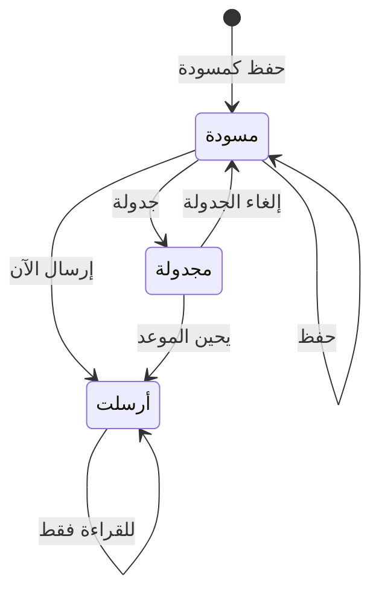

# إنشاء حملة ومعاينتها وإرسالها أو جدولتها

> **المصدر**: DOC-347 · INT-019 (M13) · INT-017 · INT-040 · الجرد: المجال 7 · آخر مراجعة على الكود: 2026-10-28 (الخطوة 32)

الحملة رسالة واحدة تُرسل إلى مجموعة من عملائك عبر قناة مربوطة، الآن أو في وقت تحدده: «رسالة واحدة لجمهور محدد عبر قناة مربوطة — فوراً أو في وقت مجدول.» المصطلحات في [مسرد الأدلة](../../_glossary.md).

## لمن هذه الصفحة؟

| | |
|---|---|
| **الجمهور** | مالك المتجر فقط |
| **الصلاحية المطلوبة** | لا يوجد مفتاح صلاحية؛ يرى الموظف: «الحملات مقصورة على مالك المتجر.» |
| **ميزة الباقة** | «الحملات التسويقية» `campaigns` — إن لم تكن مفعّلة تظهر: «هذه الميزة غير متاحة في خطتك» |
| **لمالك المتجر فقط؟** | نعم |
| **مكانها** | القائمة الجانبية ← «التسويق» ← «الحملات التسويقية» (`/dashboard/marketing/campaigns`) |

## قبل أن تبدأ

- **اربط القناة أولاً.** واتساب وMeta وTikTok Shop وتيليغرام تُربط بتثبيت تطبيقها وتفعيله ([متجر التطبيقات](../14-apps-ai-support/app-store.md)). القناة غير المربوطة تظهر معطّلة ومعها «اربط القناة».
- «رسائل SMS» و«البريد الإلكتروني» غير مربوطتين بعد، فلا تُرسل حملة عبرهما.

## دورة حياة الحملة

| الحالة | معناها |
|---|---|
| «مسودة» | محفوظة ولم تُرسل. تُعدَّل وتُعاين وتُرسل أو تُجدول |
| «مجدولة» | ستُرسل تلقائياً في «موعد الإرسال». يمكن إلغاؤها قبل ذلك |
| «أُرسلت» | خرجت. **لا تُعدَّل ولا تُرسل مرة أخرى** |

## الخطوات

### إنشاء الحملة

1. افتح «الحملات» واضغط «حملة جديدة»: «تُحفظ كمسودة أولاً، ثم تُراجَع وتُرسل.»
2. اكتب «اسم الحملة»: «للاستخدام الداخلي — لا يراه العميل.»
3. اختر «القناة» من القنوات المربوطة.
4. اختر «الجمهور» (الجدول التالي). لـ«من اشترى منتجاً» اختر «المنتج المشترى».
5. اكتب «نص الرسالة». «المتغير {customer_name} يُستبدل باسم العميل.»
6. اضغط «حفظ كمسودة». يظهر «أُنشئت الحملة كمسودة».

 <!-- capture: /dashboard/marketing/campaigns/new, desktop 1440, mock mode -->

### المعاينة

1. في الحملة المحفوظة اضغط «معاينة». إن كانت لديك تعديلات غير محفوظة يظهر «احفظ التعديلات أولاً».
2. تظهر «معاينة الحملة»: «عدد المستلمين» والرسالة «كما تصل العميل» باسم أول مستلم.
3. إن لم يوجد أحد يظهر: «لا يوجد مستلمون في هذا الجمهور حالياً.»

 <!-- capture: /dashboard/marketing/campaigns/3 → «معاينة», desktop 1440, mock mode -->

### الإرسال الآن

1. اضغط «إرسال الآن». يسألك: «إرسال الحملة الآن؟» ويذكّرك بالقناة والجمهور: «لا يمكن التراجع بعد الإرسال.»
2. أكّد. يظهر «أُرسلت إلى (العدد) مستلم».

### الجدولة وإلغاؤها

1. اضغط «جدولة» واختر «وقت الإرسال»: «تُرسل تلقائياً في الوقت المحدد؛ يمكن إلغاؤها قبل ذلك.»
2. أكّد. يظهر «جُدولت للإرسال (الموعد)» وتصبح الحالة «مجدولة».
3. للإلغاء اضغط «إلغاء الجدولة» وأكّد: «تعود الحملة مسودة ولا يُرسل شيء.» يظهر «أُلغيت الجدولة — عادت الحملة مسودة».

## الحقول

| الحقل | إلزامي؟ | القيود | ملاحظات |
|---|---|---|---|
| «اسم الحملة» | نعم | حرفان على الأقل | لا يراه العميل |
| «القناة» | نعم | «رسائل SMS»، «البريد الإلكتروني»، «واتساب»، «Meta (فيسبوك وإنستغرام)»، «TikTok Shop»، «بوت تيليغرام» | المربوطة فقط قابلة للاختيار |
| «الجمهور» | نعم | «كل العملاء»، «أصحاب السلات المتروكة»، «العملاء الخاملون»، «من اشترى منتجاً» | الخاملون: «لم يطلبوا منذ 90 يوماً.» |
| «المنتج المشترى» | نعم لـ«من اشترى منتجاً» | منتج منشور | |
| «نص الرسالة» | نعم | 5 إلى 1000 حرف | العدّاد تحت الحقل |
| «وقت الإرسال» | نعم للجدولة | في المستقبل | |

## ما يحدث بعد ذلك

- **عدد المستلمين يُحسب حسب القناة**: من له رقم أو حساب على تلك القناة فقط. لذلك قد يختلف عن عدد الجمهور في شاشة العملاء.
- عند الإرسال تتحول الحالة إلى «أُرسلت» فوراً، ثم تخرج الرسائل على دفعات. لا يمكن أن تُرسل الحملة مرتين حتى لو ضغطت مرتين.
- **الحملة المجدولة** تخرج تلقائياً خلال نحو 5 دقائق من موعدها.
- في الحملة المرسلة تظهر «أُرسلت» بتاريخها و«وصلت» و«فشلت». في المجدولة: «موعد الإرسال» و«بانتظار الإرسال».
- يمكن ربط الحملة بحدث في [الجدول الزمني](timeline-loyalty-gifting.md).

## قائمة الحملات

 <!-- capture: /dashboard/marketing/campaigns, desktop 1440, mock mode -->

الأعمدة: «الحملة» (الاسم والجمهور)، «القناة»، «الحالة»، «الوقت»، «المستلمون». البحث «ابحث باسم الحملة» وفلتر «الحالة». الأحدث أولاً.

## الرسائل التي قد تظهر لك

| الرسالة | السبب | ماذا تفعل |
|---|---|---|
| «أدخل اسم الحملة.» | الاسم فارغ أو قصير | اكتب اسماً. |
| «أدخل نص الرسالة.» · «حتى 1000 حرف.» | الرسالة أقصر من 5 أحرف أو أطول من 1000 | عدّل النص. |
| «اختر المنتج.» | «من اشترى منتجاً» دون منتج | اختر المنتج. |
| «القناة «(القناة)» غير مربوطة — الإرسال متوقف حتى ربطها.» | قناة المسودة غير مربوطة | اربطها أو اختر قناة أخرى. |
| «القناة غير مربوطة — اربطها أولاً.» | رفض الإرسال لأن القناة غير مربوطة | اربط القناة. |
| «اختر وقتاً في المستقبل.» | موعد الجدولة مضى | اختر وقتاً لاحقاً. |
| «أُرسلت هذه الحملة من قبل.» | الحملة أُرسلت | أنشئ حملة جديدة. |
| «الحملة المرسلة للقراءة فقط.» | محاولة تعديل حملة مرسلة | — |
| «الحملة غير موجودة.» | الحملة حُذفت أو الرابط خطأ | ارجع إلى القائمة. |
| «الحملات مقصورة على مالك المتجر.» | دخلت بحساب موظف | الشاشة للمالك. |

## حدود يجب معرفتها

- الرسالة من 5 إلى 1000 حرف، والمتغير المتاح `{customer_name}` وحده.
- «العملاء الخاملون» = لم يطلبوا منذ 90 يوماً.
- الحملة المجدولة قد تتأخر حتى 5 دقائق عن موعدها.
- لا يوجد حذف للحملة من الشاشة.

## قيود معروفة

> **قيد معروف:** لا يمكن إرسال حملة عبر «رسائل SMS» أو «البريد الإلكتروني» بعد؛ القناتان تظهران دائماً غير مربوطتين.

<!-- ⚠️ Discrepancy — roadmap says (DOC-347) "SMS/e-mail not connected yet → refused" / code does: the API refuses the send («القناة غير مربوطة — اربطها أولاً.»), but the dashboard never gets that far — campaign-form.tsx disables the radio of every channel that is not connected, so a new draft cannot even pick SMS or e-mail (Django would accept such a draft and preview it, m13 §4.5). Reported in step 32. -->
<!-- Note — the audience count is channel-aware (campaigns.resolve_audience); `dormant_days` is forced to 90 on every API save (DORMANT_DAYS). Scheduled dispatch: Beat `dispatch-scheduled-campaigns` every 5 minutes (m13 §4.5). The app-store link targets a roadmap-listed page (docs/guides/merchant/14-apps-ai-support/app-store.md) written in a later step. -->

## صفحات ذات صلة

- [قائمة العملاء وشرائحهم](../06-customers-wallets/customers-list.md)
- [السلات المتروكة](abandoned-carts.md)
- [الجدول الزمني والولاء والإهداء](timeline-loyalty-gifting.md)
- [مسرد الأدلة](../../_glossary.md)

