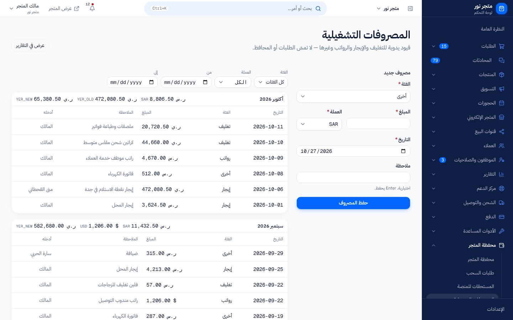
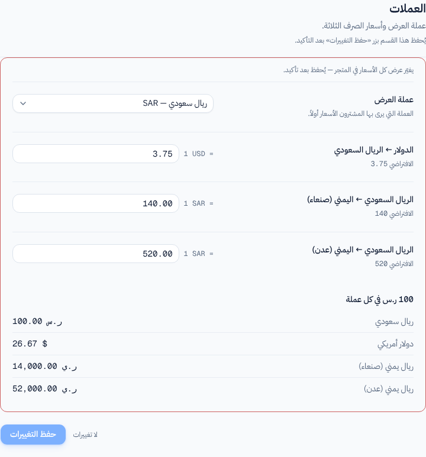

# كيف تُعرض المبالغ؟ العملات وأسعار الصرف

> **المصدر**: DOC-289 · INT-010 (M34) · INT-012 (M10) · INT-013 (M11) · INT-020 (M14) · INT-033 (M16) · INT-034 (M17) · INT-039 (M29) · INT-043 (M33) · INT-048 (M40) · الجرد A.6 · آخر مراجعة على الكود: 2026-10-27 (الخطوة 10)

تتعامل المنصة مع أربع عملات. هذه الصفحة تشرح كيف يُكتب كل مبلغ، ولماذا لا تُجمع المبالغ بعملات مختلفة، وأين يحدث التحويل بين العملات. المصطلحات في [مسرد الأدلة](../../_glossary.md).

## لمن هذه الصفحة؟

| | |
|---|---|
| **الجمهور** | مالك المتجر، والموظفون، والمشتري |
| **الصلاحية المطلوبة** | لا شيء لقراءة المبالغ. تعديل أسعار الصرف لمالك المتجر وحده |
| **ميزة الباقة** | `currency_settings` «أسعار الصرف» لتعديل الأسعار. إن لم تكن مفعّلة تظهر: «هذه الميزة غير متاحة في باقتك الحالية» |
| **لمالك المتجر فقط؟** | تعديل العملة وأسعار الصرف: نعم («هذا الإعداد يحتاج صلاحية مالك المتجر.» للموظف) |
| **مكانها** | القائمة الجانبية ← «الأدوات المساعدة» ← «أسعار الصرف» (`/dashboard/settings/currency`)، أو «الإعدادات» ← «العملات» |

## العملات الأربع

| العملة كما تظهر | الرمز | كيف يُكتب المبلغ |
|---|---|---|
| «ريال سعودي» | `SAR` | «1,250 ر.س» للمبلغ الصحيح، و«12.50 ر.س» حين توجد هللات |
| «دولار أمريكي» | `USD` | «$1» للمبلغ الصحيح، و«$12.50» حين توجد سنتات |
| «ريال يمني (صنعاء)» | `YER_OLD` | عدد صحيح دائماً، مقرّب لأقرب ريال: «52,000 ر.ي» |
| «ريال يمني (عدن)» | `YER_NEW` | عدد صحيح دائماً، مقرّب لأقرب ريال: «52,000 ر.ي» |

قواعد الكتابة:

- **الأرقام غربية** مع فاصلة الآلاف: «1,250» لا «١٢٥٠».
- **الكسور تختفي من المبلغ الصحيح** في الريال السعودي والدولار: «100 ر.س» لا «100.00 ر.س». وتظهر خانتان حين يوجد كسر: «12.50 ر.س».
- **الريال اليمني بلا كسور أبداً**، ويُقرَّب النصف إلى الأعلى: 52,000.5 تُكتب «52,001 ر.ي».
- **الريالان اليمنيان لهما الرمز نفسه «ر.ي»**. لمعرفة إن كان المبلغ بسعر صنعاء أو عدن انظر اسم العملة بجانبه، لا الرمز.

> **ملاحظة:** في واجهة المتجر يختار المشتري العملة من قائمة قصيرة: «ر.س»، «$»، «ر.ي صنعاء»، «ر.ي عدن». يُحفظ اختياره على جهازه للزيارة التالية.

## لا جمع بين عملتين

كل مجموع يُعرض **لكل عملة على حدة**، ولا تُحوَّل العملات لتُجمع في رقم واحد. أمثلة:

| أين | كيف يظهر |
|---|---|
| «المستحقات للمنصة» | مجموع لكل عملة جنباً إلى جنب، مثل «2.50 ر.س · $1» |
| «المصروفات التشغيلية» | إجمالي كل شهر لكل عملة سُجّلت فيها مصروفات |
| «محفظة شروة باي» | أربعة أرصدة، رصيد لكل عملة |
| «العهدة» عند المندوب | المبلغ بكل عملة جمعها المندوب، مفصولة بـ «·» |

> **ملاحظة:** لقطات الشاشة في الأدلة من البيانات التجريبية، وهي تعرض المبالغ بخانتين عشريتين دائماً وتضع «$» بعد الرقم («100.00 ر.س»، «26.67 $»). متجرك الحقيقي يعرضها كما في الجدول أعلاه («100 ر.س»، «$26.67»).
<!-- ⚠️ Discrepancy — mock `displayMoney()` (src/mocks/_fixtures.ts:98) says it mirrors Django `format_money()` / it always prints two decimals and a trailing `$`; Django drops the decimals of whole amounts, prefixes `$` and rounds YER to an integer (products/models/base.py:75-93). The screenshots on this page come from the mock. Reported in step 10. -->

## عملة العرض وأسعار الصرف

### الخطوات

1. من القائمة الجانبية افتح «الأدوات المساعدة» ← «أسعار الصرف».
2. اختر «عملة العرض»: العملة التي يرى بها المشترون الأسعار أولاً، وتُحسب بها مبالغ لوحتك (مثل حد الشحن المجاني وعمولات المسوّقين).
3. أدخل الأسعار الثلاثة.
4. راجع جدول «100 ر.س في كل عملة» أسفل النموذج.
5. اضغط «حفظ التغييرات» ثم أكّد في نافذة «تغيير العملات وأسعار الصرف».

### الحقول

| الحقل | إلزامي؟ | القيود | الافتراضي |
|---|---|---|---|
| «عملة العرض» | نعم | إحدى العملات الأربع | «ريال سعودي» |
| «الدولار ← الريال السعودي» | نعم | كم ريالاً سعودياً يساوي دولار واحد. رقم أكبر من صفر بأربع خانات عشرية كحد أقصى (مثل 3.7525) | 3.75 |
| «الريال السعودي ← اليمني (صنعاء)» | نعم | كم ريالاً يمنياً (صنعاء) يساوي ريال سعودي واحد. القيود نفسها | 140 |
| «الريال السعودي ← اليمني (عدن)» | نعم | كم ريالاً يمنياً (عدن) يساوي ريال سعودي واحد. القيود نفسها | 520 |

### ما يحدث بعد ذلك

- يتغيّر عرض الأسعار في المتجر فوراً. **الطلبات السابقة لا تتأثر**: كل طلب يحتفظ بمبالغه وعملته كما كانت لحظة إنشائه.
- جدول «100 ر.س في كل عملة» يحسبه الخادم، ويتحدّث بعد الحفظ لا أثناء الكتابة («المعاينة من الخادم وتتحدّث بعد الحفظ.»). بالأسعار الافتراضية: «$26.67»، «14,000 ر.ي» (صنعاء)، «52,000 ر.ي» (عدن).

> **تنبيه:** تغيير «عملة العرض» أو الأسعار يغيّر كل الأسعار التي يراها المشترون فوراً («يغيّر عرض كل الأسعار في المتجر — يُحفظ بعد تأكيد.»). راجع المعاينة قبل التأكيد.

## أين يحدث التحويل؟

كل تحويل يمر عبر الريال السعودي: من العملة الأصلية إلى الريال السعودي، ثم إلى العملة المطلوبة، بأسعار متجرك.

| أين | القاعدة | مثال (بالأسعار الافتراضية) |
|---|---|---|
| **أسعار المنتجات في واجهة المتجر** | سعر كل منتج يُحوَّل من عملته إلى العملة التي اختارها المشتري. تبدأ الواجهة بـ «عملة العرض» لمتجرك حتى يختار المشتري غيرها | منتج بـ 12.50 ر.س يظهر لمن اختار «ر.ي صنعاء» بـ «1,750 ر.ي» |
| **منتج بسعر صرف خاص** | يمكن أن يحمل المنتج سعر صرف خاصاً به لعملته، فيُستخدم بدل سعر المتجر لهذا المنتج وحده | منتج بـ 1,000 ر.ي (عدن) وسعره الخاص 500 يظهر بـ «2 ر.س» |
| **السلة والدفع** | السلة والطلب بالعملة التي اختارها المشتري. يدفع بها، وتحفظ في الطلب | — |
| **الشحن المجاني** | حد الشحن المجاني يُكتب **بعملة العرض** لمتجرك («حد الشحن المجاني · بعملة لوحة التحكم»)، ثم يُحوَّل إلى عملة سلة المشتري ويُقارن بمجموعها | حد 200 ر.س يساوي $53.33، فسلة بـ «$60» تحصل على شحن مجاني |
| **رسوم التوصيل الافتراضية** | تُكتب بالريال اليمني (عدن) دائماً | — |
| **نقطة البيع** | سعر المنتج يُحوَّل إلى «عملة العرض» لمتجرك، فكل ما في الصندوق بعملة واحدة | — |
| **محفظة العميل** | **بالريال السعودي دائماً**، مهما كانت العملة التي يتسوّق بها المشتري | — |
| **المسوّقون بالعمولة والمؤثرون** | المبالغ تُحفظ بالريال السعودي وتُعرض بـ «عملة العرض». العمولة الثابتة تُدخل وتُعرض بالريال السعودي | — |
| **العملاء** | قيمة مشتريات كل عميل على مدى تعامله تُحوَّل إلى «عملة العرض» | — |
| **أوامر الشراء** | تكلفة المنتج تُحوَّل إلى عملة أمر الشراء، وهي «عملة العرض» عند إنشاء الأمر | — |
| **البيع بالجملة** | كل سطر يُحوَّل من عملة المنتج إلى عملة المسودة، ورسوم التوصيل كذلك | — |
| **تحويل المحادثة إلى طلب** | الطلب الناتج بـ «عملة العرض» لمتجرك | — |
| **الدروبشيبينغ** | تكلفة المورّد بالدولار تُحوَّل إلى الريال السعودي بسعر «الدولار ← الريال السعودي» المحفوظ في إعداداتك، ثم يُطبَّق هامش الربح | تكلفة $10 = 37.50 ر.س قبل الهامش |

> **ملاحظة:** سعر الدولار الذي يستخدمه الدروبشيبينغ هو السعر الذي تحفظه أنت في «أسعار الصرف». لا يتحدّث يومياً ولا تلقائياً؛ حدّثه بنفسك حين يتغيّر السوق.
<!-- ⚠️ Discrepancy — roadmap calls `StoreSetting.usd_to_sar` the dropshipping «اليومي» (daily) rate / nothing refreshes it: it is the stored rate the owner edits (default 3.75). Already reported in step 04 (docs/api/overview/money.md §6.2). -->

## الرسائل التي قد تظهر لك

| الرسالة | السبب | ماذا تفعل |
|---|---|---|
| «أدخل رقماً صحيحاً.» | سعر صرف بصيغة غير صحيحة أو بأكثر من أربع خانات عشرية | أدخل رقماً مثل 3.75 أو 3.7525 |
| «يجب أن يكون أكبر من صفر.» | سعر صرف صفر أو سالب | أدخل رقماً موجباً |
| «اختر عملة من القائمة.» | عملة غير معروفة | اختر إحدى العملات الأربع |
| «هذا الإعداد يحتاج صلاحية مالك المتجر.» | موظف يحاول تعديل العملات | العملات وأسعار الصرف للمالك وحده |

## حدود يجب معرفتها

- أسعار الصرف تُحفظ بأربع خانات عشرية كحد أقصى.
- المبالغ التي تُدخلها (سعر، تكلفة، حد) بخانتين عشريتين كحد أقصى.
- الطلب لا يتغيّر بعد إنشائه إن غيّرت أسعار الصرف.

## صفحات ذات صلة

- [ما المتاح في باقتي](../02-dashboard-shell/plan-features.md)
- [من يستطيع ماذا](../12-settings-staff-integrations/permissions-matrix.md)
- [مسرد الأدلة](../../_glossary.md)

