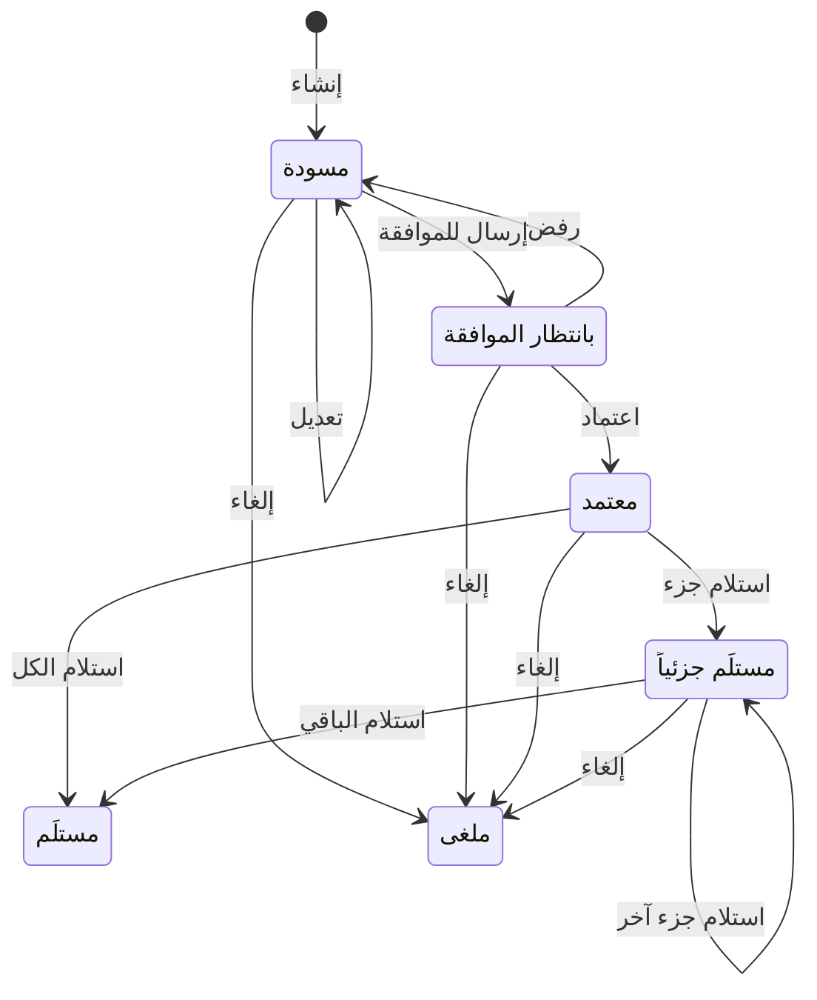

# أوامر الشراء: المسودة والإرسال والاعتماد والاستلام والإلغاء

> **المصدر**: DOC-370 · INT-035 (M23) · INT-022 · الجرد: المجال 10 · آخر مراجعة على الكود: 2026-10-28 (الخطوة 33)

أمر الشراء طلب بضاعة من [مورد](suppliers.md): «مسودة ← موافقة ← استلام. الاستلام يُحدّث مخزون الموقع تلقائياً.» الاعتماد لا يغيّر المخزون؛ **الاستلام وحده** يزيده. المصطلحات في [مسرد الأدلة](../../_glossary.md).

## لمن هذه الصفحة؟

| | |
|---|---|
| **الجمهور** | مالك المتجر، ومن يدير المشتريات، ومن يعتمدها |
| **الصلاحية المطلوبة** | الإنشاء والتعديل والإرسال والاستلام والإلغاء: «إدارة الموردين وأوامر الشراء (إنشاء/تعديل)» `suppliers.manage`. الاعتماد والرفض: «اعتماد/رفض أوامر الشراء» `suppliers.approve`. القراءة: أيّ منهما. لا دور نظامي يملكهما افتراضياً (مالك المتجر يملك كل الصلاحيات) |
| **ميزة الباقة** | لا توجد |
| **لمالك المتجر فقط؟** | لا |
| **مكانها** | القائمة الجانبية ← «المنتجات» ← «أوامر الشراء» (`/dashboard/purchase-orders`). أمر جديد: `/dashboard/purchase-orders/new` |

## دورة حياة الأمر

| الحالة | ما يمكن فعله |
|---|---|
| «مسودة» | «تعديل»، «إرسال للموافقة»، «إلغاء الأمر» |
| «بانتظار الموافقة» | «اعتماد»، «رفض»، «إلغاء الأمر» |
| «معتمد» | «تسجيل استلام»، «إلغاء الأمر» |
| «مستلَم جزئياً» | «تسجيل استلام»، «إلغاء الأمر» |
| «مستلَم» · «ملغى» | لا شيء؛ حالتان نهائيتان |

## الخطوات

### إنشاء أمر

1. افتح «أوامر الشراء» واضغط «أمر شراء جديد» (أو N): «احفظه مسودة أو أرسله للموافقة مباشرة.»
2. اختر «المورد». الموردون النشطون فقط يظهرون.
3. مع [تعدد المواقع](multi-location-mode.md) اختر «موقع الاستلام»: «المخزون يُحدَّث في هذا الموقع عند الاستلام.» بدونه يُستلم الأمر في أول موقع نشط في المتجر.
4. في «بحث عن منتج لإضافته» ابحث بالاسم أو SKU واختر المنتج. يُضاف سطر بكمية 1 وتكلفة المنتج الحالية.
5. عدّل «الكمية» و«تكلفة الوحدة» لكل سطر. احذف السطر بزر الحذف بجانبه.
6. اكتب «ملاحظات للمورد» إن أردت.
7. اضغط «حفظ كمسودة» (يظهر «أُنشئت المسودة (الرقم)») أو «حفظ وإرسال للموافقة» (يظهر «أُرسل (الرقم) للموافقة»).

 <!-- capture: /dashboard/purchase-orders/new, desktop 1440, mock mode -->

### الإرسال للموافقة

في صفحة المسودة اضغط «إرسال للموافقة». يذهب الأمر إلى صاحب الدور المعتمِد («مدير المتجر» عادةً)، ويظهر أيضاً في [صندوق الموافقات](../12-settings-staff-integrations/approvals.md) باسم رقمه.

### الاعتماد أو الرفض

1. افتح الأمر «بانتظار الموافقة».
2. اضغط «اعتماد» (يظهر «اعتُمد (الرقم)») أو «رفض» (يظهر «رُفض (الرقم) وأُعيد مسودة»).
3. **الرفض يعيد الأمر مسودة**: يعدّله منشئه ويرسله من جديد.

لا يعتمد الموظف أمراً أرسله هو. المالك يعتمد أي أمر.

### تسجيل الاستلام

1. في أمر «معتمد» أو «مستلَم جزئياً» اضغط «تسجيل استلام». تفتح «تسجيل الاستلام»: «سيُحدَّث مخزون الموقع: (الموقع)».
2. لكل سطر اكتب «المستلَم الآن» (لا يتجاوز «المتبقي»)، أو اضغط «تعبئة كل المتبقي».
3. اضغط «تسجيل استلام (العدد) وحدة». يظهر «استُلم (الرقم) بالكامل» أو «سُجّل استلام جزئي لـ (الرقم)»، ومعه «حُدِّث مخزون (الموقع)».

 <!-- capture: /dashboard/purchase-orders/22/receive, desktop 1440, mock mode -->

### الإلغاء

اضغط «إلغاء الأمر» وأكّد: «الإلغاء نهائي. الكميات المستلمة سابقاً تبقى في المخزون.» يظهر «أُلغي (الرقم)». إن كان الأمر ينتظر الموافقة يُغلق طلب الموافقة معه (يصبح مرفوضاً بملاحظة «أُلغي أمر الشراء.») فلا يبقى في صندوق الموافقات.

## صفحة الأمر

 <!-- capture: /dashboard/purchase-orders/22, desktop 1440, mock mode, fullPage -->

- **العنوان**: «أمر شراء من (المورد)» و«الاستلام في: (الموقع)».
- «الحالة»، «الإجمالي»، «طلب الموافقة» (حالته والدور المعتمِد)، «المعتمِد» بعد الاعتماد.
- **السطور**: «المنتج»، «المطلوب»، «الاستلام» («استُلم (العدد) من (العدد)»)، «تكلفة الوحدة»، «الإجمالي»، ثم «إجمالي الأمر». المنتج المؤرشف يظهر معه «(محذوف)»، ويُستلم عادياً.
- **«الجدول الزمني»**: كل حدث بنصه ومن أجراه ووقته، الأحدث أولاً:

| الحدث | النص |
|---|---|
| الإنشاء | «أُنشئ أمر الشراء كمسودة.» |
| التعديل | «عُدّلت المسودة.» |
| الإرسال | «أُرسل للموافقة (طلب #(الرقم)).» |
| الاعتماد | «اعتُمد الأمر.» |
| الرفض | «رُفض الأمر وأُعيد مسودة.» |
| الاستلام | «استلام جزئي.» أو «استُلمت كل الكميات.»، مع SKU والكمية |
| الإلغاء | «أُلغي الأمر.» |

## الحقول

| الحقل | إلزامي؟ | القيود |
|---|---|---|
| «المورد» | نعم | مورد نشط |
| «موقع الاستلام» | نعم مع تعدد المواقع | موقع نشط |
| السطور | سطر واحد على الأقل للإرسال | المنتجات المسلسلة والحزم والمزادات لا تظهر في البحث |
| «الكمية» | نعم | عدد صحيح موجب |
| «تكلفة الوحدة» | نعم | رقم حتى خانتين عشريتين، بعملة المتجر يوم إنشاء الأمر |
| «ملاحظات للمورد» | لا | حتى 1000 حرف |

- **تكلفة السطر المقترحة** هي سعر تكلفة المنتج محوّلاً إلى عملة متجرك. التكلفة تُحفظ في الأمر ولا تتغيّر إن غيّرت تكلفة المنتج لاحقاً.
- **رقم الأمر** `PO-` ثم أربع خانات، مثل `PO-0007`.
- **الإجمالي** يحسبه المتجر.

## القائمة

- **نمطان**: «لوحة» (عمود لكل حالة) و«جدول».
- **أعمدة الجدول**: «الرقم»، «المورد»، «الموقع»، «الحالة»، «السطور»، «الإجمالي»، «الإنشاء». الأحدث أولاً، 20 في الصفحة.
- **البحث** «رقم الأمر أو المورد أو SKU»: يقبل `PO-0012` أو `po12` أو `12`. الرقم وحده قد يطابق أيضاً موردين أو SKU فيها الرقم نفسه.
- **الفلاتر**: «الحالة»، «المورد»، «الموقع» (مع تعدد المواقع)، و«من» و«إلى» لتاريخ الإنشاء.

## ما يحدث بعد ذلك

- **عند الاستلام**: تزيد الكمية في موقع الاستلام (أو في الرقم العام للمنتج دون تعدد المواقع)، وتُكتب في [سجل الحركات](movements-and-reservations.md) حركة «استلام أمر شراء» مرجعها الأمر. أول استلام لمنتج في موقع يُنشئ له مخزوناً هناك.
- **عند الاعتماد أو الرفض أو الإلغاء**: لا يتغيّر المخزون.

### إن عدّل أحد الأمر في الوقت نفسه

إن غيّر مستخدم آخر الأمر بعد أن فتحته، يُرفض إجراؤك ويظهر «حُدِّث الأمر من مستخدم آخر.» مع «إعادة التحميل». أعد التحميل وراجع الأمر، ثم كرّر الإجراء إن ظل مناسباً. لا يُعاد الإجراء تلقائياً.

## الرسائل التي قد تظهر لك

| الرسالة | السبب | ماذا تفعل |
|---|---|---|
| «اختر المورد.» · «المورد غير نشط.» | مورد ناقص أو موقوف | اختر مورداً نشطاً. |
| «اختر موقع الاستلام.» | تعدد المواقع مفعّل ولم تختر موقعاً | اختره. |
| «لا يوجد موقع نشط — أضف موقعاً من صفحة المواقع.» | لا موقع نشط في المتجر | أضف موقعاً ([المواقع](locations.md)). |
| «أضف سطراً واحداً على الأقل.» | إرسال أمر بلا سطور | أضف سطراً. |
| «الكمية عدد صحيح موجب.» | كمية بكسر أو صفر | صحّحها. |
| «تكلفة الوحدة رقم حتى خانتين عشريتين.» | تكلفة غير صحيحة | صحّحها. |
| «حدد المتغير.» | منتج ذو متغيرات دون متغير | اختر المتغير. |
| «هذا المنتج لا يُستلم بأمر شراء (مسلسل/حزمة/مزاد).» | منتج من هذه الأنواع | لا يُضاف إلى أمر شراء. |
| «حُدِّث الأمر من مستخدم آخر.» | تغيّر الأمر بعد فتحه | «إعادة التحميل». |
| «التعديل متاح للمسودة فقط.» · «الإرسال متاح للمسودة فقط.» | الأمر لم يعد مسودة | — |
| «الأمر ليس بانتظار الموافقة.» | حُسم الأمر | — |
| «لا يمكن الموافقة على طلبك الخاص.» | تعتمد أمراً أرسلته | يعتمده غيرك. |
| «تم حسم هذا الاعتماد بالفعل من طرف آخر.» | اعتمده أو رفضه غيرك للتو | أعد التحميل. |
| «الاعتماد لمن يحمل صلاحية اعتماد المشتريات.» | لا تملك `suppliers.approve` | اطلبها. |
| «الاستلام متاح للأوامر المعتمدة فقط.» | الأمر غير معتمد | اعتمده أولاً. |
| «تتجاوز المتبقي (…).» | استلام أكثر من المتبقي | خفّض الكمية. |
| «أدخل كمية مستلمة لسطر واحد على الأقل.» | كل الكميات صفر | أدخل كمية. |
| «لا يمكن إلغاء أمر مستلَم أو ملغى.» | الأمر نهائي | — |
| «لا يوجد دور معتمد متاح — أنشئ دوراً أولاً.» | لا دور يعتمد | أنشئ دوراً ([الأدوار](../12-settings-staff-integrations/roles-and-assignments.md)). |
| «إنشاء أوامر الشراء لمن يحمل صلاحية إدارة الموردين.» | لا تملك `suppliers.manage` | اطلبها. |
| «أمر الشراء غير موجود.» | الرابط خطأ | ارجع إلى القائمة. |

## حدود يجب معرفتها

- الكميات أعداد صحيحة.
- التكلفة بخانتين عشريتين وبعملة المتجر يوم الإنشاء.
- الإلغاء لا يُرجع ما استُلم؛ الكميات المستلمة تبقى في المخزون.
- الرفض من شاشة الأمر لا يطلب سبباً. الرفض من [صندوق الموافقات](../12-settings-staff-integrations/approvals.md) يطلب ملاحظة.

<!-- Note — step 24 (m23 §6): `version` optimistic lock on every transition (submit optional); rejection returns to draft; cancel of a pending order closes its approval as rejected with the note «أُلغي أمر الشراء.»; the M18 queue is a second door with its own messages («لا يمكنك الموافقة على طلبك.», «حُسم الطلب من مستخدم آخر.»). Receiving by the owner writes actor «النظام» in the movement (purchase_order_service). Status labels differ between the model and the UI; the guide uses the UI's (PO_STATUS_LABELS). -->

## صفحات ذات صلة

- [الموردون](suppliers.md)
- [طلبات الموافقة](../12-settings-staff-integrations/approvals.md)
- [سجل الحركات](movements-and-reservations.md)
- [المواقع](locations.md)
- [مسرد الأدلة](../../_glossary.md)

