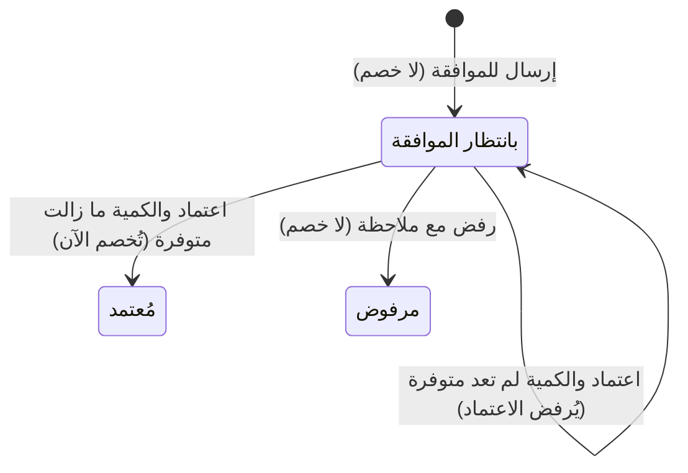

# طلب إعدام كمية تالفة أو مفقودة واعتماده

> **المصدر**: DOC-362 · INT-024 (M21) · INT-022 (M18) · الجرد: المجال 10 · آخر مراجعة على الكود: 2026-10-28 (الخطوة 33)

الإعدام (الإتلاف) إخراج كمية تالفة أو منتهية أو مفقودة من المخزون. لا يُخصم مباشرة: «إعدام المخزون التالف أو المفقود يمرّ عبر موافقة المالك — لا يُخفَّض الرقم مباشرة.» الطلب يذهب إلى صندوق الموافقات، والكمية تُخصم عند اعتماده فقط. المصطلحات في [مسرد الأدلة](../../_glossary.md).

## لمن هذه الصفحة؟

| | |
|---|---|
| **الجمهور** | من يطلب: فريق المخزون. من يعتمد: صاحب الدور المعتمِد («مدير المتجر» عادةً) ومالك المتجر |
| **الصلاحية المطلوبة** | الطلب: «إتلاف مخزون» `inventory.writeoff` — يملكها افتراضياً «مدير المتجر» و«مدير الفرع» و«أمين مخزن». عرض القائمة: `inventory.view` |
| **ميزة الباقة** | «المخزون» `inventory` للطلب. الاعتماد من صندوق الموافقات يحتاج أيضاً «الموظفون والصلاحيات» `staff_rbac` |
| **لمالك المتجر فقط؟** | لا |
| **مكانها** | «المنتجات» ← «المخزون» ← «طلبات الإعدام» (`/dashboard/inventory/writeoffs`). القرار: «القرار من صندوق الموافقات» (`/dashboard/staff/approvals?type=stock_writeoff`) |

## مسار الطلب

## الخطوات

### طلب الإعدام

1. افتح «طلبات الإعدام» واضغط «طلب إعدام». تفتح «طلب إعدام مخزون»: «يُرسل الطلب إلى صندوق الموافقات ولا تُخصم الكمية حتى يُعتمد.»
2. اختر «المنتج». يظهر «المتاح الآن».
3. مع تعدد المواقع اختر «الموقع».
4. اكتب «الكمية».
5. اكتب «سبب الإعدام»، مثل التلف أثناء النقل أو انتهاء الصلاحية.
6. اضغط «إرسال للموافقة». يظهر «أُرسل طلب الإعدام للموافقة».

 <!-- capture: /dashboard/inventory/writeoffs → «طلب إعدام», desktop 1440, mock mode -->

### اعتماد الطلب أو رفضه

1. أعلى «طلبات الإعدام» يظهر «(العدد) طلب · (العدد) بانتظار الموافقة»، ومعه رابط «القرار من صندوق الموافقات».
2. في صندوق الموافقات تظهر بطاقة الطلب بملخصه، مثل: إعدام 4 × طقم صحون — كسر أثناء الجرد. فيها الكمية والملاحظة ومن طلب.
3. اعتمد الطلب، أو ارفضه مع كتابة سبب الرفض. تفاصيل الصندوق في [طلبات الموافقة](../12-settings-staff-integrations/approvals.md).

 <!-- capture: /dashboard/staff/approvals?type=stock_writeoff, desktop 1440, mock mode -->

## الحقول

| الحقل | إلزامي؟ | القيود |
|---|---|---|
| «المنتج» | نعم | منتج أو متغير. المنتجات المسلسلة والحزم والمزادات لا تظهر في القائمة |
| «الموقع» | نعم مع تعدد المواقع | |
| «الكمية» | نعم | أكبر من صفر، حتى 3 خانات عشرية، ولا تتجاوز الكمية الحالية |
| «سبب الإعدام» | نعم | حتى 300 حرف |

## ما يحدث بعد ذلك

- **عند الطلب**: لا يتغيّر شيء في المخزون ولا تُكتب حركة. يظهر الطلب «بانتظار الموافقة».
- **عند الاعتماد**: تُخصم الكمية فوراً، وتُكتب في [سجل الحركات](movements-and-reservations.md) حركة «تعديل يدوي» ملاحظتها تبدأ بـ «إعدام مخزون:» ومرجعها «طلب إعدام #(الرقم)». يصبح الطلب «مُعتمد».
- **إن نقصت الكمية بين الطلب والاعتماد** (بيعت مثلاً) ولم تعد تكفي، يُرفض الاعتماد ويبقى الطلب «بانتظار الموافقة». ارفضه، أو عدّل المخزون أولاً.
- **عند الرفض**: لا يُخصم شيء. يصبح الطلب «مرفوض».
- لا يعتمد الموظف طلبه هو.

## القائمة

الأعمدة: «التاريخ»، «المنتج»، «الموقع»، «الكمية»، «السبب»، «الطالب» («مالك المتجر» أو اسم الموظف)، «الحالة» («بانتظار الموافقة»، «مُعتمد»، «مرفوض»). الأحدث أولاً.

## الرسائل التي قد تظهر لك

| الرسالة | السبب | ماذا تفعل |
|---|---|---|
| «اختر المنتج.» | لم تختر منتجاً | اختره. |
| «أدخل كمية أكبر من صفر.» · «رقم أكبر من صفر حتى 3 خانات عشرية.» | كمية غير صحيحة | صحّحها. |
| «الكمية تتجاوز المتاح (…).» | الكمية أكبر من الموجود | اطلب الكمية الموجودة أو أقل. |
| «الملاحظة مطلوبة لطلب الإعدام.» | السبب فارغ | اكتب السبب. |
| «300 حرف على الأكثر.» | السبب طويل | اختصره. |
| «حدد الموقع.» · «الموقع غير موجود.» | الموقع ناقص أو غير صحيح | اختر موقعاً. |
| «لا يوجد دور معتمِد متاح — أنشئ دوراً أولاً.» | لا دور يمكنه الاعتماد | أنشئ دوراً ([الأدوار](../12-settings-staff-integrations/roles-and-assignments.md)). |
| «الكمية المطلوب إعدامها تتجاوز المخزون الحالي — ارفض الطلب أو عدّل المخزون أولاً.» | نقص المخزون قبل الاعتماد | ارفض الطلب أو عدّل المخزون. |
| «المنتج لم يعد موجوداً — ارفض الطلب.» · «المتغيّر لم يعد موجوداً — ارفض الطلب.» | حُذف المنتج أو المتغير | ارفض الطلب. |
| «المتجر أصبح متعدد المواقع والطلب بلا موقع — ارفضه واطلب من جديد.» | فُعّل تعدد المواقع بعد الطلب | ارفضه وأعد الطلب مع موقع. |
| «لا يمكنك الموافقة على طلبك.» | تحاول اعتماد طلبك | يعتمده غيرك. |
| «الملاحظة مطلوبة عند الرفض.» | رفضت دون سبب | اكتب السبب. |

## حدود يجب معرفتها

- الكمية تُخصم عند الاعتماد، لا عند الطلب.
- الدور المعتمِد هو «مدير المتجر»، فإن لم يوجد هذا الدور فأول دور نشط.
- في المتجر ذي الموقع الواحد يعتمد الطلب أي صاحب للدور المعتمِد. مع موقع محدد: صاحب الدور في ذلك الموقع، أو المالك.

## قيود معروفة

> **قيد معروف:** إن لم تكن ميزة «الموظفون والصلاحيات» في باقتك، تُرسَل طلبات الإعدام لكن لا يمكن اعتمادها ولا رفضها من صندوق الموافقات، حتى من مالك المتجر. عدّل المخزون يدوياً بملاحظة تذكر الإعدام بدلاً من ذلك.

> **قيد معروف:** قائمة «المنتج» في النموذج تعرض أول 100 منتج فقط (بالترتيب الأبجدي). إن لم تجد المنتج فيها فخفّض كميته من [تعديل الكمية](adjust-stock.md) بملاحظة تذكر الإعدام.

> **قيد معروف:** «المتاح الآن» في النموذج هو الكمية العامة للمنتج، لا كمية الموقع المختار.

<!-- ⚠️ Discrepancy — roadmap says (DOC-362) approver «مدير المتجر» / code: _default_approver_role() falls back to the first active role when no system role «مدير المتجر» exists (step 23), and the screen describes the approval as «موافقة المالك». The decision route approvals/<id>/resolve/ is gated on plan feature `staff_rbac` (off by default) — write-offs can be requested but not decided on such stores (step 23). Reported again in step 33. -->
<!-- ⚠️ Discrepancy — code vs code: the write-off form lists units from useInventory({page_size: 100}) (writeoffs-screen.tsx), so products beyond the first 100 (by name) cannot be picked; «المتاح الآن» shows catalog stock while the server caps against the location row's on-hand in multi-location mode. Reported in step 33. -->
<!-- Note — the UI names the feature «طلبات الإعدام» while the permission seed calls it «إتلاف مخزون» and the roadmap «الإتلاف»; this guide uses the screen's word. -->

## صفحات ذات صلة

- [طلبات الموافقة](../12-settings-staff-integrations/approvals.md)
- [تعديل الكمية](adjust-stock.md)
- [سجل الحركات](movements-and-reservations.md)
- [مسرد الأدلة](../../_glossary.md)

