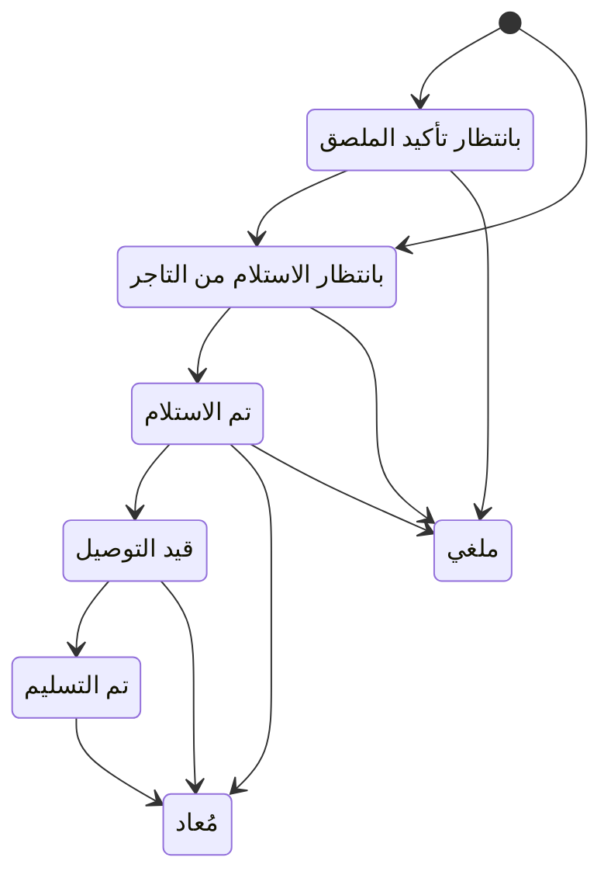

# متابعة بوليصات شروة شيب وتعديل حالتها

> **المصدر**: DOC-380 · INT-047 (M39) · الجرد: المجال 11 · آخر مراجعة على الكود: 2026-10-28 (الخطوة 34)

تبويب «البوليصات» في شاشة «شروة شيب» يعرض كل بوليصة بمحورين منفصلين: «أين الشحنة؟» (حالة الشحنة) و«هل حُصِّلت التكلفة؟» (حالة التحصيل). المصطلحات في [مسرد الأدلة](../../_glossary.md).

## لمن هذه الصفحة؟

| | |
|---|---|
| **الجمهور** | مالك المتجر ومن يملك «عرض الطلبات» |
| **الصلاحية المطلوبة** | العرض: «عرض الطلبات» `orders.view` — يملكها افتراضياً «مدير المتجر» و«مدير الفرع» و«كاشير» و«أمين مخزن». تعديل الحالة يدوياً: مالك المتجر وحده |
| **ميزة الباقة** | «شروة شيب» `sharwa_ship` |
| **لمالك المتجر فقط؟** | تعديل الحالة نعم |
| **مكانها** | «الشحن والتوصيل» ← «بوليصات شروة شيب» ← تبويب «البوليصات» (`/dashboard/shipping/sharwa-ship?tab=waybills`). صفحة البوليصة: `/dashboard/shipping/sharwa-ship/<رقمها>` |

## الحالتان

| «أين الشحنة؟» | معناها |
|---|---|
| «بانتظار تأكيد الملصق» | بوليصة شركة شحن خارجية تنتظر تأكيد الشركة ([طابور AWB](awb-queue-and-rate-cards.md)) |
| «بانتظار الاستلام من التاجر» | صدرت البوليصة؛ ينتظر المندوب استلام الشحنة من متجرك |
| «تم الاستلام» | استلمها المندوب |
| «قيد التوصيل» | في الطريق إلى العميل |
| «تم التسليم» | سُلِّمت |
| «مُعاد» | عادت |
| «ملغي» | أُلغيت |
| «شحنة مُعوَّضة» | فُقدت وعُوِّضت |

| «هل حُصِّلت التكلفة؟» | معناها |
|---|---|
| «بانتظار التحصيل» | لم تُخصم تكلفة البوليصة بعد |
| «حُصِّلت» | خُصمت من محفظة شروة باي |
| «مُعفاة» | أُلغيت البوليصة ولم تُحتسب تكلفتها |

## قائمة البوليصات

- فوق القائمة عدّادات «بانتظار الاستلام من التاجر» و«قيد التوصيل» و«تم التسليم». الضغط على عدّاد يصفّي به، والضغط مرة أخرى يلغيه. العدّادات لكل البوالص، مهما كانت الفلاتر.
- الفلاتر: «الحالة»، «التحصيل»، «الناقل» (شروة شيب، أرامكس، سمسا)، والبحث «رقم البوليصة أو العميل أو الطلب».
- الأعمدة: «البوليصة»، «الطلب»، «الناقل»، «المنطقة»، «التكلفة»، «الوزن كغ»، «الحالة»، «التحصيل»، «التاريخ».
- **البوليصة الرئيسة فقط تظهر في القائمة.** إن كان لها بوالص فرعية يظهر تحت رقمها «رئيسة · (العدد) فرعية». البوليصة التي آخر حدث مقبول فيها معلَّم للمراجعة تحمل «قيد المراجعة».
- 20 بوليصة في الصفحة، الأحدث أولاً.

 <!-- capture: /dashboard/shipping/sharwa-ship?tab=waybills, desktop 1440, mock mode -->

## صفحة البوليصة

اضغط رقم البوليصة. تحت الرقم: «(الناقل) · الطلب #(الرقم) · (العميل)».

| القسم | ما فيه |
|---|---|
| الحالتان | «أين الشحنة؟» و«هل حُصِّلت التكلفة؟». لبوليصة شركة خارجية تنتظر تأكيدها رابط «بانتظار تأكيد الملصق — طابور AWB» |
| التفاصيل | «العنوان»، «المنطقة»، «التكلفة (لقطة)»، «الوزن الفعلي»، «المبلغ عند الاستلام»، «المندوب» (أو «بلا إسناد»)، «أُنشئت»، و«البوليصة الرئيسة» للفرعية |
| «البوليصات الفرعية» | للرئيسة: كل فرعية برقمها وحالتها |
| «البنود» | المنتجات والكميات، وبعد التسليم «سُلِّم (الكمية) من (الكمية)» |
| «الأحداث» | الأحدث أولاً (التفاصيل أدناه) |

- **«المبلغ عند الاستلام»** هو ما يحصّله المندوب من العميل: مجموع أسعار البنود في الشحنة، بعملة الطلب.
- «طباعة» (أو مفتاح P) يفتح صفحة طباعة الطلب.

 <!-- capture: /dashboard/shipping/sharwa-ship/716, desktop 1440, mock mode -->

### الأحداث

كل حدث يظهر هكذا: الحالة السابقة ← الحالة الجديدة · المصدر · من قام به. المصدر واحد من «Webhook شركة شحن»، «تطبيق المندوب»، «تعديل يدوي من التاجر»، «نظامي». ومن قام به اسم الموظف أو المندوب، أو «مالك المتجر»، أو «النظام»، أو «شركة الشحن».

تحته «وقت الحدث» و«وصل»، و«الموقع» بالإحداثيات ودقتها بالمتر إن أرسلها الجهاز. وقد تظهر علامات:

| العلامة | معناها |
|---|---|
| «مرفوض — (السبب)» | لم يُطبَّق الحدث (الأسباب في الجدول التالي) |
| «خارج الترتيب» | وصل متأخراً وطُبِّق لأنه يتقدّم بالحالة |
| «قيد المراجعة» | يحتاج تحققاً بشرياً، مثل تسليم بعيد عن العنوان |
| «مزامنة متأخرة من الجهاز» | وصل بعد أكثر من 5 دقائق من وقوعه (المندوب كان بلا شبكة) |
| «ارتداد بعد التسليم — يتطلب مراجعة مالية» | شحنة مسلَّمة صارت «مُعاد» |

## الخطوات

### تعديل الحالة يدوياً

1. في صفحة البوليصة، قسم «تعديل الحالة يدوياً» (أو مفتاح E)، تظهر أزرار الحالات.
2. الأزرار المسموحة من الحالة الحالية فقط تعمل. على المعطّل: «غير مسموح من «(الحالة)»».
3. اضغط الحالة المطلوبة. يظهر «نُقلت الشحنة إلى «(الحالة)».»

«يُسجَّل بمصدر «تعديل يدوي من التاجر» ويمر بنفس قواعد الانتقال.» الحالة النهائية تقول «حالة نهائية مقفلة.»

**إن رُفض التعديل** تبقى الحالة كما هي، ويظهر السبب تحت الأزرار، ويُسجَّل الحدث المرفوض في «الأحداث»:

| السبب | معناه |
|---|---|
| «انتقال غير مسموح من الحالة الحالية» | تغيّرت الحالة بعد فتح الصفحة |
| «حدث أقدم من آخر حدث مسجَّل — أُرشِف بلا تغيير» | سُجِّل بعده حدث أحدث |
| «الطلب مسترجَع مسبقاً» | الطلب ملغى أو مسترد؛ لا يُسلَّم |
| «شحنة مُعوَّضة كمفقودة — تواصل مع المشرف» | الشحنة عُوِّضت |
| «رُفض الحدث.» | سبب آخر |

### إسناد البوليصة إلى مندوب

يتم من شاشة [الإشراف على المندوبين](courier-supervision.md)، قسم «شحنات جديدة بلا إسناد». البوليصة الفرعية تنتقل مع رئيستها: إسناد واحدة يسند المجموعة كلها.

## انتقالات الحالة

«شحنة مُعوَّضة» لا تُختار من الأزرار؛ تضعها المنصة.

## ما يحدث بعد ذلك

- كل حالة مقبولة تصل إلى العميل إشعاراً إن كان مشتركاً في التنبيهات، وتُرسل إلى روابط الويب المسجّلة.
- **«تم التسليم» ← «مُعاد»** يفتح مراجعة مالية لدى المنصة. لا يُعاد المال تلقائياً.

## الرسائل التي قد تظهر لك

| الرسالة | السبب | ماذا تفعل |
|---|---|---|
| «الشحنة غير موجودة.» | رقم بوليصة غير موجود | ارجع إلى «البوليصات». |
| «حالة غير معروفة.» | حالة غير صحيحة | حدّث الصفحة. |
| «هذا الإجراء مقصور على مالك المتجر.» | موظف يحاول التعديل | التعديل لمالك المتجر. على الأزرار: «التعديل لمالك المتجر» |
| «ليست لديك صلاحية لعرض الشحنات.» | لا تملك «عرض الطلبات» | اطلبها من مالك المتجر. |
| «تعذّر الحفظ.» | خطأ في الاتصال | أعد المحاولة. |
| «لا بوليصات بعد» | لم تُصدر بوليصة بعد | «أصدر أول بوليصة من تبويب «بانتظار الإصدار».» |
| «لا نتائج لهذه الفلاتر» | لا نتائج | غيّر الفلاتر. |

## حدود يجب معرفتها

- البحث برقم الطلب يعمل حين تكتب الرقم وحده.
- فلتر «الناقل» بقيمة شروة شيب يشمل البوالص القديمة التي لم يُسجَّل لها ناقل.
- ضغط الزر نفسه مرتين لا ينقل الشحنة مرتين.

## قيود معروفة

> **قيد معروف:** لا يوجد في الشاشة فلتر بالتاريخ، رغم أن المتجر يدعم التصفية بتاريخ الإصدار.

<!-- ⚠️ Discrepancy — roadmap says filters "status/billing/carrier/search/dates" (DOC-380) / code: the API accepts from/to (m39 §5.1) but sharwa-ship-screen.tsx filterParsers hold status, billing, carrier and q only — no date control. Reported in step 34. -->
<!-- Note — manual status: owner only, 200 even when refused (accepted false + rejection_reason), idempotency key {pk}:{to_status}:{uuid} (m39 §5.3). The UI hides label_pending and compensated_lost buttons. geo_required is shown as null on reads (m39 §9). Assign is a supervision row (sharwa_ship OR shipping_providers, owner only) and moves the parent's sub-shipment for a child (m39 §5.4). flagged_for_review in this list is read from the latest ACCEPTED event (m38 §10 notes M38 reads any event). -->

## صفحات ذات صلة

- [إصدار بوليصات شروة شيب](sharwa-ship-issue-waybill.md)
- [الإشراف على المندوبين](courier-supervision.md)
- [طابور AWB ولقطات التسعيرة](awb-queue-and-rate-cards.md)
- [الحالات الحدّية](zone-review-and-edge-cases.md)
- [مسرد الأدلة](../../_glossary.md)

