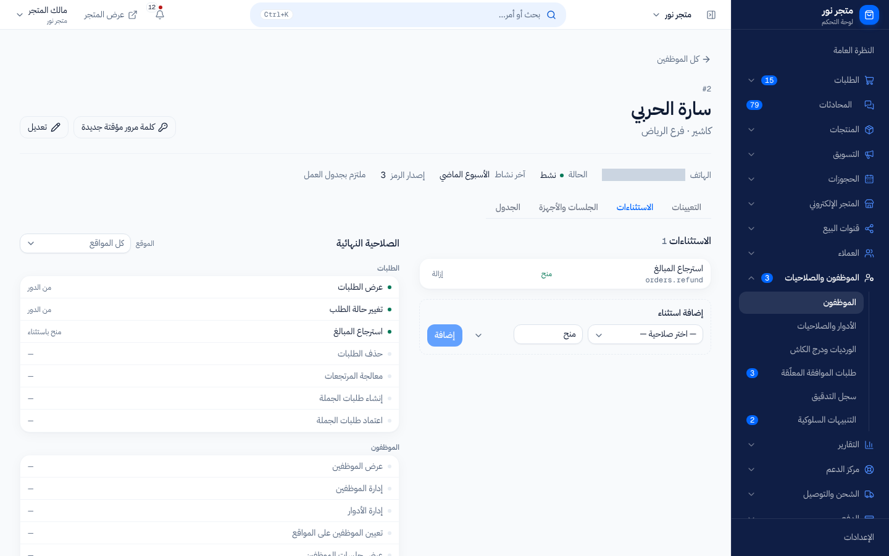
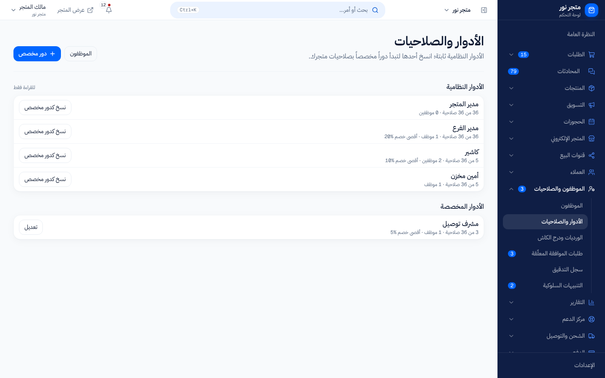

# من يستطيع ماذا: مصفوفة الأدوار والصلاحيات

> **المصدر**: DOC-286 · INT-022 (M18) · INT-043 (M33) · INT-033 (M16) · INT-044 (M36) · INT-035 (M23) · INT-024 (M21) · INT-008 (M48) · INT-017 (M07) · الجرد A.5 · آخر مراجعة على الكود: 2026-10-27 (الخطوة 10)

هذه الصفحة تشرح كل صلاحية يمكن أن تمنحها لموظف: ماذا تفتح له من شاشات، ومن يملكها من الأدوار الجاهزة. وتسرد في آخرها الشاشات التي لا تفتحها أي صلاحية لأنها لمالك المتجر وحده. المصطلحات في [مسرد الأدلة](../../_glossary.md).

## لمن هذه الصفحة؟

| | |
|---|---|
| **الجمهور** | مالك المتجر، ومن يدير الموظفين («مدير المتجر» أو أي موظف يملك صلاحية إدارة الموظفين) |
| **الصلاحية المطلوبة** | لقراءة الأدوار: `staff.view` «عرض الموظفين». لتعديلها: `staff.manage_roles` «إدارة الأدوار والصلاحيات». مالك المتجر يملك كل الصلاحيات |
| **ميزة الباقة** | `staff_rbac` «الموظفون والصلاحيات». متوقفة افتراضياً لكل متجر حتى تفعّلها المنصة لمتجرك؛ قبل ذلك لا يظهر قسم «الموظفون والصلاحيات» في القائمة ([ما المتاح في باقتي](../02-dashboard-shell/plan-features.md)) |
| **لمالك المتجر فقط؟** | لا |
| **مكانها** | القائمة الجانبية ← «الموظفون والصلاحيات» ← «الأدوار والصلاحيات» (`/dashboard/staff/roles`) |

## كيف تُحسب صلاحيات الموظف؟

1. **مالك المتجر يملك كل الصلاحيات دائماً.** لا يحتاج دوراً، ولا تحجب عنه أي صلاحية.
2. **الموظف يملك صلاحيات أدواره.** يُسند الدور للموظف في موقع أو أكثر (تبويب «التعيينات» في صفحة الموظف). إن حمل أكثر من دور جُمعت صلاحياتها كلها.
3. **الاستثناءات تأتي فوق الدور.** في تبويب «الاستثناءات» تختار صلاحية ثم «منح» أو «حجب»، لكل المواقع أو لموقع واحد. «حجب» يغلب الدور.
4. **النتيجة في «الصلاحية النهائية»**: بجانب كل صلاحية مصدرها («من الدور»، «منح باستثناء»، «حجب باستثناء») أو شَرطة إن لم يملكها.

> **ملاحظة:** لا يستطيع الموظف تعديل تعييناته أو استثناءاته بنفسه، حتى لو ملك صلاحية إدارتها: «لا يمكنك تعديل تعييناتك أو استثناءات صلاحياتك بنفسك.»

## الأدوار الجاهزة

يأتي كل متجر بأربعة أدوار نظامية. هي **للقراءة فقط**: لا تُعدَّل ولا تُحذف. لتعديل صلاحيات أحدها اضغط «نسخ كدور مخصص» ثم عدّل النسخة.

| الدور | صلاحياته | «أقصى نسبة خصم» في نقطة البيع |
|---|---|---|
| «مدير المتجر» | 29 صلاحية: كل صلاحيات الطلبات والعملاء والمخزون والخصومات والموظفين، و«عرض التقارير» و«تصدير التقارير»، والمرتجعات والجملة والدعم والمحادثات والأسواق الإلكترونية والدروبشيبينغ والكتالوج والمصروفات | بلا حد |
| «مدير الفرع» | الصلاحيات الـ 29 نفسها | 20% |
| «كاشير» | «عرض الطلبات»، «تحديث حالة الطلب»، «عرض العملاء»، «عرض المخزون»، «تطبيق خصم» | 10% |
| «أمين مخزن» | «عرض الطلبات»، «عرض المخزون»، «تعديل المخزون»، «إتلاف مخزون»، «عرض التقارير» | بلا حد |

> **تنبيه:** سبع صلاحيات لا يملكها أي دور جاهز، ولا حتى «مدير المتجر»: تقارير المبيعات، وصافي الربح، وتقارير العملاء، وتقارير المخزون، وأداء الموظفين، وإدارة الموردين وأوامر الشراء، واعتماد أوامر الشراء. ولأن الأدوار الجاهزة لا تُعدَّل، **أنشئ دوراً مخصصاً** (أو انسخ «مدير المتجر» وأضفها) إن أردت أن يرى موظف تقارير المبيعات أو يدير المشتريات.
<!-- ⚠️ Discrepancy — roadmap says «مدير المتجر» and «مدير الفرع» hold the whole catalogue / the seeds grant them 29 of the 36 keys: 0144 copied the 20 keys that existed then, 0159 and 0182–0235 add 9 explicitly, and no migration among all 239 products migrations grants the seven keys of 0172, 0174 and 0178 (reports.sales.view, reports.profit.view, reports.customers.view, reports.inventory.view, reports.staff_performance.view, suppliers.manage, suppliers.approve). Upgrades the step-04 "to confirm" note in docs/api/overview/permissions.md. Reported in step 10. -->

## كل صلاحية وماذا تفتح

الأسماء أدناه كما تظهر في شاشة الدور، مجمّعة كما تجمعها الشاشة. «الأدوار الجاهزة» تعني من يملكها عند إنشاء المتجر.

### الطلبات

| الصلاحية | ماذا تفتح | الأدوار الجاهزة |
|---|---|---|
| «عرض الطلبات» `orders.view` | قسم «الطلبات»: «كل الطلبات» وتفاصيل الطلب، «إنشاء طلب جديد»، «مسودات الجملة»؛ «الحالات الحدّية» و«بوليصات شروة شيب» في قسم الشحن؛ ونتائج الطلبات في البحث الشامل | الأربعة |
| «تحديث حالة الطلب» `orders.update_status` | تغيير حالة التنفيذ والحالة المالية للطلب، وتعديله، وحفظ الطلب اليدوي الجديد؛ شاشة «حالات الطلب»؛ تحديث عنوان الشحنة وتحويل الطلب إلى استلام | المديران، «كاشير» |
| «استرجاع مبلغ» `orders.refund` | إعادة مبلغ للمشتري من صفحة الطلب، و«سجل الاسترجاعات» | المديران |
| «حذف طلب» `orders.delete` | لا شيء حالياً: لا توجد شاشة تحذف طلباً | المديران |
| «معالجة استرجاعات الفروع» `orders.process_returns` | «المرتجعات» (مراجعة طلبات الإرجاع والموافقة عليها) و«المرتجعات (RMA)» | المديران |
| «إنشاء طلبات الجملة (B2B)» `orders.create_b2b` | إنشاء مسودة طلب جملة وعرض المسودات | المديران |
| «الموافقة على طلبات الجملة (B2B)» `orders.approve_b2b` | اعتماد مسودات الجملة أو رفضها | المديران |

> **ملاحظة:** فتح شاشة «إنشاء طلب جديد» يحتاج «عرض الطلبات»، لكن حفظ الطلب يحتاج «تحديث حالة الطلب» أو «إنشاء طلبات الجملة (B2B)».

### العملاء

| الصلاحية | ماذا تفتح | الأدوار الجاهزة |
|---|---|---|
| «عرض العملاء» `customers.view` | قسم «العملاء»: «تقرير العميل» وملف كل عميل وملاحظاته، «محافظ العملاء»، «نقاط الولاء»؛ ونتائج العملاء في البحث الشامل | المديران، «كاشير» |
| «تعديل بيانات العميل» `customers.edit_profile` | إيقاف الدفع عند الاستلام لرقم معيّن، واعتماد التقييمات، وإنشاء محفظة عميل وشحن رصيدها | المديران |
| «إدارة فئة العميل (VIP)» `customers.manage_tier` | لا شيء حالياً | المديران |
| «تصدير بيانات العملاء» `customers.export` | زر تصدير قائمة العملاء | المديران |

> **ملاحظة:** المنصة تراقب ما يفعله كل موظف يومياً. تصدير أكثر من 1000 عميل في اليوم يُنشئ تنبيهاً حرجاً لك في «التنبيهات السلوكية» ويوقف تصدير ذلك الموظف بقية اليوم برسالة «تجاوزت حدّ التصدير اليومي، راجع مدير المتجر.»؛ والحد الأقصى 5000 صف في اليوم. وفتح أكثر من 5000 ملف عميل في اليوم يُنشئ تنبيهاً. مالك المتجر لا يُراقَب.

### المخزون

| الصلاحية | ماذا تفتح | الأدوار الجاهزة |
|---|---|---|
| «عرض المخزون» `inventory.view` | «المخزون» (الكميات والحركات والحجوزات وطلبات الإعدام)، وقراءة قائمة المنتجات وتفاصيلها وسجل تغييراتها وتصديرها، وأسعار الكميات | المديران، «كاشير»، «أمين مخزن» |
| «تعديل المخزون» `inventory.adjust` | تعديل كمية منتج أو كمية موقع، ومسح المرتجعات الواردة إلى المستودع وقرار فحصها | المديران، «أمين مخزن» |
| «إتلاف مخزون» `inventory.writeoff` | طلب إتلاف كمية. الطلب لا يُنفَّذ فوراً: يذهب إلى «طلبات الموافقة المعلّقة» | المديران، «أمين مخزن» |

> **ملاحظة:** عرض قائمة المنتجات نفسها يحتاج «عرض المخزون». موظف بلا هذه الصلاحية يرى عنصر «جميع المنتجات» في القائمة، لكن الشاشة ترفض تحميل المنتجات.
<!-- ⚠️ Discrepancy — the sidebar entry «جميع المنتجات» (navigation.ts) carries no permission gate / Django `GET products/` requires `inventory.view` (docs/api/overview/permissions.md §2.3). Reported in step 10. -->

### الخصومات

| الصلاحية | ماذا تفتح | الأدوار الجاهزة |
|---|---|---|
| «تطبيق خصم» `discounts.apply` | «الكوبونات» (عرض الكوبونات والعروض)، وتطبيق خصم في نقطة البيع حتى «أقصى نسبة خصم» لدوره | المديران، «كاشير» |
| «إدارة الخصومات» `discounts.manage` | إنشاء الكوبونات والعروض وتعديلها، وتعديل السعر القديم وفترة التخفيض في المنتج | المديران |

بدون «إدارة الخصومات» يرفض حفظ المنتج تغيير السعر القديم أو فترة التخفيض: «ليست لديك صلاحية تعديل الخصومات (السعر القديم وفترة التخفيض).»

### المنتجات والكتالوج

| الصلاحية | ماذا تفتح | الأدوار الجاهزة |
|---|---|---|
| «إدارة الكتالوج (التصنيفات والعلامات والوسوم والتشكيلات والشارات)» `catalog.manage` | إضافة المنتجات وتعديلها وحذفها (المحرر، التعديل السريع، الإجراءات الجماعية، الصور، المتغيرات)، و«التصنيفات» و«التنظيم والاكتشاف» (الماركات والوسوم والمجموعات والشارات)، و«نماذج المنتجات» و«نماذج المتغيرات»، وأسعار الكميات، وإعدادات الحزم والتخصيص والمزادات والأرقام التسلسلية. وتسمح أيضاً بتعديل أقسام الإعدادات غير المقصورة على المالك | مالك المتجر، المديران |

موظف بلا هذه الصلاحية يرى المنتج للقراءة فقط. وفي أقسام الإعدادات المفتوحة للفريق تظهر له «تعديل الإعدادات مقصور على المالك ومدير المتجر.»

### التقارير

| الصلاحية | ماذا تفتح | الأدوار الجاهزة |
|---|---|---|
| «عرض التقارير» `reports.view` | قسم «التقارير» في القائمة («مركز التقارير»، «التقارير المجدولة»)، و«تقرير المنتج» | المديران، «أمين مخزن» |
| «تصدير التقارير» `reports.export` | «تصديراتي» وتصدير أي تقرير وجدولة التقارير، وتصدير المخزون | المديران |
| «عرض تقارير المبيعات (الإيراد الإجمالي)» `reports.sales.view` | تقارير المبيعات والمالية، وتحديث أرقام النظرة العامة واليوم، و«سجل التدقيق» | لا أحد |
| «عرض صافي الربح والهامش (حساس)» `reports.profit.view` | تقرير صافي الربح | لا أحد |
| «عرض تقارير العملاء» `reports.customers.view` | تقارير العملاء (ومنها السلات المتروكة) | لا أحد |
| «عرض تقارير المخزون» `reports.inventory.view` | تقارير المخزون | لا أحد |
| «عرض تقرير أداء الموظفين (حساس — يكشف أداء أفراد)» `reports.staff_performance.view` | تقرير أداء الموظفين | لا أحد |

كل تقرير في «مركز التقارير» يحتاج صلاحيته الخاصة؛ الموظف لا يرى إلا التقارير التي يملك صلاحيتها. فصل الربح عن المبيعات مقصود: تستطيع أن تُري مديراً أرقام المبيعات دون هامش الربح.

> **ملاحظة:** في القائمة يحتاج قسم «التقارير» صلاحية «عرض التقارير»، لكن التقارير نفسها تحتاج صلاحياتها الخاصة. موظف يملك «عرض التقارير» وحدها يفتح «مركز التقارير» ولا يجد فيه تقريراً.

### الموظفون

| الصلاحية | ماذا تفتح | الأدوار الجاهزة |
|---|---|---|
| «عرض الموظفين» `staff.view` | «الموظفون» وصفحة كل موظف، وقراءة «الأدوار والصلاحيات»، و«الورديات ودرج الكاش»، و«طلبات الموافقة المعلّقة»، و«التنبيهات السلوكية» | المديران |
| «إدارة الموظفين (إنشاء/فصل)» `staff.manage` | إضافة موظف وتعديله وإنهاء خدمته، و«كلمة مرور مؤقتة جديدة»، وإنهاء جلساته، والرموز الشخصية والأجهزة. وتسمح بحسم **أي** طلب موافقة | المديران |
| «إدارة الأدوار والصلاحيات» `staff.manage_roles` | إنشاء الأدوار المخصصة وتعديلها وحذفها | المديران |
| «إدارة إسنادات المواقع» `staff.manage_assignments` | تبويب «التعيينات» وتبويب «الاستثناءات»، وإضافة موظفين إلى موقع | المديران |
| «عرض جلسات الموظفين» `staff.view_sessions` | تبويب «الجلسات والأجهزة» وقائمة الرموز والأجهزة، و«سجل التدقيق» | المديران |

> **ملاحظة:** «سجل التدقيق» يفتحه الخادم لمن يملك «عرض جلسات الموظفين» **أو** «عرض تقارير المبيعات (الإيراد الإجمالي)»، لكن عنصر القائمة يظهر لحامل «عرض جلسات الموظفين» فقط.
<!-- ⚠️ Discrepancy — Django audit-log routes accept `staff.view_sessions` OR `reports.sales.view` (api/views_staff.py:242 AUDIT_ANY) / the sidebar entry «سجل التدقيق» is gated on `staff.view_sessions` alone (navigation.ts). Reported in step 10. -->

### الموردون

| الصلاحية | ماذا تفتح | الأدوار الجاهزة |
|---|---|---|
| «إدارة الموردين وأوامر الشراء (إنشاء/تعديل)» `suppliers.manage` | «الموردون وأوامر الشراء» و«أوامر الشراء»: إنشاء الموردين وأوامر الشراء وتعديلها واستلامها | لا أحد |
| «اعتماد/رفض أوامر الشراء» `suppliers.approve` | اعتماد أوامر الشراء أو رفضها. حاملها وحده يرى «أوامر الشراء» في القائمة دون «الموردون وأوامر الشراء» | لا أحد |

### الدعم الفني وقنوات البيع والمالية

| الصلاحية | ماذا تفتح | الأدوار الجاهزة |
|---|---|---|
| «استلام محادثات الدعم الفني» `support.takeover_session` | «جلسات الدعم الفني»: استلام جلسة من البوت والرد فيها وإعادتها وإغلاقها. بدونها: «ليست لديك صلاحية استلام جلسات الدعم.» | المديران |
| «الوصول لصندوق وارد قنوات البيع» `channels.inbox.access` | «المحادثات». ثم يحدد المالك لكل موظف أي القنوات يرى ويرد عليها من «وصول الموظفين للقنوات» | المديران |
| «إدارة الأسواق الإلكترونية (أمازون، نون)» `channels.marketplaces.manage` | «الأسواق الإلكترونية (أمازون، نون)» | المديران |
| «إدارة استيراد المنتجات والدروبشيبينغ» `channels.dropshipping.manage` | «استيراد المنتجات والدروبشيبينغ» | المديران |
| «إدارة المصروفات التشغيلية (عرض الدفتر وتسجيل المصروفات)» `expenses.manage` | «المصروفات التشغيلية». يمكن نقلها إلى دور مخصص آخر من «الأدوار والصلاحيات» | المديران |

## قواعد خاصة لا تأتي من الصلاحيات وحدها

| القاعدة | كيف تعمل |
|---|---|
| **حد الخصم في نقطة البيع** | «أقصى نسبة خصم» في الدور («فارغ = بلا حد؛ الخصم فوقه يحتاج موافقة.»). إن حمل الموظف أكثر من دور يملك «تطبيق خصم» في مواقع الصندوق يُحسب الأعلى، و«بلا حد» يغلب أي رقم. الخصم فوق الحد يحتاج رمز المدير أو موافقة «مدير الفرع» (أو «مدير المتجر» إن لم يوجد) |
| **من يحسم طلب الموافقة** | مالك المتجر، أو من يملك «إدارة الموظفين (إنشاء/فصل)»، أو من يحمل الدور المعتمِد للطلب في موقعه. غيرهم يرى: «الحسم لحامل دور «(اسم الدور)» في هذا الموقع أو للمالك.». ولا أحد يوافق على طلبه هو: «لا يمكنك الموافقة على طلبك.» |
| **الدور المعتمِد الافتراضي** | طلبات الإعدام وأوامر الشراء ومسودات الجملة تذهب إلى «مدير المتجر»؛ خصومات نقطة البيع وعجز الوردية إلى «مدير الفرع» ثم «مدير المتجر» |
| **عجز الوردية في نقطة البيع** | يحسمه مالك المتجر أو حامل «إدارة الموظفين (إنشاء/فصل)» أو «مدير الفرع» أو «مدير المتجر» في موقع الصندوق. غيرهم: «حلّ فرق الوردية لمدير الفرع أو مالك المتجر.». ولا يحسم أحد عجز ورديته هو |
| **نتائج البحث الشامل** | تُقصّ حسب الصلاحية: الطلبات لمن يملك «عرض الطلبات»، والعملاء لمن يملك «عرض العملاء» |
| **المحادثات لكل قناة** | «الوصول لصندوق وارد قنوات البيع» تفتح الشاشة، ثم يرى الموظف القنوات التي سمح له بها المالك فقط |
| **عناصر القائمة ذات البدائل** | بعض العناصر تظهر لمن يملك أياً من صلاحيتين، مثل «أوامر الشراء» لمن يدير الموردين **أو** يعتمد أوامر الشراء |

## ما لا تفتحه أي صلاحية: لمالك المتجر فقط

هذه الشاشات والإجراءات لا تظهر للموظفين في القائمة إطلاقاً، وإن وصلوا إليها يرفضها الخادم بالرسالة المذكورة، مهما كانت صلاحياتهم.

| المنطقة | ما يراه الموظف إن حاول |
|---|---|
| أقسام الإعدادات المالية والهيكلية: «الشحن»، «العملات»، «الدفع»، «المواقع» | «هذا الإعداد يحتاج صلاحية مالك المتجر.» |
| «تصميم المتجر» و«ترتيب الأقسام» وشريط الإعلانات | «تصميم المتجر مقصور على مالك المتجر.» |
| «السلات المتروكة والاسترداد الآلي»، «الحملات التسويقية»، «الجدول الزمني»، «برنامج الولاء»، «الإهداء» | «السلات المتروكة مقصورة على مالك المتجر.» · «الحملات مقصورة على مالك المتجر.» · «الجدول الزمني مقصور على مالك المتجر.» · «إعدادات نقاط الولاء مقصورة على مالك المتجر.» · «إعدادات الإهداء مقصورة على مالك المتجر.» |
| «ربط بوابات الدفع»، «المحافظ المحلية»، «التحويل البنكي»، و«محفظة المتجر» و«طلبات السحب» و«المستحقات للمنصة» | «المدفوعات والمحفظة مقصورة على مالك المتجر.» |
| إعدادات الشحن: «رسوم التوصيل»، «نقاط الاستلام»، «شركات الشحن»، «مندوبو الشحن»، «ملفات التغليف»، «مراجعة المناطق» | «إعدادات الشحن مقصورة على مالك المتجر.» |
| إنشاء المواقع وتعديلها، وتفعيل تعدد المواقع، وقواعد التوجيه | «إدارة المواقع مقصورة على مالك المتجر.» |
| «النطاقات»، «Webhooks»، «أدوات التتبع» | «النطاقات مقصورة على مالك المتجر.» · «الـ Webhooks مقصورة على مالك المتجر.» · «أدوات التتبع مقصورة على مالك المتجر.» |
| إضافة المسوّقين بالعمولة والمؤثرين وتعديلهم ومستحقاتهم | «إدارة المسوّقين والمؤثرين ومستحقاتهم لمالك المتجر.» |
| «التواصل الاجتماعي والمحادثات» (ربط القنوات، الردود الآلية، القوالب، مزامنة الكتالوج، وصول الموظفين) | «إعدادات القنوات لمالك المتجر فقط.» |
| تثبيت التطبيقات وتفعيلها وإعداداتها، ولوحة شروة AI | «إدارة التطبيقات لمالك المتجر فقط.» |
| إصدار بوالص شروة شيب وتعديلها، و«شروة شيب» (المناطق)، و«مندوبو الشحن (إشراف)»، و«مناوبات المندوبين» | «هذا الإجراء مقصور على مالك المتجر.» |
| «متاجري» (لوحة المتاجر المتعددة) | «هذه الصفحة لمالك المتجر فقط.» |
| إرسال إشعار المتصفح لكل المشتركين | «إرسال الإشعارات لكل المشتركين للمالك وحده.» |

> **ملاحظة:** الكوبونات والعروض **ليست** لمالك المتجر وحده: تفتحها «تطبيق خصم» و«إدارة الخصومات». وقراءة قائمة المسوّقين والمؤثرين والتطبيقات مفتوحة للفريق؛ التعديل وحده للمالك.

> **ملاحظة:** «تطبيق المندوب» عكس ذلك: لا يدخله إلا موظف مربوط بملف مندوب، ومالك المتجر نفسه لا يدخله.

## ما يحدث بعد ذلك

- تغيير صلاحيات دور يسري على كل موظف يحمل هذا الدور.
- عنصر القائمة الذي يحتاج صلاحية لا يملكها الموظف يظهر باهتاً، ويظهر عند الوقوف عليه: «ليست لديك صلاحية لهذا القسم». أما عنصر المالك وحده فيختفي تماماً، وعنصر ميزة الباقة المتوقفة يختفي للجميع.
- إن فتح موظف رابط شاشة لا يملك صلاحيتها تظهر له «ليست لديك صلاحية لعرض هذه الصفحة» مع «اطلب الصلاحية من مالك المتجر أو مدير المتجر.»

## الرسائل التي قد تظهر لك

| الرسالة | السبب | ماذا تفعل |
|---|---|---|
| «ليست لديك صلاحية لهذا الإجراء.» | تحاول إجراءً لا تملك صلاحيته | اطلب الصلاحية من مالك المتجر أو من يدير الأدوار |
| «الأدوار النظامية للقراءة فقط — انسخها كدور مخصص.» | تحاول تعديل دور جاهز | اضغط «نسخ كدور مخصص» وعدّل النسخة |
| «الأدوار النظامية لا تُحذف.» | تحاول حذف دور جاهز | لا يُحذف؛ لا تُسنده لأحد إن لم تحتجه |
| «الدور مُعيَّن لموظفين — أعد تعيينهم أولاً.» | تحذف دوراً يحمله موظفون | غيّر دورهم من صفحة كل موظف ثم احذف |
| «الدور معتمِد في طلبات موافقة سابقة — لا يُحذف حفاظاً على سجلها.» | الدور مسجّل معتمِداً لطلبات قديمة | أبقِه؛ يمكنك عدم إسناده لأحد |
| «لا يمكنك تعديل تعييناتك أو استثناءات صلاحياتك بنفسك.» | موظف يعدّل صلاحياته | يعدّلها له المالك أو موظف آخر يملك الصلاحية |
| «النسبة بين 0 و100.» | «أقصى نسبة خصم» خارج النطاق | أدخل رقماً من 0 إلى 100 أو اتركه فارغاً |

## قيود معروفة

> **قيد معروف:** صلاحيتا «حذف طلب» و«إدارة فئة العميل (VIP)» تظهران في شاشة الدور، لكن لا توجد شاشة تستخدمهما بعد؛ منحهما لا يغيّر شيئاً.

> **قيد معروف:** خيار حصر دخول الموظف بعناوين IP محددة يظهر تحذيراً فقط؛ لا يمكن إدخال قائمة العناوين بعد.

## صفحات ذات صلة

- [ما المتاح في باقتي](../02-dashboard-shell/plan-features.md)
- [لماذا تظهر لي رسالة منع؟](../02-dashboard-shell/troubleshooting-access.md)
- [مسرد الأدلة](../../_glossary.md)

