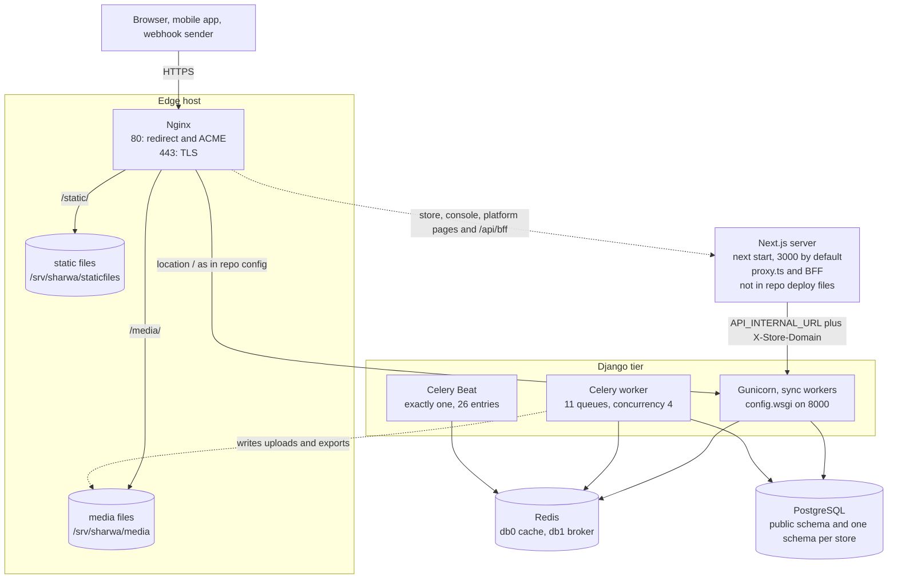
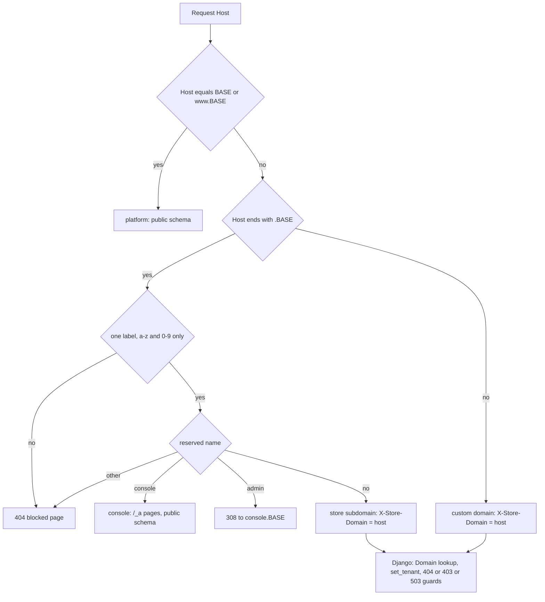

# Production topology

> **Source**: DOC-515 · inventory A.10, A.11 · INT-023 · decisions (BFF, tenant guard, Sharwa Pay origin)
> **Code**: `sharwa_saas/deploy/{docker-compose.prod.yml,Dockerfile,gunicorn.conf.py,celery.env,deploy.sh,systemd/*.service,nginx/sharwa.conf,nginx/sharwa.docker.conf,nginx/snippets/*.conf}` · `sharwa_saas/config/{settings.py,urls_public.py,urls_tenant.py,middleware.py}` · `sharwa_saas/api/{middleware.py,permissions.py,views_platform.py,views_onboarding.py,views_sharwa_pay.py}` · `sharwa_saas/tenants/{middleware.py,models.py}` · `sharwa-frontend/{src/proxy.ts,src/lib/tenant.ts,src/lib/bff/upstream.ts,src/env.ts,next.config.ts,.env.example}`
> **Last verified against code**: 2026-10-28 (step 39)

> **Not run in step 39.** Nothing was deployed, probed or started: every line below comes from reading the configuration files named above, not from a running environment. The acceptance check of DOC-515 is only "a topology diagram and a port/host table exist" (§2.1 and §4.1); no staging comparison was made. Statements marked **derived** follow from the code but were not executed; statements marked **unverified** could not be checked from the repositories at all.

## 1. Purpose

This page is the map of what runs where in production and which hostname reaches which process: the edge (Nginx), the Next.js server (BFF), the Django application server, Celery (worker and one Beat), Redis, PostgreSQL with its schemas, and media files. It also lists the origins (platform, console, store subdomains, custom domains) and which Django APIs answer only on the platform (public schema).

It is not the setup guide for any single piece: environment variables are in [`../environment.md`](../environment.md), the request-size layers in [`../upload-limits.md`](../upload-limits.md), jobs in [`../../architecture/50-background-jobs.md`](../../architecture/50-background-jobs.md), custom-domain TLS in [`../runbooks/custom-domain-tls.md`](../runbooks/custom-domain-tls.md).

> **What the repository contains.** `sharwa_saas/deploy/` describes the **Django side only**: Nginx → Gunicorn, Celery, Redis, optional PostgreSQL. There is **no** deployment artifact for the Next.js server in either repository (no Dockerfile, compose service, systemd unit or Nginx block; `package.json` only has `next start`). The Next.js tier is drawn below from what the code requires of it, and marked as not in the repository wherever the repository gives no value.

> ⚠️ Discrepancy — roadmap says the topology covers "Django app server (gunicorn/uvicorn)" / code runs **Gunicorn with `worker_class = 'sync'`, one thread** (`deploy/gunicorn.conf.py:31-32`, `deploy/Dockerfile:48`, `deploy/systemd/gunicorn.service:23`) on `config.wsgi:application`. `config/asgi.py` exists but nothing starts it, and `requirements.txt` has no uvicorn, daphne or channels (`gunicorn>=23,<24` at line 20). Reported in step 39.

> ⚠️ Discrepancy — roadmap says Nginx has `client_max_body_size 8M` / code sets **`client_max_body_size 55m;`** (`deploy/nginx/snippets/sharwa-proxy.conf:12`), sized for 50 MB supplier feeds. The 8 MB figure is Django's `DATA_UPLOAD_MAX_MEMORY_SIZE` (`config/settings.py:368`); the comment above it (`settings.py:364-367`) still says Nginx must match 8M and is stale. Already reported in DOC-514 ([`../upload-limits.md`](../upload-limits.md)); repeated here because the roadmap repeats it. Reported in step 39.

## 2. Components

| Component | Location | Role |
|---|---|---|
| Nginx | `deploy/nginx/sharwa.conf` (bare metal) · `deploy/nginx/sharwa.docker.conf` + `deploy/nginx/snippets/*.conf` (compose) | TLS termination, HTTP→HTTPS redirect, ACME webroot, `/static/` and `/media/` from disk, reverse proxy of everything else to Gunicorn, 55 MB bodies, `444` for unknown hosts on port 80 |
| Next.js server | `sharwa-frontend` (`next start`) | Host-based tenant routing (`src/proxy.ts`), pages for platform / console / stores, and the BFF (`/api/bff/*`, `/api/v1/*`) that calls Django at `API_INTERNAL_URL`. **Not in the repository's deployment files** |
| Gunicorn + Django | `deploy/gunicorn.conf.py` · `config/wsgi.py` | The API and the legacy Django pages; django-tenants picks the schema per request |
| Celery worker | `deploy/systemd/celery-sharwa.service` · compose `worker` · `deploy/celery.env` | 11 queues, concurrency 4, warm shutdown |
| Celery Beat | `deploy/systemd/celery-sharwa-beat.service` · compose `beat` | 26 periodic entries (`CELERY_BEAT_SCHEDULE`, `settings.py:622`); **exactly one instance** |
| Redis | compose `redis` (redis:7-alpine, AOF, `noeviction`) or the host's Redis | db 0 = Django cache, db 1 = Celery broker |
| PostgreSQL | external/managed by default, or compose `db` (postgres:16-alpine, profile `with-db`) | `public` schema + one schema per store |
| Media and static files | bare metal `/srv/sharwa/media`, `/srv/sharwa/staticfiles`; compose volumes `media`, `static` | written by Django/Celery, read by Nginx |
| Certbot / certificates | `/etc/letsencrypt` (host), webroot `/var/www/certbot` | wildcard certificate for the platform; per-domain certificates for custom domains |
| Release step | `deploy/deploy.sh` · compose `release` | `migrate_schemas --shared`, `--tenant`, `migrate_passwords`, `migrate_merchant_phone`, `collectstatic --noinput` |

### 2.1 Port and host table

| Process | Bind address | Port | Reachable from | Source |
|---|---|---|---|---|
| Nginx, bare metal | all interfaces (`listen 80`, `listen [::]:80`, `listen 443 ssl http2`) | 80, 443 | internet | `nginx/sharwa.conf:17-18, 31-32, 47-48` |
| Nginx, compose | container `nginx:1.27-alpine`, fixed address `172.28.0.10` on network `sharwa` (`172.28.0.0/24`) | 80, 443 published (`80:80`, `443:443`) | internet | `docker-compose.prod.yml:146-173` |
| Gunicorn, bare metal | `127.0.0.1` (`GUNICORN_BIND` default) | 8000 | Nginx on the same host | `gunicorn.conf.py:27`, `nginx/sharwa.conf:11` |
| Gunicorn, compose (`web`) | `0.0.0.0` inside the container (`GUNICORN_BIND` set by the image) | 8000, `expose` only (not published) | compose network | `Dockerfile:27`, `docker-compose.prod.yml:68` |
| Next.js | not in the repository; `next start` listens on **3000** unless told otherwise (Next default — **unverified** for production) | 3000 | Nginx (required, see §4.2) | `package.json` scripts · `README.md` |
| Celery worker | none (outbound to Redis and PostgreSQL) | — | — | `celery-sharwa.service:18-24` |
| Celery Beat | none; schedule file `/var/lib/sharwa-beat/celerybeat-schedule` (systemd `StateDirectory`) or volume `beat` at `/app/celerybeat` | — | — | `celery-sharwa-beat.service:19-21`, `docker-compose.prod.yml:104` |
| Redis | `REDIS_CACHE_URL` default `redis://localhost:6379/0`, `CELERY_BROKER_URL` default `redis://localhost:6379/1`; compose: host `redis` | 6379 | app hosts only; compose publishes no port | `settings.py:230, 562`, `docker-compose.prod.yml:27-28, 112-125` |
| PostgreSQL | `DB_HOST` default `localhost`; compose default host `db` (`DOCKER_DB_HOST`) | `DB_PORT` default 5432 | app hosts only | `settings.py:105-114`, `docker-compose.prod.yml:25-26` |
| Certbot webroot | `/var/www/certbot` (compose volume `certbot-webroot`, read-only in Nginx) | — | Let's Encrypt over port 80 | `nginx/sharwa.conf:21-23`, `docker-compose.prod.yml:160` |

Timeouts line up on purpose: Nginx `proxy_connect_timeout 5s`, `proxy_read_timeout 65s` / `proxy_send_timeout 65s` (`sharwa-proxy.conf:66-69`) against Gunicorn `timeout 60` (`gunicorn.conf.py:34`).

### 2.2 Host table (origins)

`<BASE>` is `TENANT_BASE_DOMAIN`, the same value on both sides (Django `settings.py:30`, Next `src/env.ts:13`). `noor` is a sample store.

| Origin | Example | Resolved by Next (`resolveTenant`, `src/lib/tenant.ts:100-121`) | Django schema | What it serves |
|---|---|---|---|---|
| Platform | `<BASE>`, `www.<BASE>` | `kind: platform` — no rewrite (`proxy.ts:48-51`) | `public` | landing, store registration, the customer Sharwa Pay wallet (`/sharwa-pay`), plus every webhook and the AI engine's signed endpoints (§4.3) |
| Console | `console.<BASE>` | `kind: reserved`, group `admin` → rewritten to the internal `/_a/…` prefix (`proxy.ts:53-56`, `tenant.ts:113`) | `public` (no `X-Store-Domain` is sent) | platform owner's console; Django `platform/*` endpoints |
| Old admin name | `admin.<BASE>` | `reserved` → `308` redirect to `console.<BASE>` (`proxy.ts:57-61`) | — | — |
| Other reserved names | `api`, `mail`, `ai`, `support`, `static`, `media`, … (the list has 22 names, `tenant.ts:7-30`; `console` and `admin` are special above, `www.<BASE>` is treated as the platform) | `reserved` → `404` page | — | `ai.<BASE>` is the separate Sharwa AI engine's host name; it is not served by this stack |
| Store subdomain | `noor.<BASE>` | `kind: subdomain`; path decides the group: `/dashboard` → `_d`, `/pos` → `_p`, `/agent` → `_c`, else storefront `_s` (`tenant.ts:124-129`) | the store's schema, chosen by Django from `X-Store-Domain: noor.<BASE>` | storefront, dashboard, POS, courier app |
| Custom domain | `shop.example.com` | `kind: custom_domain`; the whole host is the store key and is sent upstream verbatim (`tenant.ts:119-120`) | the store's schema, if a `tenants.Domain` row exists | same as a store subdomain |
| Two-label hosts under the base | `a.b.<BASE>` | `invalid` → `404` page (`tenant.ts:109-111`) | — | — |

On a store origin `/sharwa-pay` is not served: Next answers `308` to the platform origin (`proxy.ts:76-81`). The Sharwa Pay wallet is a **platform-origin** feature.

## 3. Data placement

| Data | Where | Notes |
|---|---|---|
| Shared apps | schema `public` | `SHARED_APPS` (`settings.py:121-140`): `django_tenants`, `tenants`, `core`, `billing`, `sharwapay`, `appstore`, `marketing`, `sharwa_ship`, `admin`, `auth`, `contenttypes`, `sessions`, `messages`, `staticfiles`, `rest_framework`, `drf_spectacular`. `tenants.Client` is the store registry; `tenants.Domain` is the routing table (`TENANT_MODEL`, `TENANT_DOMAIN_MODEL`, `settings.py:209-210`) |
| Store apps | one schema per store (`Client.schema_name`) | `TENANT_APPS` (`settings.py:152-160`): `contenttypes`, `auth`, `sessions`, `messages`, `products`, `api`. Sessions and CSRF state are therefore per store |
| Router and backend | `django_tenants.postgresql_backend`, `TenantSyncRouter` | `settings.py:107, 117-119`; one connection pool setting `CONN_MAX_AGE` default 60 |
| Cache | Redis db 0, key prefix `sharwa`, 2 s connect/socket timeouts | `settings.py:230-244`. Holds OTP HMACs (for example `auth:reset:<schema>:<token>`, `api/views_auth.py:366-371`), rate-limit counters (`rl:…`), POS manager-code lockouts (`pos:manager_code:<schema>:<register>`, `pos_service.py:880`), the landing-stats cache (`public:landing_stats:v1`, 3600 s, `api/views_public.py`) and other short-lived markers. Losing Redis loses these, not business data |
| Broker | Redis db 1 | `CELERY_BROKER_URL` (`settings.py:562`); results are not stored (`CELERY_TASK_IGNORE_RESULT = True`, line 563); tasks are acknowledged late (line 564). Compose Redis runs `--appendonly yes --maxmemory-policy noeviction` because an eviction policy would silently delete queued tasks (`docker-compose.prod.yml:114-116`) |
| Media | local file system: `MEDIA_ROOT = <repo>/media`, URL prefix `/media/` (`settings.py:361-362`); files are written under `<schema>/<folder>/<name>` (`core/uploads.py:88`) | No remote storage backend is configured (`STORAGES` / `DEFAULT_FILE_STORAGE` are not set). `boto3` is used only to build time-limited links for media held by the AI gateway's MinIO (`requirements.txt:21-23`). Web, worker and Nginx must therefore see the **same directory** — one host, or a shared volume (compose does this with the `media` volume mounted in `web`, `worker`, `beat`, `release` at `/app/media` and in Nginx, read-only, at `/srv/sharwa/media`) |
| Static files | `STATIC_ROOT = <repo>/staticfiles` filled by `collectstatic` | Nginx serves `/static/` from `/srv/sharwa/staticfiles/` with a 30-day expiry (`sharwa-proxy.conf:15-21`); compose volume `static` |
| Logs | stdout (JSON when `DEBUG=False`); ERROR-only rotating file `logs/sharwa_errors.log` (10 MB × 5) | `settings.py:413, 437-452`; journald (`journalctl -u gunicorn`) or `docker compose logs` |
| Celery Beat state | `celerybeat-schedule` file | losing it only resets "last run" bookkeeping |

`/media/` is treated as hostile content by Nginx, not by Django: `.html/.svg/.js/.xml/…` → `403`, non-images forced to download, `nosniff` plus a deny-all CSP, dotfiles → `404` (`sharwa-proxy.conf:30-48`, `sharwa-media-headers.conf:3-6`). Details of what may be uploaded: [`../upload-limits.md`](../upload-limits.md).

## 4. Flows

### 4.1 Topology

Solid arrows are what `deploy/` configures. The dotted Nginx → Next.js arrow is what the code requires but the repository does not configure (§4.2). The `nginx → Gunicorn` arrow is the repository's `location /` (`sharwa-proxy.conf:57-73`); it is what serves Django's own pages, `/webhooks/*` and, for the platform host, the API.

### 4.2 The Next.js tier — what the code requires

| Requirement | Evidence | Consequence for the edge |
|---|---|---|
| An Nginx (or equivalent) must sit **in front of Next** and set `X-Real-IP` from `$remote_addr` | `clientIp()` trusts `X-Real-IP`, else the right-most `X-Forwarded-For` entry (`src/lib/bff/upstream.ts:58-74`) | A Next server exposed directly would let a visitor choose the address Django rate-limits on |
| Django must list the **Next server's address** in `REAL_IP_TRUSTED_PROXIES` | the BFF overwrites `X-Forwarded-For` / `X-Real-IP` with one entry (`upstream.ts:122-129`); `RealIpMiddleware` believes them only from trusted addresses (`config/middleware.py:55-66`) | Default `127.0.0.1,::1` fits Next on the same host. The compose value `172.28.0.10` is **Nginx's** address and does not cover a Next server on another address (**derived**) |
| `API_INTERNAL_URL` must be reachable **from the Next server**; the BFF calls `${API_PROXY_URL ?? API_INTERNAL_URL}${path}` | `src/env.ts:17-18`, `upstream.ts:10, 147` | Django sees `Host: <that address>` on every BFF call, not the shopper's host |
| `TENANT_BASE_DOMAIN` identical in both services | `env.ts:13`, `settings.py:30` | Different values give stores that Next and Django disagree about |
| `/media/` is served before Next | `next.config.ts:12-19` rewrites `/media/:path*` to Django when `API_PROXY_URL`/`API_INTERNAL_URL` is set; `proxy.ts:118` skips `/media/`; the comment says "Production serves the same path from Nginx" | Keep `location ^~ /media/` in Nginx on every host that serves stores, including custom domains |
| Write bodies are buffered, no cap of its own | `upstream.ts:139-144` | The ceilings are Nginx `55m` and Django `8 MB` ([`../upload-limits.md`](../upload-limits.md)) |

> ⚠️ Discrepancy — roadmap says the topology includes a "Next.js server" with Nginx fronting store subdomains, custom domains, the console host and the Sharwa Pay platform origin / code configures **one** Nginx server pair for `<BASE>` and `*.<BASE>` that proxies **everything to Gunicorn** (`nginx/sharwa.conf:33, 41`; `sharwa-proxy.conf:58`). There is no `console.` block, no Sharwa Pay block (both fall under the wildcard), no custom-domain block, and no upstream for Next.js. How production routes store, console and platform hosts to Next.js is not described in either repository (also noted in [`../upload-limits.md`](../upload-limits.md) and [`../../architecture/20-bff.md`](../../architecture/20-bff.md) §7.4). Reported in step 39.

### 4.3 What is on which origin (Django side)

Django has two URL configurations, chosen by the tenant that `TenantMainMiddleware` resolves (`settings.py:312-313`): `PUBLIC_SCHEMA_URLCONF = config.urls_public` for the `public` tenant and `ROOT_URLCONF = config.urls_tenant` for stores.

| Kind | Paths | Answers on | Guard | Source |
|---|---|---|---|---|
| Platform pages | `/`, `/register/…`, `/register/status/<token>/`, `/master-dashboard/…`, `/sharwa-pay/…` (HTML), `/manifest.json`, `/sw.js` | platform origin only (`urls_public`) | URL configuration | `config/urls_public.py:34-56` |
| Webhooks | `/webhooks/kuraimi/topup/`, `/webhooks/sharwaconnect/`, `/webhooks/sharwa-ai/session-status/`, `/webhooks/sharwa-ai/inbound-message/`, `/webhooks/meta/`, `/webhooks/tiktok-shop/`, `/webhooks/telegram/<bot_id>/`, `/webhooks/suppliers/<code>/<token>/` | platform origin only | URL configuration; each verifies its own secret/signature | `urls_public.py:61-73` |
| Sharwa AI engine calls | `/sharwa-ai/commerce/changes`, `/order_lookup`, `/stock_observation`, `/.well-known/sharwa-ai-jwks.json` | platform origin only | signed requests; JWKS is public | `urls_public.py:92-96` |
| Django admin | `/sharwa-secure-gate/` | platform origin (`urls_public.py:34`) and, as the store's own admin, every store origin (`urls_tenant.py:227`) | Django login | — |
| Internal test tool | `/internal/kuraimi-simulator/` | platform origin only | `@user_passes_test(is_superuser)` — **not** gated by `DEBUG` (`tenants/views.py:629-630`) | `urls_public.py:74` |
| Public-schema-only API | `/api/v1/public/{market-categories,register,register/verify-otp,register/resend-otp,plans,stats}/` | answers `404` «غير موجود.» on a store host | `PublicOnlyMixin.initial` | `api/views_onboarding.py:213-221`, `api/urls.py:231-236` |
| Public-schema-only API | `/api/v1/sharwa-pay/*` (customer wallet) | `404` on a store host | `_public_only()` | `api/views_sharwa_pay.py:26-28`, `api/urls.py:463-470` |
| Public-schema-only API | `/api/v1/platform/*` (console) | `404` «غير موجود.» on a store host | `_public_only()` then console session and role | `api/views_platform.py:90-92`, `api/urls.py:473-518` |
| Store-only API | everything else under `/api/v1/` | `403` on the platform host without `X-Store-Domain` | `HasTenantContext` (`connection.schema_name != 'public'`), message «لم يتم تحديد المتجر المطلوب. استخدم النطاق الفرعي للمتجر أو أرسل ترويسة X-Store-Domain.» | `api/permissions.py:5-18` |
| API docs | `/api/schema/`, `/api/docs/`, `/api/redoc/` | platform origin | none (describe shape, not data) | `urls_public.py:85-87` |

`api/urls.py` is included by both URL configurations (`urls_public.py:84`, `urls_tenant.py:726`); the guards above decide which side answers.

### 4.4 How a request reaches a store

The Django half (`api/middleware.py:40-103`, in `/api/` only): unknown host → `404` «لا يوجد متجر مرتبط بالنطاق "<host>" في ترويسة X-Store-Domain.»; store deactivated → `403` «هذا المتجر غير نشط حالياً.»; a session already bound to another store → `403` «الجلسة الحالية موثَّقة على متجر مختلف — لا يمكن التحويل إلى متجر آخر بهذه الجلسة.»; a store still being provisioned → `503` with `Retry-After: 10` from `TenantProvisioningGuardMiddleware` (`tenants/middleware.py:20-43`). Full resolution rules: [`../../architecture/10-multi-tenancy.md`](../../architecture/10-multi-tenancy.md); custom domains: [`../../architecture/12-custom-domains.md`](../../architecture/12-custom-domains.md).

### 4.5 Edge behaviour for unknown hosts

| Request | Bare-metal Nginx result | Source |
|---|---|---|
| `http://<BASE>/…` or `http://noor.<BASE>/…` | `301` to `https://$host$request_uri` (ACME path excepted) | `sharwa.conf:16-27` |
| `http://shop.example.com/…` (custom domain, no block of its own) | falls to `default_server` on port 80 → `return 444` (connection closed). The ACME challenge location is **not** present in that block | `sharwa.conf:46-51` |
| `https://shop.example.com/…` (custom domain, no block of its own) | There is no `default_server` for port 443, so Nginx uses the **first** server listening on 443 — the platform block — (**derived** from Nginx's default-server rule, not run): the browser gets the platform certificate (name mismatch) and, if the client accepts it, the request is proxied to Gunicorn with the custom host in `Host` | `sharwa.conf:30-42` |
| Compose variant | same, with `sharwa.docker.conf:35-39` (`listen 80 default_server;`, `return 444`) | — |

## 5. Invariants

| Invariant | Enforced by |
|---|---|
| Exactly one Beat in the whole deployment, or every periodic task fires twice | convention: compose `beat` is never scaled (`docker-compose.prod.yml:103`), one systemd unit (`celery-sharwa-beat.service:3-4`); nothing in code detects a second Beat |
| Every queue used in code is consumed by the worker | `deploy/celery.env:16` is the only queue list; `deploy/check_celery_queues.py` fails CI otherwise |
| Redis must never evict | compose `--maxmemory-policy noeviction`; a host Redis must be configured the same way (**unverified** for a non-compose Redis) |
| Gunicorn only trusts the proxy's `X-Forwarded-*` | `forwarded_allow_ips` (`gunicorn.conf.py:47`; compose sets `172.28.0.10`); `RealIpMiddleware` uses the same address list |
| Nginx writes `X-Forwarded-Proto` itself | `sharwa-proxy.conf:62`; `SECURE_PROXY_SSL_HEADER` (`settings.py:500`, inside the `if not DEBUG:` block at 494-508) trusts it, so a missing header loops `SECURE_SSL_REDIRECT` |
| Django answers the platform host only from `public` and store hosts only from a store schema | the two URL configurations plus `PublicOnlyMixin` / `_public_only()` / `HasTenantContext` (§4.3) |
| Cookies are host-only | neither `SESSION_COOKIE_DOMAIN` nor `CSRF_COOKIE_DOMAIN` is set anywhere in `settings.py` (the only mention is the comment at lines 827-833); a session never crosses stores |
| `ALLOWED_HOSTS` has no wildcard default | `settings.py:24` (`KeyError` if absent) |

## 6. Background work

| Process | Command (from the unit/compose file) | Notes |
|---|---|---|
| Worker | `celery -A config worker -Q ${CELERY_QUEUES} -c 4 --max-tasks-per-child 200 -O fair -l info -n worker@%H` | queues: `default, whatsapp, support, channels_meta, channels_tiktok, channels_telegram, channels_broadcast, marketplaces_amazon, marketplaces_noon, suppliers_sync, suppliers_orders` (11); `acks_late` + `reject_on_worker_lost`; compose `stop_grace_period: 10m`, systemd `TimeoutStopSec=600` |
| Beat | `celery -A config beat -l info --schedule <file>` | 26 entries, for example `retry-stalled-tenant-provisioning` every 5 minutes (`minute='2-59/5'`), `dispatch-scheduled-campaigns` every 5 minutes, `force-close-expired-shifts` every 30 minutes, `compute-all-tenants-daily-metrics` at 00:10, `send-scheduled-report-emails` at 03:00. Beat reads the schedule only at start — `deploy.sh` restarts it every release |

Store provisioning is asynchronous: registration creates the `Client` and its `Domain`, and a worker builds the schema; until then the store answers `503` + `Retry-After: 10`. If no worker or Beat runs, new stores stay `pending`. The full list of tasks, queues and retries: [`../../architecture/50-background-jobs.md`](../../architecture/50-background-jobs.md) and [`../runbooks/celery.md`](../runbooks/celery.md).

## 7. Configuration

| Setting / variable | Default | Where it matters in the topology |
|---|---|---|
| `TENANT_BASE_DOMAIN` (Django and Next) | Django `localhost`; Next: required | `<BASE>`; wildcard certificate and Nginx `server_name` |
| `ALLOWED_HOSTS` | required | must contain every host Django sees in `Host`: the internal address the BFF calls (`API_INTERNAL_URL`), the platform and store hosts when Nginx sends requests to Django directly, custom hosts reaching Django directly |
| `CSRF_TRUSTED_ORIGINS` | empty + `http://localhost:8000`, `http://127.0.0.1:8000` + `https://<BASE>` and `https://*.<BASE>` when the base is not `localhost` | `settings.py:54-68`; see custom-domain note in §9 |
| `API_INTERNAL_URL` / `API_PROXY_URL` (Next) | required / unset | Django address from the Next server; not in the repository for production |
| `REAL_IP_TRUSTED_PROXIES`, `REAL_IP_PROXY_COUNT` | `127.0.0.1,::1`; `1` | compose: `172.28.0.10`; add the Next server's address if it is not on `127.0.0.1` |
| `GUNICORN_BIND`, `GUNICORN_FORWARDED_ALLOW_IPS`, `GUNICORN_WORKERS` … | `127.0.0.1:8000`, `127.0.0.1,::1`, `min(2×CPU+1, 9)` | [`../environment.md`](../environment.md) §3.9 |
| `CELERY_QUEUES`, `CELERY_WORKER_CONCURRENCY` … | `deploy/celery.env` | single source of truth for the worker |
| `REDIS_CACHE_URL`, `CELERY_BROKER_URL` | `redis://localhost:6379/0`, `/1` | keep the two databases different |
| `SHARWA_EDGE_IP`, `SHARWA_EDGE_CNAME` | empty; `TENANT_BASE_DOMAIN` | DNS targets shown to merchants for custom domains — must be the real edge address/name ([`../runbooks/custom-domain-tls.md`](../runbooks/custom-domain-tls.md)) |
| `SHARWA_DOMAIN`, `DOCKER_DB_HOST`, `DOCKER_DB_PORT`, `SHARWA_IMAGE_TAG` | compose-only | Nginx template and image tag |

Build/start of Next.js stops when `TENANT_BASE_DOMAIN` or `API_INTERNAL_URL` is missing (`src/env.ts:8-9`, imported by `next.config.ts:3`). `next.config.ts:22-24` sets `typescript.ignoreBuildErrors: true`, so `next build` does **not** fail on type errors: run `npx tsc --noEmit` separately ([`go-live-checklist.md`](go-live-checklist.md)).

## 8. Failure modes and fixes

| Failure | Symptom | Cause | Handling / fix |
|---|---|---|---|
| Two Beats | every periodic task runs twice (duplicate reminders, double sweeps) | a manual `celery beat` left running when the unit is enabled | stop the manual process (`deploy/README.md` §1 note); never scale compose `beat` |
| Queue not consumed | tasks accepted and never run | a queue used in code but absent from `celery.env` | add it to `deploy/celery.env` in the same change; CI `check_celery_queues.py` catches it |
| Redis evicts | queued tasks vanish, OTP codes disappear | `maxmemory-policy` other than `noeviction` | set `noeviction` (compose does) |
| Every visitor has the same IP | one per-IP limit locks out the platform | Next's address not in `REAL_IP_TRUSTED_PROXIES`, or Next not behind a proxy that sets `X-Real-IP` | §4.2 |
| Redirect loop on HTTPS | browser "too many redirects" | Nginx does not send `X-Forwarded-Proto` while `SECURE_SSL_REDIRECT` is on | `sharwa-proxy.conf:62` must be kept |
| Upload refused with a plain Nginx page | `413` | body above 55 MB | [`../upload-limits.md`](../upload-limits.md) |
| Web request cut at about 60 s | `502`/`504` | Gunicorn `timeout 60` against Nginx 65 s | keep long work in Celery |
| Store hostname returns `503` | «store is being prepared» page | provisioning not finished (worker or Beat down) | start the worker; Beat re-sends stalled provisioning every 5 minutes |
| Custom domain stays `verifying` | HTTPS never answers | no Nginx block/certificate for the host (§4.5) | [`../runbooks/custom-domain-tls.md`](../runbooks/custom-domain-tls.md) |
| Unknown host on port 443 | certificate warning, then Django 400/404 | no `default_server` for 443 (§4.5, derived) | add a `default_server` block with `ssl_reject_handshake on;` (Nginx ≥ 1.19.4) — not in the repository |

## 9. Open items

- **Next.js deployment is undocumented in the repository.** Missing: how it is started (`next start` port), which Nginx block fronts it, what `API_INTERNAL_URL`/`API_PROXY_URL` are in production, how it is restarted on a release. Needs a decision by fares; this page cannot supply it.
- **Public tenant and its `Domain` rows.** Requests that carry no `X-Store-Domain` are resolved by `Host`, and `SHOW_PUBLIC_IF_NO_TENANT_FOUND` is not set (the django-tenants default is `False`), so the host the BFF calls (`API_INTERNAL_URL`) and the platform hosts each need a `Domain` row on the `public` `Client`. No code or management command in the repository creates that `Client` (`schema_name='public'`) or those rows; only the tests do (`api/test_platform_console_api.py:80`). How production is initialised is **unverified**.
- **Absolute media URLs carry the host Django sees.** Serializers call `request.build_absolute_uri(file.url)` (`api/serializers_catalog.py:62-66`, `api/serializers.py:104-192`), and Django has no `USE_X_FORWARDED_HOST`. Behind the BFF that host is `API_INTERNAL_URL`'s, so image links in JSON point at the internal address unless that value is the public platform origin. `DevMediaMiddleware` exists precisely because of this in development (`config/middleware.py:72-84`). What production does is **unverified**.
- **Console "Django admin" link uses the internal origin.** `src/app/(admin)/%5Fa/(console)/layout.tsx:22` passes `${UPSTREAM_ORIGIN}/sharwa-secure-gate/` to the shell; in production `UPSTREAM_ORIGIN` must be an address the platform owner's browser can open (**unverified**).
- **Custom domains and CSRF.** Django trusts `https://<BASE>` and `https://*.<BASE>` only; the BFF sends `Origin: https://<host>` (`upstream.ts:133-134`) and Django's host is the internal one, so a state-changing request from `https://shop.example.com` is **derived** to fail the origin check unless that origin is added to `CSRF_TRUSTED_ORIGINS` (and Django restarted). Not covered by [`../../architecture/12-custom-domains.md`](../../architecture/12-custom-domains.md); handled as a step in [`../runbooks/custom-domain-tls.md`](../runbooks/custom-domain-tls.md).
- **No `default_server` on 443** (§4.5) — the platform certificate answers for unknown hosts.
- **`/internal/kuraimi-simulator/` is reachable in production** for any logged-in superuser; the route is not `DEBUG`-gated. Consider blocking it in Nginx.
- **Backups.** Neither `deploy.sh` nor compose backs up PostgreSQL or `media/`; backup tooling is not in the repository (**unverified**).
- **Single-host assumption for media.** With local file storage, adding a second web/worker host needs a shared media volume.
- Staging comparison of this page against a running environment was **not done**.

## 10. Related pages

- [`go-live-checklist.md`](go-live-checklist.md) (DOC-517) · [`rollback.md`](rollback.md) (DOC-518) · [`../runbooks/custom-domain-tls.md`](../runbooks/custom-domain-tls.md) (DOC-516)
- [`../environment.md`](../environment.md) · [`../upload-limits.md`](../upload-limits.md) · [`../dependencies.md`](../dependencies.md) · [`../runbooks/celery.md`](../runbooks/celery.md) · [`../runbooks/switch-module-live.md`](../runbooks/switch-module-live.md)
- [`../../architecture/10-multi-tenancy.md`](../../architecture/10-multi-tenancy.md) · [`../../architecture/11-provisioning.md`](../../architecture/11-provisioning.md) · [`../../architecture/12-custom-domains.md`](../../architecture/12-custom-domains.md) · [`../../architecture/20-bff.md`](../../architecture/20-bff.md) · [`../../architecture/50-background-jobs.md`](../../architecture/50-background-jobs.md)
