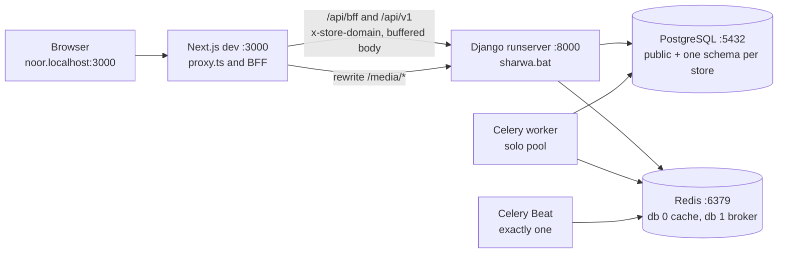

# Runbook — Windows development environment (Django, Celery and Next.js together)

> **Source**: DOC-519 · inventory A.11 · INT-020 · A.2 mock runtime
> **Owner**: fares · **Last dry run**: not dry-run in step 39 (no Windows machine was available to the author; every command below is derived from code and marked *(unverified)* where the code does not prove it)
> **Code**: `sharwa_saas/sharwa.bat` · `config/settings.py` · `config/middleware.py` · `config/urls_public.py` · `core/uploads.py` · `products/management/commands/normalize_media_filenames.py` · `tenants/provisioning.py` · `tenants/tasks.py` · `sharwa-frontend/package.json` · `next.config.ts` · `src/env.ts` · `src/mocks/runtime.ts`
> **Last verified against code**: 2026-10-28 (step 39)

> ⚠️ **Acceptance check NOT run.** The task's "Done when" is *a fresh Windows machine reaches a working live store following this guide*. That check has **not** been performed: nobody followed this guide on a clean Windows machine in step 39. Treat the guide as code-derived and unproven until fares (or a new teammate) runs it end to end and records the date in the "Last dry run" line above. Open items are listed in [section "Open items"](#open-items).

Legend: **(unverified)** = not proven by repository code or a run; it is general Windows / Celery / browser behaviour or a command shape taken from tests.

## When to use

- A new developer sets up a Windows machine to work on Sharwa (Django backend `C:\sharwa_saas`, Next.js frontend `C:\sharwa_front\sharwa-frontend`).
- A live store must be exercised against Django from `npm run dev` (the integration protocol in `docs/architecture/21-mock-runtime.md`).
- A store logo or gallery image returns `404` on a Windows machine, or Arabic file names appear as `????` in the console ([section "Local media on Windows"](#local-media)).

Not for production or staging: those use Gunicorn, Nginx and systemd/Docker ([`deployment/`](deployment/README.md)).

## Impact and risk

- Local only. Creates a PostgreSQL database with one schema per store, a local `media/` tree and a local Redis dataset. Nothing reaches a real WhatsApp, payment or carrier endpoint while `DEBUG=True` and the integration variables of `.env.example` stay empty ([`environment.md`](environment.md) §4 and §6).
- Edits one system file, the Windows `hosts` file, and needs an Administrator prompt for that.
- Ports used: `8000` (Django), `3000` (Next.js), `5432` (PostgreSQL), `6379` (Redis). Duration: not measured.
- Fully reversible ([Roll back](#roll-back)).

## Prerequisites

- Access: an Administrator Windows account (installers, `hosts` file); repository access to both repos.
- Versions (full table: [`dependencies.md`](dependencies.md) §2):

  | Component | Version in the repository | Note |
  |---|---|---|
  | Python | 3.13 | Django 6.1 needs 3.12 or newer. A leftover pip log on the existing developer machine (`C:\sharwa_saas\_pip_out.txt`, not tracked) shows `cp313` / `win_amd64` wheels installed into `C:\sharwa_saas\venv`. |
  | PostgreSQL | 16 | The Windows installer registers a service. |
  | Redis | not pinned | A Redis-compatible server must run: the settings comment names **Memurai, Docker or WSL** (`config/settings.py:225-229`). |
  | Node.js | not pinned (`package.json` has no `engines`; `@types/node` is `^20`) | Next.js 16.4.2 and React 19.3.0 (`package.json:27,30`). Use a current LTS and confirm it against the Next.js 16 requirement *(unverified)*. |
  | Git | any | |

- Fixed paths: the roadmap, `sharwa.bat` and the other docs assume `C:\sharwa_saas` and `C:\sharwa_front\sharwa-frontend`. Other paths work but then every command below needs adjusting.
- Values to have ready: `<DB_NAME>`, `<DB_USER>`, `<DB_PASSWORD>`, `<SECRET_KEY>`, `<CRYPTOGRAPHY_KEY>` (throw-away values for a laptop; never reuse production ones), a store sub-domain such as `noor`, a platform-owner username `<ADMIN_USER>`.

## How the pieces fit

Six processes cooperate. Django, the Celery worker, Celery Beat and Next.js each need their own terminal; PostgreSQL and Redis run as Windows services.



What each piece is for in a live run:

| Process | Without it |
|---|---|
| PostgreSQL | nothing starts (`DATABASES` reads `DB_NAME`, `DB_USER`, `DB_PASSWORD` at import, `config/settings.py:105-115`) |
| Redis | the cache backend is Redis (`settings.py:230-244`, timeouts 2 s) and the Celery broker is Redis db 1 (`settings.py:562`); OTP counters and rate limits fail or stall |
| Django (`sharwa.bat`) | no API: the Next.js BFF answers `502` «الخادم غير متاح حالياً.» (`src/lib/bff/upstream.ts:193`) |
| Celery worker | **a new store never leaves `pending`**: registration only creates the `Client` and `Domain` rows and queues `provision_tenant_schema.delay(...)` (`tenants/provisioning.py:116-125`); until a worker runs it, the store host answers the 503 provisioning page (`tenants/middleware.py:25-43`) |
| Celery Beat | no scheduled job fires, including the 5-minute sweeper that re-queues stuck stores (`settings.py:625-628`); with a worker alone, registration still provisions the store |
| Next.js | no UI |

## Steps

### 1. Place the repositories

```bat
:: both folders must end up exactly here
C:\sharwa_saas
C:\sharwa_front\sharwa-frontend
```

### 2. Backend virtual environment

`sharwa.bat` activates a folder named `venv` next to itself (`sharwa.bat:18`); keep that name.

```bat
cd /d C:\sharwa_saas
py -3.13 -m venv venv
call venv\Scripts\activate
python -m pip install --upgrade pip
python -m pip install -r requirements.txt
```

- Do **not** `pip install django-cryptography`. `requirements.txt` explains that the only PyPI release is incompatible with Django 6.1 and that a patched copy lives in the repository's `django_cryptography/` folder.
- `psycopg2==2.9.12` is pinned in source form; whether a Windows wheel exists for it on Python 3.13 is *(unverified)*. The existing machine installed requirements successfully (see the pip log above).
- Create the log folder if it is missing: the file handler writes `logs\sharwa_errors.log` (`settings.py:447`) and a missing folder stops start-up. A fresh clone has **no** `logs\` folder (verified in Step 51, [`_verification.md`](_verification.md#o-4)): without it the first `manage.py` command stops with `ValueError: Unable to configure handler 'file'`.

  ```bat
  if not exist logs mkdir logs
  ```

### 3. PostgreSQL

In `psql` as the superuser (names are yours; they go into `.env` in step 5):

```sql
CREATE ROLE <DB_USER> LOGIN PASSWORD '<DB_PASSWORD>';
CREATE DATABASE <DB_NAME> OWNER <DB_USER>;
-- only if you will run "manage.py test": the runner creates a test database
ALTER ROLE <DB_USER> CREATEDB;
```

### 4. Redis

Install and start one Redis-compatible server on `localhost:6379` (Memurai service, Docker, or WSL). The settings use database `0` for the cache and `1` for Celery, so that cache keys never collide with queue messages and a `FLUSHDB` on one does not wipe the other (`settings.py:225-226`).

```bat
:: Memurai ships memurai-cli; with Docker use: docker exec <container> redis-cli ping
redis-cli ping
```

Expected: `PONG` *(unverified)*.

### 5. Backend `.env`

```bat
cd /d C:\sharwa_saas
copy .env.example .env
notepad .env
```

`settings.py` loads `.env` itself (`from dotenv import load_dotenv; load_dotenv()`, lines 1-2). Set at least these (variable semantics: [`environment.md`](environment.md) §3):

| Variable | Value for a laptop | Fails without it |
|---|---|---|
| `SECRET_KEY` | `<SECRET_KEY>` | `KeyError: 'SECRET_KEY'` (`settings.py:20`) |
| `DEBUG` | `True` (exact text) | everything in [environment.md §6](environment.md#debug-only) is off: no media serving, secure cookies on plain HTTP |
| `ALLOWED_HOSTS` | keep the example's `.localhost,127.0.0.1,…`; **no spaces after commas** | `KeyError` (`settings.py:24`), or `400` on a host not listed |
| `DB_NAME`, `DB_USER`, `DB_PASSWORD` | the values from step 3 (`DB_HOST=localhost`, `DB_PORT=5432` are the defaults) | `KeyError` (`settings.py:108-110`) |
| `CRYPTOGRAPHY_KEY` | `<CRYPTOGRAPHY_KEY>` | `ImproperlyConfigured` «CRYPTOGRAPHY_KEY غير مضبوط في متغيرات البيئة. …» (`settings.py:44-49`) |
| `TENANT_BASE_DOMAIN` | `localhost` | store hosts become `<sub>.<value>` (`tenants/validators.py:86-88`); must equal the Next.js value |
| `REDIS_CACHE_URL`, `CELERY_BROKER_URL` | `redis://localhost:6379/0` and `redis://localhost:6379/1` (the defaults) | cache and broker errors |
| `CORS_ALLOWED_ORIGINS`, `CSRF_TRUSTED_ORIGINS` | the example values | `403` on writes from an unlisted origin |

Leave every WhatsApp, payment, carrier, AI and marketplace variable empty: with `DEBUG=True` the one-time codes are logged instead of sent ([`environment.md`](environment.md) §6).

### 6. Create the schema, the platform tenant and an owner

```bat
cd /d C:\sharwa_saas
call venv\Scripts\activate
python manage.py migrate_schemas --shared
```

django-tenants resolves every request by looking for a `Domain` row for the host, and a host with no row is refused ([`10-multi-tenancy.md`](../architecture/10-multi-tenancy.md) middleware table, row 2). The repository has **no data migration or command that creates the platform (`public`) tenant** (searched `tenants/migrations`, `management/commands`); its tests create it with `Client.objects.get_or_create(schema_name='public', …)` (`api/test_platform_console_api.py:80`). A one-off shell line of the same shape *(unverified: not run)*:

```bat
python manage.py shell -c "from tenants.models import Client, Domain; c, _ = Client.objects.get_or_create(schema_name='public', defaults={'name': 'Platform'}); Domain.objects.get_or_create(domain='localhost', defaults={'tenant': c, 'is_primary': True})"
```

Platform owner for `console.localhost` (a Django user in the shared tables; `is_superuser` = «مالك المنصة», `is_staff` = «مشرف تشغيلي», `tenants/console_service.py`, `console_role`):

```bat
python manage.py createsuperuser --username <ADMIN_USER>
```

### 7. Terminal 1 — Django (`sharwa.bat`)

```bat
C:\sharwa_saas\sharwa.bat
```

`sharwa.bat` does exactly this and nothing else: `cd /d "%~dp0"` (line 10), `chcp 65001` + `set PYTHONUTF8=1` + `set PYTHONIOENCODING=utf-8` (lines 13-15, a UTF-8 console so Arabic file names in `django.request` logs read correctly), `call venv\Scripts\activate` (18), `python manage.py runserver` (21), `pause` (24). It starts no worker, no Beat, no Redis and no Next.js ([`management-commands.md`](management-commands.md) §6). Expected: `Starting development server at http://127.0.0.1:8000/`.

### 8. Terminal 2 — Celery worker

Same UTF-8 settings as `sharwa.bat`: the worker logs Arabic messages and `settings.py:467` makes it use the project's `LOGGING`, so a legacy code page prints `--- Logging error ---` instead of the line (`config/middleware.py:104-105` describes the same symptom).

```bat
cd /d C:\sharwa_saas
chcp 65001 >nul
set PYTHONUTF8=1
set PYTHONIOENCODING=utf-8
call venv\Scripts\activate
celery -A config worker -l info -P solo -Q default,whatsapp,support,channels_meta,channels_tiktok,channels_telegram,channels_broadcast,marketplaces_amazon,marketplaces_noon,suppliers_sync,suppliers_orders
```

- The `-Q` list is `CELERY_QUEUES` of `deploy/celery.env` (the Linux unit uses `-Q ${CELERY_QUEUES}`, `deploy/systemd/celery-sharwa.service`). For store provisioning alone, queue `default` is enough: `provision_tenant_schema` is routed to `default` on purpose (`tenants/tasks.py:167-169`). Tasks routed to a queue you did not list wait unconsumed.
- **Does Celery work on Windows in this repo?** The repository ships **no Windows service file** (only `deploy/systemd/*.service` and `deploy/docker-compose.prod.yml`) and `sharwa.bat` never starts a worker. `-P solo` (a single in-process worker) is Celery's own workaround for the prefork pool, which Celery 5 does not support on Windows. That is general Celery behaviour, **not code-verified here**, and **no worker was started on Windows in step 39** *(unverified)*. The same commands appear in [`runbooks/celery.md`](runbooks/celery.md) (also marked not verified).
- Consequences of the solo pool to expect *(unverified)*: one task at a time (a long provisioning run blocks every other task), and the per-task `soft_time_limit` / `time_limit` (for example `tenants/tasks.py:170-171`, 900 s and 960 s; `products/tasks/_common.py:28,31`) are not enforced by the solo pool.
- **Eager mode is not a dev option.** `CELERY_TASK_ALWAYS_EAGER` is set only when `DJANGO_TESTING=1` (`settings.py:769-771`), which `manage.py` sets by itself for the `test` command only (`manage.py:11-12`). The same switch also replaces Redis with an in-memory cache (`settings.py:248-251`) and the settings comment says not to widen that exception to development (`settings.py:245-247`). Exporting `DJANGO_TESTING=1` before `runserver` would make every `.delay()` run inside the HTTP request *(unverified, not recommended)*.

### 9. Terminal 3 — Celery Beat (exactly one)

```bat
cd /d C:\sharwa_saas
chcp 65001 >nul
set PYTHONUTF8=1
set PYTHONIOENCODING=utf-8
call venv\Scripts\activate
celery -A config beat -l info --schedule %TEMP%\celerybeat-schedule
```

Never run two Beats: every periodic task would fire twice (`deploy/docker-compose.prod.yml:103`, [`dependencies.md`](dependencies.md) §2). Skip this terminal if you only need a store to provision; start it for anything scheduled ([`runbooks/celery.md`](runbooks/celery.md)). Two management commands have no Beat entry at all and need Windows Task Scheduler if you want them ([`management-commands.md`](management-commands.md) §2).

### 10. Frontend install and environment

```bat
cd /d C:\sharwa_front\sharwa-frontend
npm install
copy .env.example .env.local
```

`.npmrc` sets `legacy-peer-deps=true`. `.env.local` is git-ignored (`.env*` except `.env.example`). The four required keys come ready in the example: `TENANT_BASE_DOMAIN=localhost`, `NEXT_PUBLIC_TENANT_BASE_DOMAIN=localhost`, `API_INTERNAL_URL=http://localhost:8000`, `NEXT_PUBLIC_PLATFORM_WHATSAPP=967700000000`. `next.config.ts:3` imports `src/env.ts`, which stops start-up with «TENANT_BASE_DOMAIN مطلوب (مثال: localhost أو sharwaah.com)» or «API_INTERNAL_URL يجب أن يكون رابطاً كاملاً (مثال: http://localhost:8000)» when they are missing (`src/env.ts:15,17`).

### 11. Terminal 4 — Next.js, live against Django

The Next.js side decides per module whether the BFF answers from Django or from a fixture (`SHARWA_MOCKS`, `SHARWA_LIVE_MODULES`; defaults: mocks `on` in dev, no module live). For a **live store** switch everything to Django:

```bat
cd /d C:\sharwa_front\sharwa-frontend
set SHARWA_MOCKS=off&& npm run dev
```

```powershell
cd C:\sharwa_front\sharwa-frontend
$env:SHARWA_MOCKS="off"; npm run dev
```

For fixtures only (mock scripts, screenshots): `set SHARWA_LIVE_MODULES=none&& npm run dev`.

**Why there is no space before `&&`.** In `cmd`, `set NAME=value && next-command` stores everything between `=` and `&&`, trailing space included, so `set SHARWA_MOCKS=off && npm run dev` sets the variable to `"off "` (with a space). The Next.js side compares exact text: `isMocksOn()` accepts only `on` and `off` (`src/mocks/runtime.ts:7-12`) and `src/env.ts:19` validates `z.enum(["on","off"])`, so `"off "` is rejected (or, for the runtime check, ignored in favour of the `NODE_ENV` default). For `SHARWA_LIVE_MODULES` the extra space is harmless because the list is trimmed (`runtime.ts:50-53`), but use the same habit everywhere: write `none&&` and `off&&` with the `&&` glued to the value. The quoted form `set "SHARWA_MOCKS=off" && npm run dev` also avoids the space; it is a `cmd` feature and is *(unverified)* in this repository.

Three more rules, all in [`../architecture/21-mock-runtime.md`](../architecture/21-mock-runtime.md) §4.4:

- A variable set in the shell **wins over `.env.local`**; `set SHARWA_LIVE_MODULES=` (nothing after `=`) **deletes** it, it does not set it to empty. Use `none` to override a list that `.env.local` carries.
- `set` in a `cmd` window lasts until the window closes: the next `npm run dev` in the same window still sees `SHARWA_MOCKS=off`.
- Restart `next dev` after changing any value; a running process does not see it.

Per-module live keys and the 39-key sample line: [`../architecture/22-live-module-keys.md`](../architecture/22-live-module-keys.md), [`environment.md`](environment.md) §1.

### 12. Hosts-file entries for store sub-domains

A store lives at `<sub>.<TENANT_BASE_DOMAIN>`, for example `http://noor.localhost:3000/`; the platform console at `http://console.localhost:3000/` (`README.md` table; `src/proxy.ts:53-56`). The `hosts` file cannot hold wildcards, so each name needs its own line.

1. Open Notepad **as Administrator** and open `C:\Windows\System32\drivers\etc\hosts` (file type "All files").
2. Add one line per store you will open, plus the console:

   ```text
   127.0.0.1 noor.localhost
   127.0.0.1 console.localhost
   ```

3. Save, then flush the resolver cache:

   ```bat
   ipconfig /flushdns
   ```

Notes:

- The host in the browser must equal a `Domain` row exactly: the BFF forwards the port-less host as `X-Store-Domain`, and Django looks it up with `Domain.objects.get(domain=…)` (`api/middleware.py:50,62`). A new store gets `<sub>.<TENANT_BASE_DOMAIN>` automatically (`tenants/registration.py:48-49`).
- Whether the entries are needed at all is *(unverified)*: current Chromium and Firefox are known to resolve any `*.localhost` name to the loopback address themselves, while tools that use the Windows resolver (`curl`, Postman) may not. The repository's README lists `noor.localhost:3000` with no hosts instruction. Add the lines whenever a name does not resolve.
- Cookies: no cookie `Domain` is set (`settings.py:827-832`; a `.localhost` cookie domain is dropped by browsers), so the session cookie of `noor.localhost` reaches both `:3000` and `:8000`, and store `noor` never sees the session of store `glow`.

### 13. Get a store

Through the product's own flow (needs terminals 1, 2 and 4, and Redis):

1. Open `http://localhost:3000/register`, fill in the store name, a sub-domain such as `noor` and a fake phone `9677XXXXXXXX`.
2. The WhatsApp code is not sent while `DEBUG=True`: the generated code is written to the Django log and a fixed debug code is accepted ([`environment.md`](environment.md) §6, `api/views_onboarding.py:85,129,321`).
3. Registration creates the `Client` (status `pending`) and `Domain` rows and queues provisioning (`tenants/registration.py:29-73`). The worker creates and migrates the schema, then marks it `ready` (`tenants/provisioning.py`, [`11-provisioning.md`](../architecture/11-provisioning.md)). Until then the store host shows the provisioning page.
4. Set the first password on the page the wait screen redirects to, then sign in at `http://noor.localhost:3000/dashboard`.

Optional demo data for a ready store (fake categories and products; needs `pip install Faker`, which is not in `requirements.txt`; development only):

```bat
python manage.py seed_store <SCHEMA> --products 50
```

`seed_tenants` creates `*.sharwa.local` load-test stores and is not suitable for this guide.

## Local media on Windows <a id="local-media"></a>

Uploaded files (store logo, product gallery, home-section images) live in `C:\sharwa_saas\media\<SCHEMA>\…` (`MEDIA_ROOT`, `settings.py:361-362`; git-ignored). Windows made three things go wrong at once; each has a layer of defence:

| Layer | What it does | Code |
|---|---|---|
| Prevent | `tenant_upload_path` stores any upload whose **file name is not pure ASCII** under a random name `<32 hex>.<ext>` in the same folder (`randomize_name=True` fields always do). Path shape: `<schema>/<base_path>/<name>`; an extension outside the field's list is refused before anything is written. | `core/uploads.py:62-88` |
| Serve | `DevMediaMiddleware` serves `/media/…` for **any** host, before the tenant is chosen. | `config/middleware.py:72-157`, installed only while `DEBUG` (`settings.py:282-283`) |
| Serve (second line) | `urls_public` also maps `MEDIA_URL` to `MEDIA_ROOT` under `DEBUG` ("a second line of defence if the middleware is removed"); `urls_tenant` does the same for store hosts. | `config/urls_public.py:98-101`, `config/urls_tenant.py:739-740` |
| Repair | `normalize_media_filenames` renames files uploaded before 2026-10-24 and rewrites every row that points to them. | `products/management/commands/normalize_media_filenames.py` |

**Why the middleware exists.** The API builds absolute image URLs on the origin the request arrived at, which for the BFF is `http://localhost:8000/media/<schema>/…` (`API_INTERNAL_URL`). `localhost:8000` resolves to the `public` schema, whose URL conf did not serve `/media/`, so every logo and gallery image uploaded locally returned `404` (docstring, `config/middleware.py:72-84`). Files are already split by schema in their path, so serving them for any origin matches what Nginx does in production (`location /media/`). In the browser the path is also same-origin: `next.config.ts:16-19` rewrites `/media/:path*` to `${API_PROXY_URL ?? API_INTERNAL_URL}/media/:path*`, and `src/proxy.ts:118` leaves `/media/` out of the store rewrite.

What `DevMediaMiddleware` resolves (`config/middleware.py`):

1. Only `GET` and `HEAD` for paths under `MEDIA_URL` (lines 88-93); everything else passes through untouched.
2. **Double-encoded paths**: candidates are the request path and its `unquote()`d form (`_media_candidates`, 114-123) — a link encoded twice by a proxy or rewrite arrives as `%D9%84…` text and is decoded once more.
3. **NFC and NFD variants** of each candidate (same function): a name saved in one Unicode normalization form and requested in the other.
4. **Path safety** for each candidate (`_inside`, 126-134): backslashes become `/`, `..`, absolute paths and drive letters are refused, and the real path must stay under `MEDIA_ROOT`.
5. First candidate that is an existing file wins; otherwise the **last path segment** is compared with the folder's entries after NFC normalization and `casefold()` (`resolve_media_path`, 137-157). Only the file name is compared this way; folder segments must match as written (Windows' own case-insensitivity covers folders).
6. Served by `django.views.static.serve` (conditional requests and content type included). A miss answers `404` «الملف غير موجود.» and logs one **ASCII-only** line, because `%a` escapes the Arabic name: `DevMedia 404: <escaped path> not found under MEDIA_ROOT=<escaped root>` (line 106). A Windows console on cp1252 or cp1256 used to print `--- Logging error ---` instead (comment, 104-105).

> ⚠️ Discrepancy — roadmap says `DevMediaMiddleware` resolves "case variants of Arabic names" / code does an NFC + `casefold()` comparison of the final file name only (`config/middleware.py:153-156`); Arabic letters have no case, so `casefold()` matters for the Latin part of a name. No test exercises a case difference (`api/test_dev_media.py` covers single and double encoding, NFD vs NFC, a missing file, `..`, and ASCII-safe logging). Reported in step 39.

Repair old files (preview is the default; details, output format and safety: [`management-commands.md`](management-commands.md#normalize_media_filenames)):

```bat
python manage.py normalize_media_filenames
python manage.py normalize_media_filenames --apply --schema <SCHEMA>
```

Back up `media\` and the database before `--apply`; the command has no undo. Tests: `python manage.py test api.test_dev_media api.test_normalize_media` (9 tests; `TenantTestCase` needs PostgreSQL, Redis is not needed because `manage.py` sets `DJANGO_TESTING`). Not run in step 39. Production notes on the same folder: [`upload-limits.md`](upload-limits.md) §3.1.

## Verify

1. **Django answers.**

   ```bat
   curl -i http://localhost:8000/api/v1/auth/csrf/
   ```

   Expected `200` with `{"csrfToken": "…"}` and a `Set-Cookie: csrftoken` *(unverified: not run; shape from `api/views_auth.py` `CsrfTokenView`)*.
2. **The BFF reaches it.** Open `http://noor.localhost:3000/dashboard` and sign in. In the browser's network panel no response carries `x-sharwa-mock: 1`, and the amber «بيانات تجريبية» line never appears — the validity rule for a live run ([`03-phase-history.md`](../architecture/03-phase-history.md) §5.3).
3. **Provisioning worked.** The store host shows the storefront or dashboard, not the 503 provisioning page; the worker terminal shows the `provision_tenant_schema` task finishing.
4. **Media.** Upload a logo whose file name is Arabic in the dashboard settings. The browser shows it, and `dir C:\sharwa_saas\media\<SCHEMA>\store_logos` lists a 32-hex name. Open the logo URL directly on `http://localhost:8000/media/<SCHEMA>/store_logos/<NAME>`; it must answer `200` with no `DevMedia 404` line in the Django terminal.
5. **Console.** `http://console.localhost:3000/login` with `<ADMIN_USER>`; the overview lists the store. Live console reads use Django's `GET /api/v1/platform/auth/me/` ([`../architecture/62-infra-fixes.md`](../architecture/62-infra-fixes.md) §4.4).
6. **Quality gates** (`README.md`): `npm run lint`, then `npx next typegen`, then `npm run typecheck` (`package.json:9-10`, the latter is `tsc --noEmit`). On a fresh clone `tsc` fails with `TS2304: Cannot find name 'RouteContext'` until `next typegen` (or `next dev` / `next build`) has written `.next/types` ([`_verification.md`](_verification.md#o-5)). The README's `rm -rf .next/types` is bash; on Windows use `rmdir /s /q .next\types` (cmd) or `Remove-Item -Recurse -Force .next\types` (PowerShell).

## Roll back

- Stop the four terminals (`Ctrl+C`; in the worker terminal wait for "Warm shutdown").
- Remove the lines added to the `hosts` file; `ipconfig /flushdns`.
- Drop local data: `DROP DATABASE <DB_NAME>;` in `psql`; clear Redis with `redis-cli -n 0 FLUSHDB` and `redis-cli -n 1 FLUSHDB`; delete `C:\sharwa_saas\media` if its files are disposable.
- Delete `C:\sharwa_saas\venv`, `C:\sharwa_front\sharwa-frontend\node_modules` and `.next`.
- `.env` and `.env.local` are git-ignored: delete them if the machine is shared.

## Troubleshooting

| Symptom | Likely cause | Fix |
|---|---|---|
| `KeyError: 'SECRET_KEY'` (or `ALLOWED_HOSTS`, `DB_NAME`, `DB_USER`, `DB_PASSWORD`) on any `manage.py` command | `.env` missing or incomplete | Step 5; [`environment.md`](environment.md) §5 |
| `ImproperlyConfigured: CRYPTOGRAPHY_KEY …` | empty `CRYPTOGRAPHY_KEY` | set a throw-away value |
| Django answers `400` for `noor.localhost` | host not in `ALLOWED_HOSTS` or spaces after commas | `.localhost` covers `localhost` and all sub-domains |
| `404` from `localhost:8000` for every request, or `404` on a store host | no `Domain` row for that host (platform tenant missing, or the store's domain differs from the host you typed) | step 6; the host must equal the `Domain` row |
| Next.js stops with «TENANT_BASE_DOMAIN مطلوب …» or «API_INTERNAL_URL يجب أن يكون رابطاً كاملاً …» | `.env.local` missing | `copy .env.example .env.local`, restart |
| Next.js rejects `SHARWA_MOCKS` | `set SHARWA_MOCKS=off && …` left a trailing space | glue `&&` to the value (step 11) |
| Store host shows the 503 provisioning page and never becomes ready | no worker running, or worker not consuming `default` | step 8; the sweeper retries every 5 minutes only if Beat runs (`settings.py:627`); status in the console |
| `.delay()` appears to do nothing; scheduled jobs never run | no worker / no Beat on a dev machine | steps 8-9; [`runbooks/celery.md`](runbooks/celery.md) |
| Errors from the cache backend about connecting to `localhost:6379` | Redis not running | step 4 (cache timeouts are 2 s, `settings.py:240-241`) |
| `403` «CSRF …» on the first write after sign-in | origin not trusted, or stale `csrftoken` cookie | `DEBUG=True` adds `http://*.localhost` (no port) because the BFF sends an `Origin` without the port (`settings.py:820-826`, `src/lib/bff/upstream.ts:133`); clear cookies for `localhost` |
| Sign-in succeeds, then the login screen returns | a cookie `Domain` of `.localhost` (browsers drop it) | do not set `SESSION_COOKIE_DOMAIN`; see `settings.py:827-832` |
| Logo or gallery image is `404` | `DEBUG` is not `True`, so `DevMediaMiddleware` is not installed; or the file really is not in `media\<SCHEMA>\…` | check the Django log line `DevMedia 404: …` (ASCII-safe); for old Arabic-named files run `normalize_media_filenames` |
| Arabic shows as `????` or the log prints `--- Logging error ---` | console code page | `chcp 65001`, `set PYTHONUTF8=1`, `set PYTHONIOENCODING=utf-8` in **every** Python terminal (`sharwa.bat:13-15`) |
| `ValueError: Unable to configure handler 'file'` at start (the traceback's cause is `FileNotFoundError … logs\sharwa_errors.log`) | `logs\` folder missing | step 2 |
| `Address already in use` on 8000 or 3000 | a previous server is still running | `netstat -ano \| findstr :8000`, then `taskkill /PID <PID> /F` *(general Windows)* |
| Worker stops or hangs during a long task on Windows | solo pool, no time limits | restart the worker; expected limitation *(unverified)* |

## Open items

- **Acceptance check not run** (see the box at the top): a fresh Windows machine reaching a working live store has not been demonstrated.
- Celery worker and Beat commands on Windows (`-P solo`, `--schedule %TEMP%\…`) are not verified by a run.
- The creation of the platform (`public`) `Client` and `Domain` has no repository tool; the shell line in step 6 is shaped from tests (it worked on the Step 51 verification stack, [`_verification.md`](_verification.md#p2-1)).
- Whether `*.localhost` resolves without hosts-file entries in the browsers the team uses is not verified.
- Wheel availability for `psycopg2==2.9.12` on Python 3.13 / Windows, and the Node.js version required by Next.js 16.4.2, are not verified.

## Related

- [`environment.md`](environment.md) — every variable, start-up failures (§5), DEBUG-only behaviour (§6), per-environment matrix (§4).
- [`management-commands.md`](management-commands.md) — `sharwa.bat` (§6), `normalize_media_filenames` (§3.2), development commands (§4).
- [`runbooks/celery.md`](runbooks/celery.md) — queues, Beat, restarts; [`runbooks/switch-module-live.md`](runbooks/switch-module-live.md) — turning one module live.
- [`upload-limits.md`](upload-limits.md), [`dependencies.md`](dependencies.md), [`testing/django-suites.md`](testing/django-suites.md).
- [`../architecture/21-mock-runtime.md`](../architecture/21-mock-runtime.md), [`../architecture/22-live-module-keys.md`](../architecture/22-live-module-keys.md), [`../architecture/20-bff.md`](../architecture/20-bff.md), [`../architecture/10-multi-tenancy.md`](../architecture/10-multi-tenancy.md), [`../architecture/11-provisioning.md`](../architecture/11-provisioning.md).
- [`../architecture/62-infra-fixes.md`](../architecture/62-infra-fixes.md) — the cross-cutting fixes behind this guide (body buffering, local media, CSRF bootstrap, savepoints).
