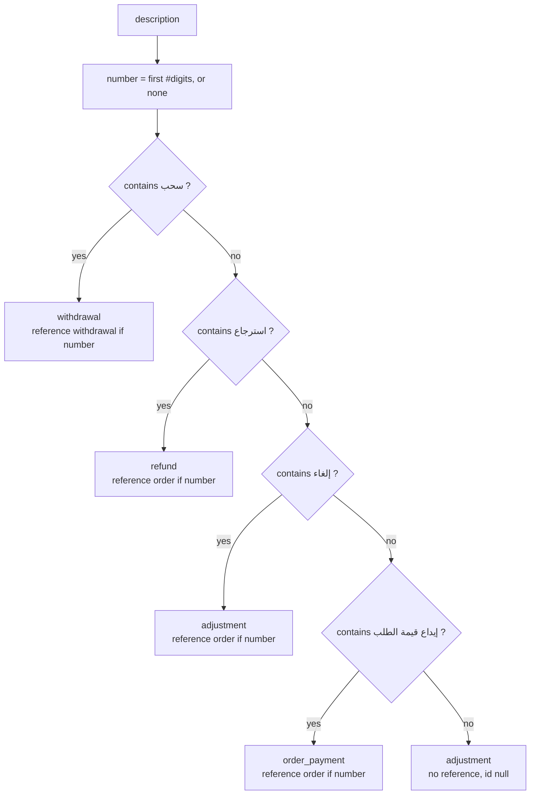
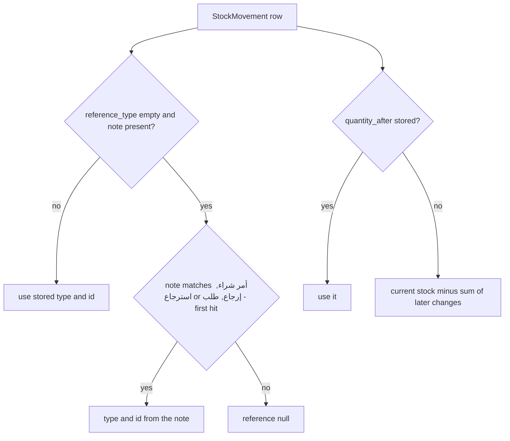

# Data backfills and legacy-data derivations

> **Source**: DOC-509 · inventory A.9 · INT-020, INT-022, INT-024, INT-026, INT-029, INT-031, INT-033, INT-035, INT-045, INT-005, INT-043
> **Code**: `sharwa_saas/products/migrations/0209…0235` · `sharwa_saas/tenants/migrations/0027_platform_console_api.py` · `sharwa_saas/billing/migrations/0012…0013` · `sharwa_saas/sharwapay/migrations/0003_console_review_fields.py` · `sharwa_saas/products/services/{inventory_service,staff_service,procurement_service,returns_api_service,engagement_service}.py` · `sharwa_saas/products/management/commands/normalize_media_filenames.py`
> **Last verified against code**: 2026-10-28 (step 39)

> **Verification queries are untested.** Every SQL statement and Django-shell snippet on this page was written from the models and migration code. None was run in step 39 (no database), so each is marked *(untested)*. Run them on a restored copy first. Table names are Django defaults (`<app>_<model>`) unless a model sets `db_table` (the Sharwa Pay tables do: `tenants_sharwapay…`). Replace `<SCHEMA>` with the store schema (for example `noor`).

## 1. Purpose

Phase 002 changed the shape of existing data in three different ways, and the roadmap lists them together. This page separates them, because only the first kind is visible in `django_migrations`:

| Kind | Where the rule runs | Stored? | Re-runnable |
|---|---|---|---|
| **A. Backfill in a migration** (`RunPython`) | once per schema, when the migration is applied | yes | per migration, see §3 |
| **B. Seed in a migration** | once per schema (or once for `public`) | yes (rows created) | yes (`get_or_create`) |
| **C. Derivation at read time** (nothing written) | every request that shows the row | no | not applicable |
| **D. Management command** | when an operator runs it | yes (files and rows) | yes (preview first) |

For each item: the source rule, the verification, and what the roadmap said when the code differs. The ledger of the migrations themselves is [`phase-002-ledger.md`](phase-002-ledger.md); how to apply them is [`../runbooks/migrations.md`](../runbooks/migrations.md).

## 2. Components

| ID | Item | Kind | Where | INT |
|---|---|---|---|---|
| F1 | `Product.updated_at = created_at` | A | `products/0211_product_updated_at.py:10-12` | 005 |
| F2 | `ProductTemplate.blueprint_fields` from 33 legacy columns | A | `products/0214_producttemplate_blueprint_fields.py:40-51` | 005 |
| F3 | Main image copied into the gallery | A | `products/0215_product_main_image_to_gallery.py:11-20` | 005 |
| F4 | `MerchantWalletTransaction.kind` and references from the description | A | `products/0221_merchant_wallet_api.py:15-34` | 020 |
| F5 | Old shifts marked "force-close notice seen" | A | `products/0229_pos_api.py:11-13` | 033 |
| F6 | `PurchaseOrder.updated_at = created_at` | A | `products/0230_procurement_api.py:9-11` | 035 |
| F7 | `TenantDeactivationRecord.updated_at = created_at` | A | `tenants/0027_platform_console_api.py:13-15` | 030 |
| F8 | `TenantFeatureOverride.updated_at = created_at` | A | `billing/0012_tenantfeatureoverride_updated_at.py:7-9` | 030 |
| F9 | Sharwa Pay top-ups: bank name and claimed phone | A | `sharwapay/0003_console_review_fields.py:15-21` | 031 |
| F0 | Category order and tag last-used (older, INT-006) | A | `products/0209_backfill_catalog_org.py:15-33` | 006 |
| S1 | Permission `catalog.manage` | B | `products/0210_seed_catalog_manage_permission.py:20-33` | 006 |
| S2 | Permission `expenses.manage` | B | `products/0235_seed_expenses_permission.py:18-31` | 043 |
| S3 | Feature `pos` | B | `billing/0013_seed_pos_feature.py:11-22` | 033 |
| R1 | Stock-movement reference and balance | C | `products/services/inventory_service.py:380-445` | 024 |
| R2 | Serialized unit's order | C | `products/services/inventory_service.py:474-478` | 024 |
| R3 | Behavior-alert value and limit | C | `products/services/staff_service.py:982-991` | 022 |
| R4 | Purchase-order number and "created" event | C | `products/models/suppliers.py:96-99` · `products/services/procurement_service.py:297-299` | 035 |
| R5 | Return timeline for returns without audit rows | C | `products/services/returns_api_service.py:170-174` | 026 |
| R6 | Store reviews without stars; product reviews approved by default | C (default) | `products/services/engagement_service.py:140-152` · `storefront_product_service.py:200` | 029 |
| D1 | `normalize_media_filenames` | D | `products/management/commands/normalize_media_filenames.py` | 020 |

## 3. Data model — one section per item

### F1 — `Product.updated_at` (`0211`)

**Rule.** `Product.objects.update(updated_at=F('created_at'))` right after the column is added: a product that was never edited starts with `updated_at == created_at` instead of the migration time. Reverse: `RunPython.noop`.

**Verify** *(untested)* — expect 0 rows:

```sql
SELECT count(*) FROM "<SCHEMA>".products_product WHERE updated_at < created_at;
```

### F2 — `ProductTemplate.blueprint_fields` (`0214`)

**Rule.** For every template whose `blueprint_fields` is empty, copy each non-empty legacy column into the JSON dictionary under the column's name. `None` and `""` are dropped. The 33 columns are the `COLUMNS` tuple (`0214:16-25`): `barcode`, `old_price`, `sale_start_at`, `sale_end_at`, `cost_price`, `currency`, `is_taxable`, `tax_rate`, `payment_policy`, `low_stock_threshold`, `allow_backorder`, `min_quantity`, `max_quantity`, `unit`, `allow_variable_quantity`, `product_type`, `weight`, `length`, `width`, `height`, `is_free_shipping`, `delivery_duration`, `is_bookable`, `description`, `description_en`, `video_url`, `variant_display_style`, `product_template`, `is_available`, `published_at`, `is_featured`, `meta_title`, `meta_description`. Values: `Decimal` → string (for `min_quantity` and `max_quantity` three decimals with trailing zeros trimmed, `0214:31-34`); `date`/`datetime` → ISO string (`:35-36`); everything else as stored. The old columns are **not** dropped (mirror for the legacy Django screen, header `0214:1-9`). The rule is copied into the migration on purpose, with no import from `products.blueprint`. This is the "one-time ProductTemplate blueprint to JSON migration" of INT-005. The header says a sector template seeded with defaults ends with 15 fields (stated in the file, not re-counted).

**Verify** *(untested)*, Django shell — templates that still have legacy values but an empty blueprint (expect none for templates not edited since):

```python
import importlib
from django_tenants.utils import schema_context
from products.models import ProductTemplate
cols = importlib.import_module('products.migrations.0214_producttemplate_blueprint_fields').COLUMNS
with schema_context('<SCHEMA>'):
    bad = [t.pk for t in ProductTemplate.objects.all()
           if not t.blueprint_fields and any(getattr(t, c) not in (None, '') for c in cols)]
    print(len(bad), bad[:20])
```

### F3 — main image into the gallery (`0215`)

**Rule.** For each product with a non-empty `Product.image` whose file name is not yet a `ProductImage.image` of that product: add one to the `sort_order` of every existing gallery row, then create a `ProductImage` with the same file name and `sort_order=0`. The file is not copied (same storage name); `Product.image` stays as a mirror read by the storefront (INT-005 decision D2). Idempotent: a product whose image is already in the gallery is skipped (`0215:17`).

**Verify** *(untested)* — expect 0 rows:

```sql
SELECT p.id
FROM "<SCHEMA>".products_product p
WHERE COALESCE(p.image, '') <> ''
  AND NOT EXISTS (SELECT 1 FROM "<SCHEMA>".products_productimage i
                  WHERE i.product_id = p.id AND i.image = p.image);
```

<a id="0221"></a>

### F4 — merchant wallet statement classes (`0221`)

**Rule.** Roadmap: "`kind`/references backfilled from the fixed description wording". Code: `classify(description)` (`0221:15-27`) takes the first `#<digits>` number in the description and applies four tests **in this order**; the first hit wins. The migration writes `kind`, `reference_kind` and `reference_id` for every row.



| Test word or phrase (exact, from `0221:19-25`) | `kind` | `reference_kind` | `reference_id` |
|---|---|---|---|
| «سحب» | `withdrawal` | `withdrawal` (empty when no number) | the number |
| «استرجاع» | `refund` | `order` (empty when no number) | the number |
| «إلغاء» | `adjustment` | `order` (empty when no number) | the number |
| «إيداع قيمة الطلب» | `order_payment` | `order` (empty when no number) | the number |
| none of the above | `adjustment` | empty | null |

The wordings the application has always written (so the rule matches them) and what each gets:

| Description in code | Written at | Class by the migration |
|---|---|---|
| «إيداع قيمة الطلب #N — دفع إلكتروني (شروة باي)» | `products/services/merchant_credit_service.py:52` | `order_payment`, order N |
| «إيداع قيمة الطلب #N — كاش عبر (شروة للتوصيل)» | `merchant_credit_service.py:59` | `order_payment`, order N |
| «طلب سحب رصيد #N — قيد المراجعة» | `products/services/payments_service.py:544` · `products/views/merchant_wallet.py:79` | `withdrawal`, withdrawal N |
| «إعادة رصيد — رُفِض طلب السحب #N» | `payments_service.py:569` | `withdrawal`, withdrawal N («السحب» contains «سحب») |
| «عكس إيداع (استرجاع جزئي/كامل) — الطلب #N» | `products/services/refund_service.py:184` | `refund`, order N |
| «عكس إيداع الطلب #N — تم إلغاء الطلب» | `products/models/orders.py:544` | `adjustment`, order N |

Since `0221` the same call sites pass the class explicitly (`kind='order_payment'`, `'withdrawal'`, `'refund'`, `'adjustment'` with a `reference`), and they agree with the table. The class `commission` exists in `KIND_CHOICES` but nothing writes it (comment at `products/models/wallets.py:253-254`), and the backfill never assigns it. A description in another wording, or one containing «سحب», «استرجاع» or «إلغاء» by accident, is classified by the first test it meets.

**Verify** *(untested)*. 1 — distribution:

```sql
SELECT kind, reference_kind, count(*)
FROM "<SCHEMA>".products_merchantwallettransaction
GROUP BY 1, 2 ORDER BY 1, 2;
```

2 — re-apply the migration's own function and list rows that disagree (expect none; a later row written with an explicit class that differs from its wording would also show up):

```python
import importlib
from django_tenants.utils import schema_context
from products.models import MerchantWalletTransaction as T
classify = importlib.import_module('products.migrations.0221_merchant_wallet_api').classify
with schema_context('<SCHEMA>'):
    bad = [(t.pk, t.description, (t.kind, t.reference_kind, t.reference_id))
           for t in T.objects.all().iterator()
           if (t.kind, t.reference_kind, t.reference_id) != classify(t.description)]
    print(len(bad), bad[:20])
```

### F5 — shifts and the force-close notice (`0229`)

**Rule.** `Shift.objects.update(force_close_notice_seen=True)` — **every** existing shift, not only force-closed ones, so no old shift raises the new notice (`0229:11-13`; the file comment says "«الورديات القسرية القائمة تُعلَّم »«مقروءة»").

> ⚠️ Discrepancy — roadmap says "old shifts marked `force_close_notice_seen`; NULL `opened_by`/`created_by` = owner" as a backfill / code does: marks all shifts (`0229:12`), and makes `Shift.opened_by` and `ShiftCashMovement.created_by` nullable (`0229:23-27`, `:44-48`) with the help text «فارغ = مالك المتجر.». No existing row is changed to `NULL`; the "owner" meaning applies to rows written after the migration. Reported in step 39.

**Verify** *(untested)* — shifts that existed before the migration and are not marked (expect 0):

```sql
SELECT count(*)
FROM "<SCHEMA>".products_shift
WHERE force_close_notice_seen = false
  AND opened_at < (SELECT applied FROM "<SCHEMA>".django_migrations
                   WHERE app = 'products' AND name = '0229_pos_api');
```

Owner-opened shifts after the migration: `SELECT count(*) FROM "<SCHEMA>".products_shift WHERE opened_by_id IS NULL;`.

### F6 — `PurchaseOrder.updated_at` (`0230`)

**Rule.** `PurchaseOrder.objects.update(updated_at=F('created_at'))` (`0230:9-11`). `version` starts at 1 through the field default.

> ⚠️ Discrepancy — roadmap says "PO number derived `PO-0001`" belongs to `0230` / code does: no migration derives a number. The number is a property computed from the primary key on every read: `PO-{pk:04d}` (`products/models/suppliers.py:96-99`), never stored, so there is nothing to backfill or verify. Reported in step 39.

**Verify** *(untested)* — expect 0:

```sql
SELECT count(*) FROM "<SCHEMA>".products_purchaseorder WHERE updated_at < created_at;
```

### F7, F8 — public `updated_at` fixes (`tenants/0027`, `billing/0012`)

**Rule.** `TenantDeactivationRecord.updated_at = created_at` and `TenantFeatureOverride.updated_at = created_at` (the header of `0027` also says `actor` stays empty). Not in the roadmap list; they run in `migrate_schemas --shared`.

**Verify** *(untested)*, `public` schema — expect 0 each:

```sql
SELECT count(*) FROM tenants_tenantdeactivationrecord WHERE updated_at < created_at;
SELECT count(*) FROM billing_tenantfeatureoverride WHERE updated_at < created_at;
```

### F9 — Sharwa Pay top-ups (`sharwapay/0003`)

**Rule.**

1. Every top-up request with a non-null, non-empty `bank_transaction_id` gets `bank_name = 'كريمي'` (`0003:17`). The rule assumes every request with a bank transaction id came from the Karimi bank webhook, which is what the webhook writes (`tenants/webhooks.py:108`, `:124`).
2. For every request with **no wallet** (`wallet` is null), the claimed phone is parsed from `reference_note` with the pattern below and stored cut to 20 characters (`0003:12`, `:18-21`). If nothing matches, `claimed_phone` stays empty.

```
الرقم الوارد:\s*(\S+)\s*$
```

The note the webhook writes for an unmatched number is «تحويل بنكي آلي عبر كريمي — عملية {transaction_id} — الرقم الوارد: {customer_note}» (`tenants/webhooks.py:123`). A `customer_note` that contains a space, or an empty one, does not match the pattern (the number must be the last non-space token). Requests that matched a wallet carry no «الرقم الوارد» text and are untouched.

> ⚠️ Discrepancy — inventory A.9 and the roadmap list a `reviewed_by` backfill for `sharwapay/0003` / code does: `reviewed_by` is added empty on both models and **not** backfilled (`0003:41-50` add the fields; the only `RunPython` is `backfill`, `:15-21`, which touches `bank_name` and `claimed_phone`). The console shows the decider as `None` for old decided rows: `'decided_by': (t.reviewed_by or None) if t.status != 'pending' else None` (`tenants/console_money_service.py:458`, same for withdrawals `:554`). New decisions store the console user's name (`console_money_service.py:501`, `:527`, `:595`). Reported in step 39.

**Verify** *(untested)*, `public` schema:

```sql
-- expect 0: a bank-webhook request without the bank name
SELECT count(*) FROM tenants_sharwapaytopuprequest
WHERE bank_transaction_id IS NOT NULL AND bank_transaction_id <> '' AND bank_name <> 'كريمي';

-- expect 0: a walletless request whose note ends in the claimed number but has no claimed_phone
SELECT id, reference_note FROM tenants_sharwapaytopuprequest
WHERE wallet_id IS NULL AND claimed_phone = '' AND reference_note ~ 'الرقم الوارد:\s*\S+\s*$';

-- informational: old decided requests with no reviewer (expected: not zero on old data)
SELECT status, count(*) FROM tenants_sharwapaytopuprequest
WHERE reviewed_by = '' AND status <> 'pending' GROUP BY 1;
```

### F0 — older INT-006 backfill (`0209`)

Outside the roadmap list, listed because it is in the same `--tenant` run. `Category.sort_order` = 0, 1, 2… inside each sibling group ordered by `name`, then `id` (the order customers already saw); `Tag.last_used_at = now` for tags that currently have products; tags without products stay null; `Collection.product_order` stays `[]` (`0209:15-33`).

**Verify** *(untested)* — right after the migration each group starts at 0 and has no gaps (merchants reorder later):

```sql
SELECT parent_id, count(*), min(sort_order), max(sort_order)
FROM "<SCHEMA>".products_category GROUP BY parent_id ORDER BY parent_id NULLS FIRST;
```

### S1, S2 — permission seeds (`0210`, `0235`)

**Rule.** Same pattern in both files (`0235` says "«نفس 0210… حرفياً»", header line 3). `Permission.get_or_create(code=…, defaults={name, category})`, then for each of the two roles «مدير المتجر» and «مدير الفرع» with `is_system_role=True`: if the role exists, `RolePermission.get_or_create(role, permission)`; if it does not exist the role is skipped silently. The reverse deletes the links and the permission. The owner has every permission implicitly; the cashier «كاشير» and «أمين مخزن» get neither key.

| Seed | `code` | `name` | `category` |
|---|---|---|---|
| `0210` | `catalog.manage` | «إدارة الكتالوج (التصنيفات والعلامات والوسوم والتشكيلات والشارات)» | «المنتجات والكتالوج» |
| `0235` | `expenses.manage` | «إدارة المصروفات التشغيلية (عرض الدفتر وتسجيل المصروفات)» | «المالية» |

Source of the role names: the system roles are created by `products/0144_seed_staff_rbac.py:36-41`. A store whose system role was renamed before the seed gets the permission but no grant; the merchant grants it from the roles screen, because run time reads the key only.

**Verify** *(untested)* — expect four rows (two codes × two roles) or more:

```sql
SELECT p.code, r.name
FROM "<SCHEMA>".products_permission p
JOIN "<SCHEMA>".products_rolepermission rp ON rp.permission_id = p.id
JOIN "<SCHEMA>".products_role r ON r.id = rp.role_id
WHERE p.code IN ('catalog.manage', 'expenses.manage') AND r.is_system_role
ORDER BY 1, 2;
```

### S3 — feature `pos` (`billing/0013`)

**Rule.** `Feature.get_or_create(code='pos', defaults=…)` in `public`: `name` «نقطة البيع (الكاشير والورديات)», `description` «شاشة الكاشير، الورديات ودرج النقد، الإيصالات والاسترجاع من الفرع.», `module_group='merchant_sections'`, `is_active_globally=True`, `requires_plan=True` (`0013:13-21`). `get_or_create` does not update an existing `pos` row. While `PlatformBillingSettings.subscriptions_enabled` is false the feature stays available to everyone (header `0013:3-7`); once plans are on it is granted by plan or by a `TenantFeatureOverride`.

**Verify** *(untested)*, `public` schema — expect one row `pos | t | t | merchant_sections`:

```sql
SELECT code, is_active_globally, requires_plan, module_group FROM billing_feature WHERE code = 'pos';
```

### R1 — stock-movement reference and balance (read time, INT-024)

> ⚠️ Discrepancy — roadmap says "`0225`: legacy `StockMovement` rows — reference parsed from note «طلب #N» / «أمر شراء #N», balance derived backwards from current stock" is a migration backfill / code does: `0225_inventory_api.py` is "«إضافات بحتة — لا هجرة بيانات»" (header, line 2) and contains no `RunPython`. The legacy rows keep `reference_type=''`, `reference_id=''` and `quantity_after=NULL`; the **API derives** both on every read (`products/services/inventory_service.py:396-445`). Reported in step 39.

**Reference rule** (`_reference`, `:396-408`, `NOTE_REFS` `:380-384`): if the row has no `reference_type` and a `note`, the note is searched with three patterns in this order and the first hit gives type and id:

```
أمر شراء #(\d+)            -> purchase_order
(?:استرجاع|إرجاع) #(\d+)   -> return
طلب #(\d+)                 -> order
```

So the note forms are «أمر شراء #N», «استرجاع #N» / «إرجاع #N» (the roadmap names only the first and the last) and «طلب #N». Labels shown: order `#N`; return `RMA-…` as is, else «إرجاع #N»; purchase order `PO-N` (no zero padding); approval «طلب إعدام #N» (`:387-393`). A note that matches nothing gives `reference: null`.

> ⚠️ Discrepancy (observation, no roadmap claim) — the purchase-order label in the movement log is `PO-{id}` (`inventory_service.py:391`), the order's own number is `PO-{pk:04d}` (`suppliers.py:99`): movement 12 of order 5 shows `PO-5` beside the order number `PO-0005`. Reported in step 39.

Current writers still depend on the rule: the sale lines `record_stock_movement(..., 'sale', variant=variant, note=f'طلب #{order.id}')` (`products/services/checkout_service.py:756`, `order_api_service.py:743`) pass no `reference`, so their `reference_type` is empty and the reference of every sale movement comes from the note.

**Balance rule** (`movement_view`, `:424-429`, `_later_sum` `:411-421`): when `quantity_after` is `NULL`, balance = current stock of the unit (variant stock if the row has a variant, else product stock) minus the sum of `quantity_change` of all **later** movements (higher `id`) of the same product and variant (or of the product with no variant). Rows written since INT-024 store `quantity_after` (read from the database at write time, `stock_movement.py:29-30`) and use it as is.

**Verify** *(untested)*. 1 — how many rows rely on each rule:

```sql
SELECT count(*) FILTER (WHERE quantity_after IS NULL)                   AS derived_balance,
       count(*) FILTER (WHERE reference_type = '' AND note ~ 'أمر شراء #\d+')          AS note_po,
       count(*) FILTER (WHERE reference_type = '' AND note ~ '(استرجاع|إرجاع) #\d+')   AS note_return,
       count(*) FILTER (WHERE reference_type = '' AND note ~ 'طلب #\d+')               AS note_order
FROM "<SCHEMA>".products_stockmovement;
```

2 — for product-level rows that do store a balance, compare it with the rule (differences show stock changes made outside the ledger; the newest row of a product always matches):

```sql
SELECT m.id, m.quantity_after AS stored,
       p.stock - COALESCE((SELECT sum(l.quantity_change)
                           FROM "<SCHEMA>".products_stockmovement l
                           WHERE l.product_id = m.product_id AND l.variant_id IS NULL AND l.id > m.id), 0) AS derived
FROM "<SCHEMA>".products_stockmovement m
JOIN "<SCHEMA>".products_product p ON p.id = m.product_id
WHERE m.variant_id IS NULL AND m.quantity_after IS NOT NULL
  AND m.quantity_after <> p.stock - COALESCE((SELECT sum(l.quantity_change)
                           FROM "<SCHEMA>".products_stockmovement l
                           WHERE l.product_id = m.product_id AND l.variant_id IS NULL AND l.id > m.id), 0)
LIMIT 20;
```

### R2 — serialized unit's order (read time, INT-024)

`InventoryItem.order` is a new nullable FK (`0225`). Legacy units keep it empty. The API answers `order_id` as `item.order_id`, otherwise `meta['order_id']` when that is an integer (`_order_of`, `inventory_service.py:474-478`, used at `:502`). Nothing copies `meta.order_id` into the column.

**Verify** *(untested)* — units that still rely on the fallback:

```sql
SELECT count(*) FROM "<SCHEMA>".products_inventoryitem WHERE order_id IS NULL AND meta ? 'order_id';
```

### R3 — behavior-alert value and limit (read time, INT-022)

> ⚠️ Discrepancy — roadmap says "`0223`: legacy `BehaviorAlert` value/limit parsed from `detail`" is a migration backfill / code does: `0223_staff_api.py` only adds the two nullable columns (`:44-53`) and has no `RunPython`. Old alerts keep `value`/`limit` `NULL` and `_alert_numbers` derives them per read (`products/services/staff_service.py:982-991`): `value` = the first integer after an opening parenthesis in `detail` (`\((\d+)`, else 0); `limit` = `ALERT_THRESHOLDS` for the action behind the alert type (`products/services/behavior_service.py:12-16`: `customers.export` 1000, `customers.view` 5000, `message.send` 200; else 0). New alerts store both (`behavior_service.py:72-73`) and `detail` still reads «رصد النظام نشاطاً غير طبيعي من الموظف «…»: <action> (<count> عملية اليوم).» (`:74`), which is why the parenthesis rule works. Reported in step 39.

**Verify** *(untested)* — alerts that rely on the derivation:

```sql
SELECT alert_type, count(*) FROM "<SCHEMA>".products_behavioralert WHERE value IS NULL GROUP BY 1;
```

### R4 — purchase orders (read time, INT-035)

Two derivations, neither stored: the number `PO-0001` (see F6) and, for an order with no audit event of kind `created`, one derived event `{kind: 'created', text: «أُنشئ أمر الشراء كمسودة.», actor: creator, at: created_at}` inserted into the timeline (`procurement_service.py:297-299`). The condition is "no `created` event among the `po.*` audit rows of that order" (`:283-296`), so it covers orders created before INT-035 and orders created from the old Django screen. Since INT-035 `create` writes the real event (`:470`).

**Verify** *(untested)* — orders that rely on the derivation:

```sql
SELECT po.id FROM "<SCHEMA>".products_purchaseorder po
WHERE NOT EXISTS (SELECT 1 FROM "<SCHEMA>".products_auditlog a
                  WHERE a.target_model = 'PurchaseOrder' AND a.target_id = po.id::text
                    AND a.action_code LIKE 'po.%' AND a.after_snapshot ->> 'kind' = 'created');
```

### R5 — return timelines before INT-026

A return request with **no** `ReturnRequest` audit rows gets a synthetic timeline: «أُنشئ طلب الإرجاع.» at `created_at`, plus, when `resolved_at` is set, «رُفض الإرجاع.» (status `rejected`) or «اعتُمد الإرجاع.» (otherwise) at `resolved_at` (`returns_api_service.py:170-174`; the module header `:11` says the same for RMA events: derived from `created_at`/`resolved_at`/`updated_at`). Not stored.

**Verify** *(untested)*:

```sql
SELECT r.id FROM "<SCHEMA>".products_returnrequest r
WHERE NOT EXISTS (SELECT 1 FROM "<SCHEMA>".products_auditlog a
                  WHERE a.target_model = 'ReturnRequest' AND a.target_id = r.id::text);
```

### R6 — reviews (`0228`, defaults only)

- `ProductReview.is_approved` is added with `default=True` (`0228:18-22`), so every review written before the migration stays visible. New storefront reviews are created with `is_approved=False` and wait for the merchant (`engagement_service.py:259`); the storefront reads approved rows only (`storefront_product_service.py:200`, `:303`).
- `StoreReview.rating` is nullable and old rows keep `NULL`. The store-reviews answer counts and averages only rows with a rating: `StoreReview.objects.filter(rating__isnull=False)` (`engagement_service.py:141-146`), so a legacy comment without stars is excluded from `average_rating` and `count`, and from the list of ten.

**Verify** *(untested)*:

```sql
SELECT count(*) FROM "<SCHEMA>".products_productreview WHERE NOT is_approved;   -- right after 0228: 0
SELECT count(*) FILTER (WHERE rating IS NULL) AS without_stars, count(*) AS total
FROM "<SCHEMA>".products_storereview;
```

### D1 — `normalize_media_filenames`

Renames upload files whose **stored name is not ASCII** (screenshots like «لقطة_شاشة_….png»; the check is `str(old).isascii()`, `:80`) to `<uuid4 hex><lower-case extension>` in the same folder and rewrites every `FileField`/`ImageField` row that points at them, in `public` and in every store schema (`:34-67`, `:69-94`). Default is preview; `--apply` executes; `--schema <name>` limits to one schema. Models in `TENANT_APPS` are visited in store schemas, models of shared apps in `public` (`:36-43`, `:59`). A row whose file is missing on disk is listed «[مفقود]» and left alone (`:85-88`). A schema where the table does not exist is skipped silently (`DatabaseError`, `:77-78`). Same-name rows share one new name (`self.renamed`, `:82-90`). Files are moved with `os.replace` on a local file system; on other storage back ends the file is saved under the new name and the old one deleted (`:104-109`). Rows are updated one at a time after each move, not in one transaction. Full usage and safety notes: [`../management-commands.md`](../management-commands.md#normalize_media_filenames).

Messages: «معاينة — لم يتغيّر شيء (أضف --apply للتنفيذ)» or «نُفّذ», followed by «: ملفات N · صفوف N · مفقودة على القرص N»; an unknown schema prints «المخطط '<name>' غير موجود.» on stderr (`:51`, `:64-66`).

**Verify** *(untested)* — after `--apply`, a preview must report nothing left:

```bash
python manage.py normalize_media_filenames
```

```bat
python manage.py normalize_media_filenames
```

Expected last line: «معاينة — لم يتغيّر شيء (أضف --apply للتنفيذ): ملفات 0 · صفوف 0 · مفقودة على القرص 0». Back up `media/` and the database before `--apply`.

### Not backfilled (stated so nobody looks for it)

| Item | What the code does |
|---|---|
| `0212` `ProductChangeLog.actor` | old rows keep `''`; the model comment says empty for old records and automatic changes (`products/models/catalog.py:1695`) and the migration header says the UI shows «—» |
| `0219` `theme_version`, `theme_updated_at` | defaults only (1, migration time); no data step |
| `0222` zone/SLA columns, `0225` locations, `0226`, `0227`, `0231`–`0234`, `0236` | defaults or `NULL`; no data step |
| `0228` `ProductReview.is_approved` | default `True` (R6) |
| `tenants/0025` `Client.provisioning_status` | default `ready` keeps existing stores usable |

## 4. Flows

Read-time derivation of one stock-movement row (R1) — the stored row is never rewritten:



## 5. Invariants

- **Backfills never delete.** Every `RunPython` here writes defaults or copies data; the old columns of `0214` stay.
- **Backfills are not re-run by `migrate_schemas`.** Once `django_migrations` has the row, a wrong value is corrected by hand or by a new migration, never by re-applying.
- **Read-time rules must keep their exact patterns.** R1 and R3 parse text that old code wrote; changing a wording in code without keeping the pattern would break old rows only.
- **Seeds are keyed by `code`, roles by `name`.** Renaming a system role before a seed leaves that role ungranted.

## 6. Background work

None. Migrations run at deploy time; D1 is run by hand. No Beat task re-runs a backfill.

## 7. Configuration

None for the migrations. `normalize_media_filenames` uses the configured storage and `MEDIA_ROOT` of the environment it runs in.

## 8. Failure modes and fixes

| Failure | Symptom | Cause | Handling / fix |
|---|---|---|---|
| Statement row shows the wrong class | an `adjustment` that is really a withdrawal, or the reverse | description matched by an earlier test (§F4) | correct the row by SQL in a transaction; keep the old value in the ticket |
| Old movement shows no reference | movement without a link although the order exists | note in another wording | none by design; set `reference_type`/`reference_id` by hand if needed |
| Console shows no "decided by" | blank for old Sharwa Pay decisions | `reviewed_by` not backfilled | expected (§F9) |
| `claimed_phone` empty on an old unmatched top-up | the console cannot suggest the wallet | note had spaces or no number after «الرقم الوارد:» | set by hand from `reference_note` |
| Slow migration on a big store | `0215`, `0221`, `0214` loop per row | Python loops (`0215:15-20` two queries per product with an image, `0221:32-34` one `UPDATE` per transaction, `0214:42-51` one per template) | schedule the deploy; timings not measured (runbook) |
| Permission seed granted nobody | see S1/S2 | system role renamed | grant from the roles screen |

## 9. Open items

1. Verification queries not executed (all marked *(untested)*).
2. Roadmap attributes to migrations three things that are runtime derivations (`0223` alerts, `0225` movements and units, `0230` PO number) and one that does not exist (`sharwapay/0003` `reviewed_by`).
3. `0229` marks all shifts, not only force-closed ones; "NULL = owner" is not a data change.
4. `PO-N` (movement label) versus `PO-000N` (order number) — cosmetic inconsistency to decide.
5. Timings of `0215`, `0221`, `0214` on a production-sized store: not measured.

## 10. Related pages

- [`phase-002-ledger.md`](phase-002-ledger.md) — every migration, schema placement, reversibility.
- [`../runbooks/migrations.md`](../runbooks/migrations.md) — applying them; post-migration checks reuse the seed queries above.
- [`../management-commands.md`](../management-commands.md) — `normalize_media_filenames` usage.
- [`../../architecture/44-stock-ledger.md`](../../architecture/44-stock-ledger.md) · [`../../architecture/43-ledgers.md`](../../architecture/43-ledgers.md) · [`../../architecture/data-model/08-finance.md`](../../architecture/data-model/08-finance.md) · [`../../architecture/data-model/03-catalog.md`](../../architecture/data-model/03-catalog.md)
