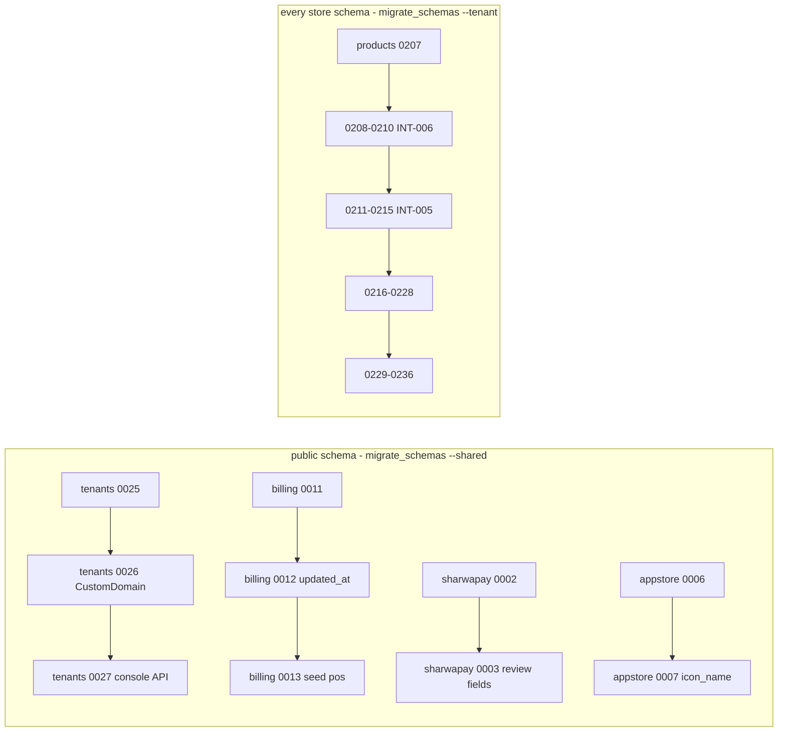
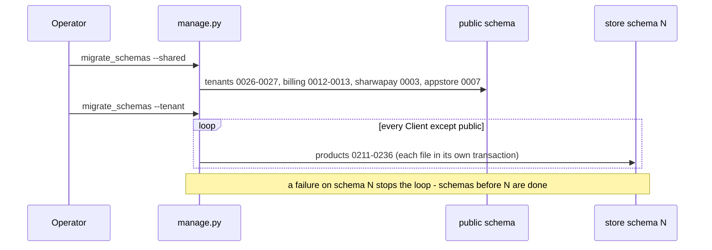

# Phase 002 migrations ledger

> **Source**: DOC-508 · inventory A.9 · INT-005, INT-009 → INT-010, INT-017 → INT-025, INT-028 → INT-033, INT-035, INT-037, INT-039, INT-040, INT-042, INT-043, INT-045 (and INT-006, see §3.2)
> **Code**: `sharwa_saas/products/migrations/0208…0236` · `sharwa_saas/tenants/migrations/0025…0027` · `sharwa_saas/billing/migrations/0011…0013` · `sharwa_saas/sharwapay/migrations/0002…0003` · `sharwa_saas/appstore/migrations/0006…0007` · `sharwa_saas/config/settings.py` (`SHARED_APPS`, `TENANT_APPS`)
> **Last verified against code**: 2026-10-28 (step 39)

> **Acceptance check NOT run.** DOC-508 says "the ledger matches `showmigrations` output on a fresh database". No database was available in step 39 and no command was executed. The ledger below was built by reading every migration file and by listing the migration directories on the development machine (`C:\sharwa_saas\…\migrations`). The comparison with a real `showmigrations` run is an open item (§9) with the commands to run in §3.4.

## 1. Purpose

One row per schema change made while integrating the 49 frontend modules (Phase 002): which app owns it, in which PostgreSQL schema it lands, what it changes, whether it moves data, whether Django can reverse it, and which migration it depends on. It does not describe the models (see [`../../architecture/data-model/README.md`](../../architecture/data-model/README.md)), the data fixes (see [`backfills.md`](backfills.md)) or the procedure to apply them (see [`../runbooks/migrations.md`](../runbooks/migrations.md)).

**Counting rule used on this page.** A "migration" is one `NNNN_*.py` file. Phase 002 = the 32 files whose INT task is in inventory A.9: `products/0211`–`0236` (26), `tenants/0026`–`0027` (2), `billing/0012`–`0013` (2), `sharwapay/0003` (1), `appstore/0007` (1). Three older files of INT-006 (`products/0208`–`0210`) are listed separately in §3.2 and are **not** in the 32.

> ⚠️ Discrepancy — roadmap says "Totals: 28 migrations" / code has **32 migration files** in the Phase 002 range (26 + 2 + 2 + 1 + 1). 28 is the number of **rows** of inventory A.9 (`products/0211`–`0215` is written as one row; counted: 1 + 8 products rows `0216`–`0223` + `tenants/0026` + `0224`–`0228` (5) + `tenants/0027` + `billing/0012` + `sharwapay/0003` + `appstore/0007` + `0229` + `billing/0013` + `0230`–`0236` (7) = 28). With INT-006's three files the directories hold 35 files in the range `products/0208`+. Reported in step 39 (first reported in official Step 06).

## 2. Components

### 2.1 Where each app migrates

django-tenants 3.14.0 (`requirements.txt:5`) decides per schema with `TenantSyncRouter` (`config/settings.py:117-119`): in the `public` schema only `SHARED_APPS` are migrated, in every store schema only `TENANT_APPS`.

| App | List | `config/settings.py` | Schema | Migrated by |
|---|---|---|---|---|
| `tenants` | `SHARED_APPS` | `:123` | `public` | `migrate_schemas --shared` |
| `billing` | `SHARED_APPS` | `:132` (`billing.apps.BillingConfig`) | `public` | `migrate_schemas --shared` |
| `sharwapay` | `SHARED_APPS` | `:133` (`sharwapay.apps.SharwaPayConfig`) | `public` | `migrate_schemas --shared` |
| `appstore` | `SHARED_APPS` | `:134` (`appstore.apps.AppStoreConfig`) | `public` | `migrate_schemas --shared` |
| `products` | `TENANT_APPS` only | `:157` | every store schema (`Client.schema_name`, e.g. `noor`) | `migrate_schemas --tenant` |
| `api` | `TENANT_APPS` | `:160` | none (no models, no migrations) | — |

Also shared and unchanged in Phase 002: `core` (`:126`), `marketing` (`:135`), `sharwa_ship` (`:138`) — their directories hold only their old migrations (`core` 0001, `marketing` 0001, `sharwa_ship` 0001–0003). `django.contrib.auth`, `contenttypes`, `sessions`, `messages` are in both lists (`:140-143`, `:153-156`) and migrate in every schema.

Consequence: a `products` migration runs once per store; a `tenants`, `billing`, `sharwapay` or `appstore` migration runs once. Counting store schemas, 26 of the 32 files run N times (N = number of stores) and 6 run once.

### 2.2 Shape of the chain



Each app has one linear chain: every `dependencies` entry in the 32 files (and in 0208–0210) names the **previous file of the same app**. There is no cross-app dependency, no `run_before`, no `atomic = False`, and no squashed migration in the range. So the apps can be applied in any order; `--shared` first is a rule of the procedure, not of the dependency graph (see the runbook).

## 3. Data model — the ledger

Columns: **Reverse** codes — `R1` Django can reverse it automatically and the reverse drops what was added (data in the dropped columns/tables is lost); `R2` reversible, but the data step has `RunPython.noop` as reverse (values written by the backfill are not undone); `R3` reversible, the reverse deletes the seeded rows; `R4` reversible only while no row holds `NULL` in a column the migration made nullable. **Data** = the migration contains a `RunPython` (yes), only seeds rows (seed) or none. **Depends on** = the previous migration of the same app (the only dependency in every row). Dates in file headers run 2026-10-22 → 2026-10-25 where a file has one.

### 3.1 Store-schema migrations (`products`, 26 files)

| Migration | INT | Operations | Data | Reverse | Depends on |
|---|---|---|---|---|---|
| `0211_product_updated_at` | 005 | `AddField Product.updated_at` (auto_now, indexed, default now, `preserve_default=False`) + `RunPython` `updated_at = created_at` | yes | R2 | `0210` |
| `0212_productchangelog_actor` | 005 | `AddField ProductChangeLog.actor` (char 150, default `''`) | no | R1 | `0211` |
| `0213_variantoption_color` | 005 | `AddField VariantOption.color` (char 7, default `''`, HEX validator) | no | R1 | `0212` |
| `0214_producttemplate_blueprint_fields` | 005 | `AddField ProductTemplate.blueprint_fields` (JSON, default `{}`) + `RunPython` builds the JSON from 33 legacy columns (columns are not dropped) | yes | R2 | `0213` |
| `0215_product_main_image_to_gallery` | 005 | `RunPython` only: `Product.image` → first `ProductImage` (`sort_order=0`), others shifted +1 | yes | R2 | `0214` |
| `0216_notifications` | 009 | `CreateModel Notification` (unique `dedupe_key`; index `notif_resolved_created_idx`; FKs `audience_role`, `audience_staff`), `CreateModel NotificationRead` (unique `notification_read_once_per_reader`) | no | R1 | `0215` |
| `0217_storesetting_fx_rate_precision` | 010 | `AlterField StoreSetting.sar_to_yer_old`, `sar_to_yer_new`, `usd_to_sar`: `decimal_places` 2 → **4** (`max_digits=12`; defaults 140.00 / 520.00 / 3.75 unchanged) | no | R1 (reverse rounds to 2 decimals) | `0216` |
| `0218_customer_crm` | 017 | `AddField ProductReview.customer_phone` (indexed); `CustomerReliabilityRecord.cod_status_reason`, `cod_status_updated_at` (null), `cod_status_updated_by`; `CreateModel CustomerNote` | no | R1 | `0217` |
| `0219_theme_version_section_label` | 018 | `AddField StoreSetting.theme_version` (default 1), `StoreSetting.theme_updated_at` (default now); `StoreSection.label` (char 80) | no | R1 | `0218` |
| `0220_marketing_api` | 019 | `AddField MarketingCampaign.sent_at` (null); `AlterField PromotionalOffer.buy_condition_type` (choices `all`, `category`, `product`, `min_items`; no SQL change) | no | R1 | `0219` |
| `0221_merchant_wallet_api` | 020 | `AddField MerchantWalletTransaction.kind` (default `adjustment`, indexed), `reference_kind`, `reference_id`; `MerchantWithdrawalRequest.payout_account` (FK `SET_NULL`), `idempotency_key` (unique, null) + `RunPython` classifies old rows from the description | yes | R2 | `0220` |
| `0222_shipping_api` | 021 | `AddField Order.delivery_latitude`, `delivery_longitude` (decimal 10,7 null), `zone_review_resolved_at`; `RestrictedZonePolygon.reason`; `AlterField DeliverySLARule.source_location` (→ null), `destination_zone_code` (→ blank, default `''`); `AddField DeliverySLARule.delivery_method` (FK `CASCADE`, null) | no | R1, R4 (`source_location`) | `0221` |
| `0223_staff_api` | 022 | `AddField StaffSession.device_label`; `PersonalAccessToken.name`, `last_used_at`; `TrustedDevice.staff` (FK `CASCADE`, null), `last_seen_at`; `AlterField RosterSchedule.location` (→ null); `AddField BehaviorAlert.value`, `limit` (null) | no | R1, R4 (`location`) | `0222` |
| `0224_webhooks` | 023 | `CreateModel WebhookEndpoint` (`secret` encrypted with `django_cryptography.fields.encrypt`), `CreateModel WebhookDelivery` (index `products_we_endpoin_8f2dba_idx`) | no | R1 | `0223` |
| `0225_inventory_api` | 024 | `AddField StockMovement.actor`, `quantity_after` (decimal 12,3 null), `reference_type`, `reference_id`; `InventoryItem.location`, `InventoryItem.order` (FKs `SET_NULL`); `ApprovalRequest.payload` (JSON); `AlterField ApprovalRequest.location` (→ null, `PROTECT`) | no | R1, R4 (`location`) | `0224` |
| `0226_locations_api` | 025 | `AddField Location.external_refs` (JSON list), `LockerDetails.provider_name`, `locker_code`, `VehicleDetails.driver_phone` | no | R1 | `0225` |
| `0227_wallets_api` | 028 | `AddField WalletTransaction.actor`, `idempotency_key` (unique, null); `CustomerPointsTransaction.wallet_transaction` (FK `SET_NULL`) | no | R1 | `0226` |
| `0228_engagement_api` | 029 | `AddField StoreReview.rating` (small int, null); `ProductReview.is_approved` (default **True**, indexed) | no | R1 | `0227` |
| `0229_pos_api` | 033 | `AlterField Shift.opened_by`, `ShiftCashMovement.created_by` (→ null); `AddField Shift.version`, `Shift.approval` (FK `SET_NULL`), `Shift.force_close_notice_seen`, `ShiftCashMovement.note`; `CreateModel PosReceipt`, `PosIdempotencyKey`; `AddField StoreSetting.pos_refund_otp_threshold` (default 200), `pos_manager_code_hash`; `RunPython` marks all shifts "notice seen" | yes | R2, R4 (two FKs) | `0228` |
| `0230_procurement_api` | 035 | `AlterField Supplier.phone` (blank, indexed); `AddField Supplier.address`, `tax_number`; `PurchaseOrder.notes`, `version`, `updated_at` (auto_now) + `RunPython` `updated_at = created_at` | yes | R2 | `0229` |
| `0231_inbox_api` | 037 | `AddField Conversation.source_platform`; `AlterField Message.status` (choices + `queued`; no SQL change); `AddField Message.error_detail`, `client_id` (unique, null), `product` (FK `SET_NULL`); `ChannelCatalogSync.last_run_at`; `CreateModel ChannelReplyTemplate` | no | R1 | `0230` |
| `0232_dropshipping_api` | 039 | `AddField SupplierConnection.catalog_sync_interval_min`, `price_sync_interval_min` (default 360 each), `last_price_sync_at`; `FeedMapping.schedule_interval_min` (null) | no | R1 | `0231` |
| `0233_app_store_api` | 040 | `AddField AppUsageLog.order` (FK `SET_NULL`) | no | R1 | `0232` |
| `0234_support_api` | 042 | `AddField SupportSession.version`; `SupportMessage.sender_name`, `client_id`; `AddConstraint support_message_client_id_once` (unique `session` + `client_id` where `client_id` is not null); `AlterField SupportTicket.customer_phone` (blank, default `''`); `AddField SupportTicket.description`, `updated_at` (auto_now), `created_by` | no | R1 | `0233` |
| `0235_seed_expenses_permission` | 043 | `RunPython` seed: `Permission expenses.manage` + `RolePermission` for «مدير المتجر» and «مدير الفرع» | seed | R3 | `0234` |
| `0236_advanced_products_api` | 045 | `AddField OrderItem.personalization` (JSON); `CreateModel ProductImportJob` | no | R1 | `0235` |

`0211`–`0215` are labelled "«هجرة» M1 … M5" in their headers (`0214` = decision D1, `0215` = decision D2). `0224_webhooks` has no INT tag (its header is Django's "Generated by Django 6.1 on 2026-10-24 21:34"); the INT-023 assignment comes from inventory A.9.

### 3.2 Public-schema migrations (6 files)

| Migration | INT | Operations | Data | Reverse | Depends on |
|---|---|---|---|---|---|
| `tenants/0026_customdomain` | 023 | `CreateModel CustomDomain` (unique `unique_custom_domain_per_client` on `client` + `domain`) | no | R1 | `tenants/0025` |
| `tenants/0027_platform_console_api` | 030 | `AddField PendingWebhookEvent.resolved_at`; `TenantDeactivationRecord.reinstated_at`, `actor`, `updated_at` (auto_now); `RunPython` `updated_at = created_at`; `CreateModel PlatformActionLog` | yes | R2 | `tenants/0026` |
| `billing/0012_tenantfeatureoverride_updated_at` | 030 | `AddField TenantFeatureOverride.updated_at` (auto_now) + `RunPython` `updated_at = created_at` | yes | R2 | `billing/0011` |
| `billing/0013_seed_pos_feature` | 033 | `RunPython` seed: `Feature(code='pos', requires_plan=True, is_active_globally=True)` | seed | R3 | `billing/0012` |
| `sharwapay/0003_console_review_fields` | 031 | `AddField SharwaPayTopupRequest.bank_name`, `claimed_phone`, `reviewed_by`; `SharwaPayWithdrawalRequest.reviewed_by` + `RunPython` (bank name and claimed phone only) | yes | R2 | `sharwapay/0002` |
| `appstore/0007_app_icon_name` | 032 | `AddField App.icon_name` (char 40) | no | R1 | `appstore/0006` |

`tenants/0025_client_provisioning_status` (provisioning fields, default `ready` so existing stores stay usable, no data step) pre-dates Phase 002 and is not in the 32; `0027` depends on `0026`, which depends on it.

### 3.3 Older INT-006 migrations (not in A.9, not in the 32)

| Migration | INT | Operations | Data | Reverse | Depends on |
|---|---|---|---|---|---|
| `products/0208_catalog_org_contract` | 006 | `Category.sort_order` + index `products_cat_parent_sort_idx`; `Category.parent` `CASCADE` → `RESTRICT` (Python-level, no SQL change); `Tag.last_used_at`; `Collection.product_order` (JSON); `AlterModelOptions` (ordering) | no (schema only, on purpose) | R1 | `0207` |
| `products/0209_backfill_catalog_org` | 006 | `RunPython`: `sort_order` 0, 1, 2… per sibling group ordered by name then id; `Tag.last_used_at = now` for tags that have products | yes | R2 | `0208` |
| `products/0210_seed_catalog_manage_permission` | 006 | `RunPython` seed `catalog.manage` + roles «مدير المتجر», «مدير الفرع» | seed | R3 | `0209` |

> ⚠️ Discrepancy — roadmap (and inventory A.9) say INT-006 has **no migration** / code has three: `products/0208_catalog_org_contract.py`, `0209_backfill_catalog_org.py`, `0210_seed_catalog_manage_permission.py` (`0211` depends on `0210`: `0211_product_updated_at.py:18`). They are applied in the same `--tenant` run as the rest. Reported in step 39 (first reported in official Step 06).

### 3.4 Totals recomputed from the files

| Measure | Count | Notes |
|---|---|---|
| Files, Phase 002 range | **32** | `products` 26 · `tenants` 2 · `billing` 2 · `sharwapay` 1 · `appstore` 1 |
| of which run in `public` / in every store schema | 6 / 26 | §2.1 |
| Files with a `RunPython` | 11 | data backfills 9 (`0211`, `0214`, `0215`, `0221`, `0229`, `0230`, `tenants/0027`, `billing/0012`, `sharwapay/0003`), seeds 2 (`0235`, `billing/0013`) |
| New tables | 11 | store: `Notification`, `NotificationRead`, `CustomerNote`, `WebhookEndpoint`, `WebhookDelivery`, `PosReceipt`, `PosIdempotencyKey`, `ChannelReplyTemplate`, `ProductImportJob` (9); public: `CustomDomain`, `PlatformActionLog` (2) |
| Operations | 119 | `AddField` 83 · `AlterField` 13 · `CreateModel` 11 · `RunPython` 11 · `AddConstraint` 1 (counted from the files with `ast`; `0211`'s `AddField` etc. included) |
| Files without any data step | 21 | 19 in `products` (`0212`, `0213`, `0216`–`0220`, `0222`–`0228`, `0231`–`0234`, `0236`), `tenants/0026`, `appstore/0007` |
| Files whose reverse can fail on `NULL` rows (R4) | 4 | `0222`, `0223`, `0225`, `0229` |

Latest migration per app after Phase 002 (from the directory listing): `products/0236_advanced_products_api`, `tenants/0027_platform_console_api`, `billing/0013_seed_pos_feature`, `sharwapay/0003_console_review_fields`, `appstore/0007_app_icon_name`. `makemigrations --check --dry-run` (run by CI, see [`../testing/ci.md`](../testing/ci.md)) was **not** run here, so model/migration drift is not excluded.

**How to verify on a fresh database (not run in step 39).** Create an empty PostgreSQL database, then:

```bash
python manage.py migrate_schemas --shared
python manage.py showmigrations tenants billing sharwapay appstore
python manage.py tenant_command showmigrations products --schema=<SCHEMA>
```

```bat
python manage.py migrate_schemas --shared
python manage.py showmigrations tenants billing sharwapay appstore
python manage.py tenant_command showmigrations products --schema=<SCHEMA>
```

(unverified: `<SCHEMA>` needs a store created first, e.g. through registration or `Client.create_schema`; plain `showmigrations` reads the `public` schema's `django_migrations` only, where `products` is not applied by design.) Every line must show `[X]`; the last lines must be the five names above.

### 3.5 INT tasks without a migration — recomputed

An INT task is counted "with a migration" when a file in §3.1–§3.3 names it in its header or inventory A.9 assigns it. That gives 26 tasks (the 25 tasks of A.9 plus INT-006): INT-005, 006, 009, 010, 017, 018, 019, 020, 021, 022, 023, 024, 025, 028, 029, 030, 031, 032, 033, 035, 037, 039, 040, 042, 043, 045. The remaining **23** tasks have no migration in any app directory:

INT-001, 002, 003, 004, 007, 008, 011, 012, 013, 014, 015, 016, 026, 027, 034, 036, 038, 041, 044, 046, 047, 048, 049.

This equals the roadmap's list ("INT-001 → INT-004, INT-006 → INT-008, INT-011 → INT-016, INT-026, INT-027, INT-034, INT-036, INT-038, INT-041, INT-044, INT-046 → INT-049") **minus INT-006**. The claim "INT-048 changed `apply_credit_if_approved` logic only" was not checked against the task text in this step. Evidence for the list: the complete `migrations/` listings of `products`, `tenants`, `billing`, `sharwapay`, `appstore`, `core`, `marketing` and `sharwa_ship` show each chain ending at the file named in §3.4, and the three apps not in §3 (`core`, `marketing`, `sharwa_ship`) hold only their old files. Not proven: that no model change was left without a migration (needs `makemigrations --check`).

## 4. Flows

What an operator sees when the ledger is applied (details and failure handling in [`../runbooks/migrations.md`](../runbooks/migrations.md)):



## 5. Invariants

- **One linear chain per app, own-app dependencies only** (checked in all 32 files and in `0208`–`0210`).
- **All migrations are transactional**: none sets `atomic = False`, so on PostgreSQL a file that fails on a schema rolls back as a whole on that schema, and the migrations before it stay applied.
- **Seeds are idempotent**: `0210`, `0235`, `billing/0013` use `get_or_create`; re-running them changes nothing. The two permission seeds skip a role that does not exist («مدير المتجر», «مدير الفرع» with `is_system_role=True`) without error — the permission is then created but not linked.
- **Data steps are re-runnable where it matters**: `0215` skips a product whose image is already in the gallery; `0214` skips a template whose `blueprint_fields` is already non-empty; the `updated_at = created_at` fixes and `0229` are plain `UPDATE`s.
- **New stores get everything**: a store created after the deploy runs the whole `products` chain on its fresh schema (`tenants/provisioning.py:184-193` — `migrate_schemas --tenant --schema` when the schema exists, `create_schema` otherwise).
- **Reverse is formal, not tested**: every file has a reverse (none is irreversible), but no reverse was run, and the `R4` reverses fail on rows that use the new `NULL`.

## 6. Background work

None. Migrations are run by the operator or by the release step (`deploy/deploy.sh:40-42`, compose `release` service `deploy/docker-compose.prod.yml:44-52`). Celery only matters indirectly: `tenants.tasks.provision_tenant_schema` migrates a brand-new schema ([`../../architecture/11-provisioning.md`](../../architecture/11-provisioning.md)).

## 7. Configuration

| Item | Value | Where |
|---|---|---|
| django-tenants | `3.14.0` | `requirements.txt:5` |
| Django | `6.1` | `requirements.txt:4` |
| Database engine | `django_tenants.postgresql_backend` | `config/settings.py:107` |
| Router | `django_tenants.routers.TenantSyncRouter` | `config/settings.py:117-119` |
| Tenant / domain model | `tenants.Client` / `tenants.Domain` | `config/settings.py:209-210` |
| Executor, `TENANT_MIGRATION_ORDER`, `TENANT_MULTIPROCESSING_*`, `TENANT_SUBPROCESS_PARALLEL` | **not set** anywhere in `config/settings.py` or the deploy files, so django-tenants defaults apply (executor `standard`, order unspecified) | `grep` over `*.py`, `*.sh`, `*.yml`, `*.bat` |
| `ATOMIC_REQUESTS` | not set | `config/settings.py:106-115` |

## 8. Failure modes and fixes

| Failure | Symptom | Cause | Handling / fix |
|---|---|---|---|
| Old code writes to a table whose migration already ran | `IntegrityError: null value in column …` on inserts such as a new `Product`, `MerchantWalletTransaction` or `PurchaseOrder` between `migrate_schemas --tenant` and the Gunicorn/worker reload | Django adds `NOT NULL` columns with the Python default and then drops the database default, so an old model that does not know the column omits it. Applies to `0211` (`updated_at`), `0221` (`kind`), `0229` (`version`), `0230` (`updated_at`, `version`), `0234` (`updated_at`, `version`) and every other `NOT NULL` column added with a default in §3.1 | Keep the window short: `deploy.sh` migrates first and reloads at `:55-58`. Not reproduced in step 39 — this follows from Django's `AddField` behaviour and the script order |
| Release script stops after a failed schema | tables migrated for some stores only; Gunicorn and Celery still run the old process image | `set -euo pipefail` (`deploy.sh:15`) stops at the failing `migrate_schemas --tenant` (`:42`), before `:55-58` | Runbook §Troubleshooting: fix, resume, then reload by hand |
| Reverse blocked | `IntegrityError` / "contains null values" when un-applying `0222`, `0223`, `0225` or `0229` | the migration made a column nullable and rows now use `NULL` | Fill or delete the `NULL` rows first, or restore from backup |
| `0221` classified a transaction wrongly | statement shows `adjustment` for a withdrawal, etc. | description matched in a fixed order (see [`backfills.md`](backfills.md#0221)) | Correct the row; the migration is not re-run |
| Seed granted nobody | `catalog.manage` / `expenses.manage` exists but «مدير المتجر» cannot use it | the store had renamed or deleted the system role before `0210`/`0235` ran | Grant the key from the roles screen (runtime reads the key only) |
| `showmigrations` shows `products` unapplied | `[ ]` for every `products` file | run against `public` | Use `tenant_command … --schema=<SCHEMA>` (§3.4) |

## 9. Open items

1. **Not run**: ledger vs `showmigrations` on a fresh database, and `makemigrations --check --dry-run` (DOC-508 Done-when).
2. Ledger count: roadmap "28" (rows) vs 32 files vs 35 with INT-006 — decision for fares whether the roadmap text should be restated.
3. INT-006 migrations are missing from inventory A.9 and the roadmap list.
4. Roadmap/A.9 attribute data steps to `0223`, `0225` and `0230` (and `reviewed_by` to `sharwapay/0003`) that the files do not contain — see [`backfills.md`](backfills.md).
5. `0224_webhooks` carries no INT tag in its file header.
6. Timings per migration on a production-size database: not measured.

## 10. Related pages

- [`backfills.md`](backfills.md) — source rule and verification query for every data step.
- [`../runbooks/migrations.md`](../runbooks/migrations.md) — how to apply this ledger across tenant schemas.
- [`README.md`](README.md) — migrations folder index.
- [`../../architecture/10-multi-tenancy.md`](../../architecture/10-multi-tenancy.md) · [`../../architecture/11-provisioning.md`](../../architecture/11-provisioning.md) · [`../../architecture/13-cross-schema-access.md`](../../architecture/13-cross-schema-access.md)
- [`../../architecture/data-model/README.md`](../../architecture/data-model/README.md) — models per domain.
- [`../management-commands.md`](../management-commands.md) — release pipeline and custom commands.
