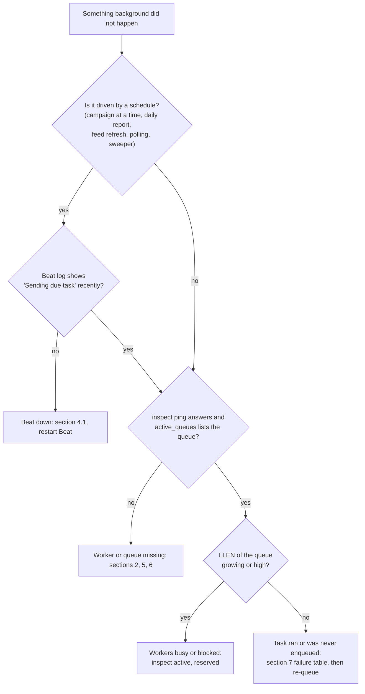

# Runbook — operating Celery workers and Beat

> **Source**: DOC-507 · inventory A.8, A.10
> **Owner**: fares · **Last dry run**: not dry-run in this step (written from the code and deploy files only; the dry-run pass is DOC-532). Commands marked *(not verified)* depend on tooling that is not in the repository.

## When to use

Use this page when something that should happen in the background has not happened:

* a scheduled campaign was not sent, low-stock webhooks stopped, supplier feeds or marketplace orders are stale, a new store stays `pending`;
* order push, WhatsApp, channel replies, webhook deliveries, report exports or AWB retries are stuck;
* a deploy changed queues or the Beat schedule, or a worker/Beat process was restarted;
* a failed item has to be re-queued (console DLQ, AWB queue, webhook redeliver, job retry).

The job list behind every symptom is the register in [Background jobs — Celery architecture and job register](../../architecture/50-background-jobs.md).

## Impact and risk

| Action | Who notices | Reversible | Duration |
|---|---|---|---|
| Reading status, queue lengths, logs | nobody | yes | seconds |
| Restart the worker | tasks in flight finish first (warm shutdown up to 10 min), then re-start; killed tasks are re-delivered (`acks_late`) | yes | up to 10 min stop time |
| Restart Beat | nothing visible; ticks that fall inside the restart gap are **not** replayed | yes | seconds |
| Re-queue from the console | the single event or item, plus its side effects (shipment status change, AWB issue, webhook call to a merchant endpoint) | no for side effects already sent | immediate |
| `celery purge` / deleting a Redis queue | every queued task in it is lost | **no** | seconds — do not use unless engineering confirms *(not verified)* |

## Prerequisites

* Shell access to the host (Linux: `sudo` for `systemctl`/`journalctl`; Docker host: access to `docker compose`).
* The repository root: `/srv/sharwa` in the systemd units, `/app` inside the containers.
* A **superuser** console session for the DLQ (`platform/webhook-events/...`); `OPERATOR_WRITES` in `tenants/console_service.py:77` allows staff operators to write only the `dues` and `sharwa_pay` areas, so everything below is superuser-only.
* A **store owner** session for the merchant-side routes (AWB retry and webhook redeliver are owner-only).
* Values to have ready: `<SCHEMA>` (the store's schema name, e.g. `noor`), `<QUEUE>`, `<CARRIER_CODE>`, `<ID>`.
* Do not paste `.env` contents, broker URLs or tokens into tickets. The commands below use `$CELERY_BROKER_URL` so the secret stays in the environment.

## Steps

### 0. Triage in one picture



### 1. Know what must be running

| Process | Count | Linux unit | Docker service | Needs |
|---|---|---|---|---|
| Worker | 1 or more | `celery-sharwa.service` | `worker` | Redis, PostgreSQL, `/srv/sharwa/.env`, `deploy/celery.env` |
| Beat | **exactly 1 cluster-wide** | `celery-sharwa-beat.service` | `beat` | Redis, `/srv/sharwa/.env` |
| Broker | 1 | `redis-server` | `redis` (`redis:7-alpine --appendonly yes --maxmemory-policy noeviction`) | disk for AOF |
| Web (the producer) | 1 or more | `gunicorn` | `web` | same broker URL as the worker |

* The broker is Redis **database 1** (`CELERY_BROKER_URL`, default `redis://localhost:6379/1`; compose sets `redis://redis:6379/1`). The Django cache is database 0.
* There is **no result backend**: `CELERY_TASK_IGNORE_RESULT = True` and no `CELERY_RESULT_BACKEND` exist (`config/settings.py:563`). Task outcomes are database rows, never Celery results.

> ⚠️ Discrepancy — roadmap says the runbook documents the "broker/result backend" / code does: only a broker is configured; results are ignored (`config/settings.py:562-563`). Reported in step 38.

**Queues every worker must consume.** The list lives in one place, `deploy/celery.env` line 16:

```
CELERY_QUEUES=default,whatsapp,support,channels_meta,channels_tiktok,channels_telegram,channels_broadcast,marketplaces_amazon,marketplaces_noon,suppliers_sync,suppliers_orders
```

Verified in this step:

| Check | Result |
|---|---|
| `deploy/systemd/celery-sharwa.service` | `ExecStart=... celery -A config worker -Q ${CELERY_QUEUES} -c ${CELERY_WORKER_CONCURRENCY} --max-tasks-per-child ${CELERY_MAX_TASKS_PER_CHILD} -O fair -l ${CELERY_LOG_LEVEL} -n worker@%%H`; `EnvironmentFile=/srv/sharwa/.env` and `/srv/sharwa/deploy/celery.env` |
| `deploy/docker-compose.prod.yml`, service `worker` | same command with `-Q "$$CELERY_QUEUES"`, `env_file: ../.env` and `./celery.env` |
| `deploy/check_celery_queues.py` | static scan of `queue=` keyword arguments, dict `'queue'` keys and `*QUEUE_MAP` / `*_QUEUES` dicts; exit 1 if a used queue is missing from `celery.env`, if a queue appears twice, or if the systemd unit or compose file does not read `CELERY_QUEUES`. An unused declared queue only prints a note |
| Queues used by code | `default`, `whatsapp`, `channels_meta`, `channels_tiktok`, `channels_telegram`, `channels_broadcast`, `marketplaces_amazon`, `marketplaces_noon`, `suppliers_sync`, `suppliers_orders` |
| Declared but unused | `support` (kept on purpose for the support-bot project, `celery.env` lines 14-15) |

A queue that no worker consumes is **not an error anywhere**: Redis accepts the tasks and they never run. That is why the guard exists. Run it before changing queues:

```bash
cd /srv/sharwa
python deploy/check_celery_queues.py
```

Expected output: exit code 0 (and a note for `support`). `deploy/deploy.sh` runs it as pre-flight (line 36) before migrations.

What each queue carries (details in the register, §6.3):

| Queue | Jobs |
|---|---|
| `default` | all Beat dispatchers and per-tenant children, provisioning, order push, outgoing webhooks, carrier webhooks, `dispatch_order_event`, `dispatch_platform_event`, support, reports, inbound channel messages, channel health, catalog sync |
| `whatsapp` | WhatsApp-channel `dispatch_channel_message` (inbox replies, campaigns, cart reminders); `dispatch_whatsapp_message` is routed here too but has no production producer today |
| `channels_meta`, `channels_tiktok`, `channels_telegram` | `dispatch_channel_message` per channel |
| `channels_broadcast` | `dispatch_broadcast_campaign_chunk` (campaign chunks, deliberately low priority) |
| `marketplaces_amazon`, `marketplaces_noon` | listing push, bulk push, feed polling, order pull, shipment confirmation, FBA refresh |
| `suppliers_sync` | supplier catalog, import, reprice, inventory, feeds, image download |
| `suppliers_orders` | supplier webhooks and the four supplier-order tasks |

### 2. Check that the processes are alive

Linux (systemd):

```bash
sudo systemctl status celery-sharwa celery-sharwa-beat redis-server --no-pager
sudo journalctl -u celery-sharwa -n 100 --no-pager
sudo journalctl -u celery-sharwa-beat -n 100 --no-pager
```

Docker:

```bash
docker compose -f deploy/docker-compose.prod.yml ps
docker compose -f deploy/docker-compose.prod.yml logs --tail=100 worker
docker compose -f deploy/docker-compose.prod.yml logs --tail=100 beat
```

Windows (developer machine): the repository ships no Windows service. `sharwa.bat` only activates `venv` and runs `python manage.py runserver`; it starts **no worker and no Beat**. Run them by hand in two more terminals *(not verified)*:

```bat
:: terminal 2 - worker. Celery 5 has no official Windows support: use the solo pool
cd C:\sharwa_saas
call venv\Scripts\activate
celery -A config worker -l info -P solo -Q default,whatsapp,support,channels_meta,channels_tiktok,channels_telegram,channels_broadcast,marketplaces_amazon,marketplaces_noon,suppliers_sync,suppliers_orders

:: terminal 3 - beat (one only)
cd C:\sharwa_saas
call venv\Scripts\activate
celery -A config beat -l info --schedule %TEMP%\celerybeat-schedule
```

Without these two processes on a developer machine, `.delay()` calls just sit in Redis (or fail if Redis is down) and no scheduled job ever fires. Tests do not need them: with `DJANGO_TESTING=1` tasks run eagerly and in-process.

Does the worker answer? (Linux; the settings module loads `.env` itself via `load_dotenv()`, `config/settings.py:1-2`, so run from the repository root.)

```bash
cd /srv/sharwa
sudo -u sharwa ./venv/bin/celery -A config inspect ping
sudo -u sharwa ./venv/bin/celery -A config inspect active_queues
```

```bash
docker compose -f deploy/docker-compose.prod.yml exec worker celery -A config inspect ping
```

Expected: one `pong` per worker node and, in `active_queues`, **all eleven** queue names listed for every worker. A worker that lists fewer queues than `celery.env` is the cause of "only this family is stuck" symptoms.

### 3. Look at the queues

Queue length is the number of messages waiting in the Redis list named after the queue (Celery's Redis transport) *(not verified here; standard behaviour)*.

```bash
# Linux or any host with redis-cli; $CELERY_BROKER_URL already selects database 1
for q in default whatsapp support channels_meta channels_tiktok channels_telegram channels_broadcast marketplaces_amazon marketplaces_noon suppliers_sync suppliers_orders; do
  printf '%-22s ' "$q"; redis-cli -u "$CELERY_BROKER_URL" LLEN "$q"
done
```

```bash
docker compose -f deploy/docker-compose.prod.yml exec redis sh -c 'for q in default whatsapp support channels_meta channels_tiktok channels_telegram channels_broadcast marketplaces_amazon marketplaces_noon suppliers_sync suppliers_orders; do printf "%s " $q; redis-cli -n 1 LLEN $q; done'
```

How to read it:

| Observation | Meaning |
|---|---|
| a queue length keeps growing and `inspect active_queues` does not list it | **no consumer** for that queue: fix the worker command / `celery.env`, restart the worker |
| `default` grows right after :00, :15, :30 | normal burst: nine Beat dispatchers share the :00 tick and each sends one message per store; it should drain in minutes |
| `default` grows and stays high, workers listed | workers are busy or blocked: `inspect active` and `inspect reserved` show what runs; with prefetch 1 and `-c 4`, four slow tasks block four slots |
| `LLEN` is 0 but the symptom persists | nothing was enqueued: Beat is down (symptom tables below), the enqueue failed (broker was down; style A enqueues swallow the error), or the task already ran and failed (see §7) |

```bash
cd /srv/sharwa
sudo -u sharwa ./venv/bin/celery -A config inspect active      # running now
sudo -u sharwa ./venv/bin/celery -A config inspect reserved    # prefetched, not started
sudo -u sharwa ./venv/bin/celery -A config inspect scheduled   # countdown / eta tasks (self-chaining jobs, retries)
sudo -u sharwa ./venv/bin/celery -A config inspect registered  # expect 110 task names, products.tasks.* and tenants.tasks.*
```

### 4. Beat — check the schedule and detect Beat down

Beat reads `CELERY_BEAT_SCHEDULE` **once, at start-up** (`config/settings.py:622`). Changing the schedule needs a deploy **and a Beat restart** (`deploy.sh` does both). There is no database scheduler (`django_celery_beat` is not installed), so there is nothing to edit at runtime.

Print the schedule Beat will use (run in the same environment as Beat):

```bash
cd /srv/sharwa
./venv/bin/python manage.py shell -c "from django.conf import settings as s; [print(k, '->', v['task'], v['schedule']) for k, v in s.CELERY_BEAT_SCHEDULE.items()]"
```

```bat
cd C:\sharwa_saas
call venv\Scripts\activate
python manage.py shell -c "from django.conf import settings as s; [print(k, '->', v['task'], v['schedule']) for k, v in s.CELERY_BEAT_SCHEDULE.items()]"
```

Expected: **26** lines. Entries the roadmap names, with their real names and times (UTC; no `CELERY_TIMEZONE` is set, see the Troubleshooting note):

| Roadmap name | Entry name in `CELERY_BEAT_SCHEDULE` | Task | Crontab |
|---|---|---|---|
| `dispatch_scheduled_campaigns` (5 min / tenant) | `dispatch-scheduled-campaigns` | `products.tasks.dispatch_scheduled_campaigns` | `*/5` |
| `dispatch-low-stock-webhooks` (15 min) | `dispatch-low-stock-webhooks` | `products.tasks.dispatch_low_stock_webhooks` | `*/15` |
| dropshipping hourly beat | `schedule-supplier-catalog-refresh` | `products.tasks.schedule_supplier_catalog_refresh` | hourly at :23 |
| `fetch_scheduled_feeds_for_tenant` | `fetch-scheduled-feeds` (dispatcher) | `products.tasks.fetch_scheduled_feeds` -> `..._for_tenant` | hourly at :37 |
| provisioning sweeper | `retry-stalled-tenant-provisioning` | `tenants.tasks.retry_stalled_tenant_provisioning` | `2-59/5` (:02, :07, ... :57) |
| supplier inventory / webhook re-queue | `schedule-supplier-inventory-sync` | `products.tasks.schedule_supplier_inventory_sync` | `3-59/5` |
| marketplace orders | `poll-marketplace-orders` | `products.tasks.poll_marketplace_orders` | `1-59/5` |
| AWB retry | `retry-pending-awb-issuance` | `products.tasks.retry_pending_awb_issuance` | `*/15` |

The full 26-row table is in [the register, §6.2](../../architecture/50-background-jobs.md#62-beat-schedule-26-entries-all-utc).

Is Beat actually firing? Beat logs `Scheduler: Sending due task <entry-name> (<task>)` at INFO for every tick (standard Celery log line; Beat runs with `-l info` in both unit and compose) *(not verified here)*:

```bash
sudo journalctl -u celery-sharwa-beat --since "30 minutes ago" --no-pager | grep -c "Sending due task"
# docker:
docker compose -f deploy/docker-compose.prod.yml logs --since 30m beat | grep -c "Sending due task"
```

A healthy Beat prints several lines per hour (at least the `*/5`, `2-59/5`, `1-59/5`, `3-59/5` entries, i.e. dozens in 30 minutes). Zero means Beat is down or stuck. If the count is healthy but the symptom persists, Beat is fine and the worker side is the problem (§5).

Beat state file (persists the last run times): `/var/lib/sharwa-beat/celerybeat-schedule` (systemd `StateDirectory=sharwa-beat`) or the `beat` volume at `/app/celerybeat/celerybeat-schedule` (compose). Only delete it if Beat refuses to start with a corrupt-file error, and only with Beat stopped.

**Two Beats are as bad as none**: every periodic task fires twice. Check for a stray manual process before enabling the unit:

```bash
ps aux | grep "[c]elery.* beat"     # expect exactly one line
```

```bat
tasklist /v | findstr /i celery
```

#### 4.1 Symptoms when Beat is down

Nothing event-driven stops when Beat stops (order push, first webhook attempts, WhatsApp and channel replies, carrier webhooks, bulk pushes, report exports requested by hand). Only entries from the Beat schedule go silent, and **missed ticks are not replayed** after Beat returns.

| What the operator sees | Beat entry (register §6.2 row) | How to confirm | Fix |
|---|---|---|---|
| A campaign stays `scheduled` after its `scheduled_at` | `dispatch-scheduled-campaigns` (#5) | campaigns list: status not `sent`; no `Sending due task` line | restart Beat; the next tick (within 5 min) sends it, `dispatch_due_campaigns` takes everything with `scheduled_at <= now` |
| No `inventory.low_stock` webhook deliveries | `dispatch-low-stock-webhooks` (#6) | endpoint deliveries list empty for the event | restart Beat |
| Supplier feeds not refreshed, catalog and prices stale, inventory not synced, supplier orders not polled | #17, #18, #19, #20 | job lists `dropshipping/jobs/` show no new `triggered_by` scheduler jobs | restart Beat; for an urgent store use `dropshipping/suppliers/<code>/sync-inventory/` or the job retry (§7) |
| Marketplace orders not arriving, FBA stock stale, connection health frozen | #13, #14, #15 | `marketplaces/jobs/` has no `beat` jobs | restart Beat; or start a pull by hand with `POST marketplaces/<market>/jobs/` (§7) |
| Channel/supplier/marketplace health badges stale | #12, #13, #16 | `connection_health` not updating | restart Beat |
| New store stuck `pending`/`provisioning` after a broker blip | `retry-stalled-tenant-provisioning` (#1) | console overview `stalled_stores` > 0 (pending older than 5 min or provisioning older than 20 min) | restart Beat (sweeper re-queues within 5 min) or console re-provision (§7) |
| AWB rows stay `pending`; shipments stay `label_pending` | #10, #11 | AWB queue lists pending rows; the retry-awb button still works because it kicks the task directly | restart Beat |
| Shifts stay open past 12 h; app subscriptions stay active after expiry; approvals not escalated; carts not expired | #3, #2, #4, #7 | see the register | restart Beat; the next tick catches up (they filter on age, not on tick time) |
| Yesterday's `DailyStoreMetrics`/snapshot missing, old report exports not cleaned, scheduled report e-mails not sent, supplier webhook payloads not purged | #23, #24, #25, #26, #21 | no rows for yesterday | after restarting Beat run the daily job once by hand (§7.5): daily entries fire only once a day and are not replayed |

### 5. Symptoms when workers are down

If the worker is stopped, all queues fill up. If one queue has no consumer, only its family stops. Start with `inspect active_queues` and the `LLEN` loop from §3.

| What the operator sees | Queue / job | How to confirm | Fix |
|---|---|---|---|
| Order push notifications not delivered | `default` / `send_order_push` | `LLEN default` grows | start/restart the worker |
| Outgoing webhooks not attempted for any merchant | `default` / `deliver_webhook` | deliveries list shows no new attempts | worker; failed ones can be redelivered afterwards |
| WhatsApp channel messages (inbox replies, campaigns, abandoned-cart reminders) not sent | `whatsapp` / `dispatch_channel_message` | `LLEN whatsapp`; `AppUsageLog` rows stay `queued` | worker consuming `whatsapp` |
| Order status events to SharwaConnect not sent | `default` / `dispatch_order_event` | `LLEN default`; usage log rows stay `queued` | start/restart the worker; failures after 5 retries are marked `failed` on the usage log |
| Inbox replies or campaign messages stay `queued` | `channels_meta` / `channels_tiktok` / `channels_telegram` / `whatsapp` by channel; `Message.status='queued'` | `LLEN` of that channel's queue is high -> no consumer. `LLEN` is 0 and the matching `AppUsageLog` row is `failed` -> the task gave up (retries exhausted, permanent provider error) and left the `Message` row `queued` | worker consuming that queue (check `celery.env` and `active_queues`); for the second case the cause is in the worker log, see [channels page §9](../../architecture/jobs/channels.md) |
| Campaign status `sent` but recipients stay `pending` | `channels_broadcast` | `LLEN channels_broadcast` | worker consuming it; chunks are idempotent (only `pending` recipients are sent) |
| Inbound customer messages do not appear in the inbox | `default` / `process_inbound_channel_message` | `LLEN default` | worker |
| Carrier webhooks answer 202 but shipments do not move | `default` / `process_carrier_webhook_event` | `LLEN default` | worker; events that failed for good are in the console DLQ (§7.1) |
| Store signs up but never becomes ready (`pending`) | `default` / `provision_tenant_schema` | `LLEN default`; store status in console | worker; the sweeper re-queues only after Beat and worker are both up |
| AWB retries not processed; Sharwa Ship activate/deactivate "in flight" for 10 minutes | `default` | the console marker `platform:sharwa-ship-job:<SCHEMA>` expires after 10 min | worker |
| Report export stays `queued` | `default` / `run_report_export` | export job status | worker |
| Marketplace push/pull jobs stay `queued` | `marketplaces_amazon` / `marketplaces_noon` | `LLEN` of the market queue | worker consuming it |
| Supplier import/catalog/inventory jobs stuck; supplier orders not forwarded | `suppliers_sync` / `suppliers_orders` | `LLEN` | worker consuming it |
| Support messages from customers not stored; staff replies not delivered | `default` (the `support` queue is unused) | `LLEN default` | worker |
| Some tasks run, but the same family keeps failing | worker is up | worker log shows the exception | §7 |

Worker up but queue draining very slowly: concurrency is 4 per worker (`CELERY_WORKER_CONCURRENCY`), children are recycled after 200 tasks, every per-tenant task has a hard limit of 360 s and dispatchers 180 s. A burst after a Beat restart is normal. Add capacity by running a second worker with the same command (compose: `up -d --scale worker=2`); never scale Beat.

### 6. Safe restarts

Rules: restart the worker with a **warm** shutdown (SIGTERM; the unit allows 600 s, compose allows 10 minutes), restart Beat after every deploy, never run two Beats, change queues only through `deploy/celery.env`.

Linux:

```bash
sudo systemctl restart celery-sharwa          # warm stop (up to 600 s), then start
sudo systemctl restart celery-sharwa-beat     # single instance, schedule re-read
sudo systemctl status celery-sharwa celery-sharwa-beat --no-pager
```

Docker:

```bash
docker compose -f deploy/docker-compose.prod.yml up -d --no-deps worker     # recreate the worker, 10 min grace
docker compose -f deploy/docker-compose.prod.yml restart beat               # never --scale beat
docker compose -f deploy/docker-compose.prod.yml up -d --scale worker=2     # more workers are fine
```

Windows (developer): press `Ctrl+C` once in the worker terminal and wait for "Warm shutdown", then start it again; start Beat again after any change to `CELERY_BEAT_SCHEDULE` *(not verified)*.

What a restart does to work in flight:

* Running tasks finish during the warm shutdown. If the process is killed anyway, `acks_late` + `reject_on_worker_lost` return the task to the queue, so it runs again. All jobs are written to tolerate this (locks, row status, unique keys: register §6.4).
* Tasks waiting on a countdown (self-chaining jobs, retries) are held by the worker; a worker that is killed rather than stopped warm releases them again only after the broker's visibility timeout *(Redis default one hour, not verified; the longest countdown in the code is 1800 s)*.
* The broker keeps its data across a Redis restart (`--appendonly yes`); a Redis that is full rejects new messages (`--maxmemory-policy noeviction`).

Deploy order (`deploy/deploy.sh`): pre-flight (`manage.py check --deploy`, `check_celery_queues.py`) -> migrate shared then tenant schemas -> data migrations -> `collectstatic` -> `systemctl reload gunicorn` -> `systemctl restart celery-sharwa` -> `systemctl restart celery-sharwa-beat`. In compose a one-shot `release` service runs migrations first and `web`, `worker`, `beat` start only if it succeeded.

Adding a queue: add the code that uses it **and** the name to `deploy/celery.env` in the same change; run `python deploy/check_celery_queues.py`; restart the worker (the new `-Q` is read at start).

### 7. Inspect failed tasks and re-queue

Because results are not stored, a "failed task" is found in three places: the worker log, Sentry (when `SENTRY_DSN` is set), and the database row the job writes. Find the family first:

| Job family | Where the failure is persisted | Where to look |
|---|---|---|
| Carrier webhook events | public `PendingWebhookEvent` (`status='pending'`) | console overview `pending_webhook_events`; `GET platform/webhook-events/` |
| Store provisioning | `Client.provisioning_status` `failed`, `provisioning_error` (first 2000 characters) | console stores list, filter `status=failed` or `status=stalled` |
| WhatsApp, order events, channel messages | `AppUsageLog.status='failed'`; `Message.status` `queued` -> `sent`/`failed` | store dashboard message log; inbox |
| AWB issuance | `PendingAWBQueue.status='failed'` | `GET shipping/awb-queue/` |
| Outgoing webhooks | `WebhookDelivery` rows, endpoint auto-disabled after repeated failures | `GET webhooks/endpoints/<ID>/deliveries/` |
| Supplier jobs | `SupplierSyncJob` status `failed` / `completed_with_errors`, error CSV | `GET dropshipping/jobs/`, `GET dropshipping/jobs/<ID>/errors.csv/` |
| Marketplace jobs | `MarketplaceSyncJob` rows, per-listing errors | `GET marketplaces/jobs/`, `GET marketplaces/jobs/<ID>/errors.csv/` |
| Marketplace shipment confirmation | detail `shipment_confirm_status='failed'` | order detail, then `POST marketplaces/orders/<order_id>/confirm-shipment/` |
| Report exports | export job `status` | `GET reports/exports/` |
| Sharwa-AI cart events, platform events | **log only** (ERROR line) | worker log; no retry UI |
| Check/Beat dispatchers | return values only; per-store exception in the worker log | worker log |

Worker log search (Linux). With `DEBUG=False` all processes write one JSON object per line (`deploy/README.md`), so grep the task name:

```bash
sudo journalctl -u celery-sharwa --since "1 hour ago" --no-pager | grep -i "raised unexpected\|Task products.tasks\|Task tenants.tasks" | tail -50
```

All routes below are under `/api/v1/` (the API is mounted at `api/v1/`). Merchant routes need the store host and an owner session; console routes need the public host and a superuser console session (`ConsoleSessionAuthentication`, `api/views_platform.py:95-111`).

#### 7.1 Console DLQ: carrier webhook events

```text
GET  /api/v1/platform/webhook-events/?status=pending&source=<CARRIER_CODE>&page=1&page_size=50
POST /api/v1/platform/webhook-events/<ID>/retry/
POST /api/v1/platform/webhook-events/<ID>/discard/
```

* `status` accepts `pending`, `resolved`, `discarded`; `source` filters by carrier code (`tenants/console_service.py:937-950`).
* **retry** runs `process_carrier_webhook_event` **inline** (no worker needed) inside a transaction with the same idempotency key, so a second retry cannot apply the shipment event twice. Success: event becomes `resolved`, response «أُعيدت معالجة الحدث بنجاح.». Failure: event stays `pending`, `attempts` +1, `error_detail` updated, HTTP 400 with «تعذّرت إعادة المعالجة: …».
* **discard** sets `status='discarded'` and `resolved_at`.
* Both write a console action log (`webhook_event.retry` / `webhook_event.discard`).
* Refusals: 409 «الحدث غير موجود أو تم التعامل معه مسبقاً.» (not found or not `pending`), 404 «الإجراء غير موجود.» (action other than retry/discard), 400 «المتجر لم يعد موجوداً — التجاهل فقط.» and 400 «الحدث بلا حالة مستهدفة في حمولته — التجاهل فقط.» (retry impossible, discard only), 403 «هذا الإجراء لمالك المنصة فقط.» for non-superusers.

#### 7.2 AWB queue

```text
GET  /api/v1/shipping/awb-queue/
POST /api/v1/shipping/awb-queue/<ID>/retry/
```

`retry_awb` (`products/services/sharwa_ship_api_service.py:369-388`) locks the row, sets `status='pending'`, clears `error_detail`, then on commit kicks `retry_pending_awb_issuance_for_tenant.delay(<SCHEMA>)` (errors swallowed — Beat picks it up within 15 minutes if the kick fails). Only rows in `failed` can be retried: 409 «إعادة المحاولة متاحة للعناصر الفاشلة فقط.»; unknown id 404 «العنصر غير موجود.». The kick processes **all** `pending` rows of that store, not only the one clicked. Owner-only.

#### 7.3 Webhook redeliver (merchant endpoints)

```text
GET  /api/v1/webhooks/endpoints/<ID>/deliveries/
POST /api/v1/webhooks/deliveries/<ID>/redeliver/
POST /api/v1/webhooks/endpoints/<ID>/test/
```

`redeliver` sends a new attempt inline for a delivery whose status is `failed` (`products/services/webhook_service.py:373-381`). Other statuses: 400 «إعادة الإرسال للتسليمات الفاشلة فقط.»; unknown id: 404 «التسليم غير موجود.». Owner-only.

#### 7.4 Job retry and manual start

| Route | Effect | Notes |
|---|---|---|
| `POST /api/v1/dropshipping/jobs/<ID>/retry/` | creates a **new** job of the same kind (`feed_import`, `inventory_sync`, `price_sync`, `product_import`, catalog) and enqueues it on `suppliers_sync`; 202 `{job_id}` | only from `failed` or `completed_with_errors`, else 409 «إعادة التشغيل للمهام الفاشلة أو المكتملة بأخطاء فقط.»; the supplier must still be connected; requires the dropshipping feature (403 otherwise) |
| `POST /api/v1/dropshipping/suppliers/<CODE>/sync-inventory/` | starts an inventory sync | |
| `POST /api/v1/marketplaces/<MARKET>/jobs/` with `{"job_type": "order_pull"}` or `{"job_type": "fba_inventory"}` | starts the job on the market queue, 202 `{job_id}` | 409 «يجري سحب الطلبات الآن بالفعل — ستظهر الطلبات الجديدة خلال لحظات.» when one is running; 409 «السوق غير مرتبط أو يتطلب إعادة الربط.» when the connection needs re-auth |
| `POST /api/v1/marketplaces/<MARKET>/listings/push/` | re-pushes listings (bulk feed above 20 targets when the marketplace supports it) | 409 while a push job is active |
| `POST /api/v1/marketplaces/orders/<ORDER_ID>/confirm-shipment/` | `retry_failed_confirmation` re-queues a failed confirmation (`confirm_marketplace_shipment_task`) | only when `shipment_confirm_status` is `failed`; 409 «الشحنة مؤكدة مسبقاً.» when already confirmed; 409 «لا يوجد رقم تتبع لإعادة التأكيد — أدخله من صفحة الطلب.» without a tracking number |
| `POST /api/v1/channels/<CODE>/catalog-sync/run/`, `POST /api/v1/channels/<CODE>/products/<PRODUCT_ID>/resync/` | runs the channel catalog sync / one product again | |
| `POST /api/v1/reports/<REPORT_CODE>/exports/` | requests a new export (the old one is not resumed) | |
| `POST /api/v1/platform/stores/reprovision/` with `{"schemas": ["<SCHEMA>"]}` | sets the store `pending`, clears the error, queues `provision_tenant_schema` | refuses stores that are `ready` or already progressing and not stalled; `failed` stores are never retried by the sweeper |
| `POST /api/v1/platform/stores/<SCHEMA>/sharwa-ship/` with `{"active": true}` | queues `activate_sharwa_ship_task` / `deactivate_sharwa_ship_task` | 409 while another job is in flight (10 min marker); 503 if the broker refuses the task |
| `POST /api/v1/push/test/` | owner-only test broadcast; 202 `{queued_for}`; 429 with `Retry-After: 60`; 400 when there are no subscribers | |

CSV product import has no job to re-queue: it is not a Celery job. The client advances it by polling `GET products/import/<token>/` (200 rows per call, `CHUNK = 200`) after `POST products/import/<token>/run/`; a second `run` answers 409 «نُفِّذت هذه المهمة مسبقاً.». If the browser stops polling, the import stops at its last chunk until the next poll.

#### 7.5 Re-run a missed or lost Beat job by hand (engineering)

Use only after Beat or a worker was down and a daily or hourly job missed its window. The dispatchers are safe to run twice (each child filters on age or status; register §6.4). Run from the repository root with the production environment *(not verified)*:

```bash
cd /srv/sharwa
sudo -u sharwa ./venv/bin/python manage.py shell -c "from products.tasks import compute_all_tenants_daily_metrics; print(compute_all_tenants_daily_metrics.delay())"
sudo -u sharwa ./venv/bin/python manage.py shell -c "from products.tasks import compute_daily_store_metrics; print(compute_daily_store_metrics.delay('<SCHEMA>', '2026-10-27'))"
sudo -u sharwa ./venv/bin/python manage.py shell -c "from products.tasks import retry_pending_awb_issuance; print(retry_pending_awb_issuance.delay())"
```

```bat
cd C:\sharwa_saas
call venv\Scripts\activate
python manage.py shell -c "from products.tasks import compute_all_tenants_daily_metrics; print(compute_all_tenants_daily_metrics.delay())"
```

The call only enqueues; a worker must be running to execute it. Do not call `send_scheduled_report_emails` twice for the same day (the check is `last_sent_at`, but a manual run can mail subscribers that were already due). Lost broadcast chunks (campaign `sent`, recipients `pending`) have no endpoint; an engineer can re-send one chunk with `dispatch_broadcast_campaign_chunk.delay('<SCHEMA>', <CAMPAIGN_ID>, [<RECIPIENT_IDS>])`, which only touches `pending` recipients.

### 8. Commands that need an external scheduler

Two management commands are meant to run on a timer but have **no Beat entry** (and no cron line in the repository). See [`management-commands.md`](../management-commands.md#send_abandoned_cart_reminders).

| Command | Suggested frequency | Safe to repeat |
|---|---|---|
| `python manage.py send_abandoned_cart_reminders` | hourly (suggested in `management-commands.md`) | yes, a cart is reminded once per step |
| `python manage.py release_stuck_orders --minutes 60` | every 15-30 minutes (a suggestion, not from the code); run once with `--dry-run` first | yes |

Linux cron (`/etc/cron.d/sharwa-jobs`, user `sharwa`) *(not verified)*:

```cron
7 * * * *    sharwa  cd /srv/sharwa && ./venv/bin/python manage.py send_abandoned_cart_reminders >> /srv/sharwa/logs/cron-abandoned.log 2>&1
*/20 * * * * sharwa  cd /srv/sharwa && ./venv/bin/python manage.py release_stuck_orders --minutes 60 >> /srv/sharwa/logs/cron-release.log 2>&1
```

Windows Task Scheduler (developer or Windows host) *(not verified)*:

```bat
schtasks /Create /TN "Sharwa abandoned carts" /SC HOURLY /TR "C:\sharwa_saas\venv\Scripts\python.exe C:\sharwa_saas\manage.py send_abandoned_cart_reminders"
schtasks /Create /TN "Sharwa release stuck orders" /SC MINUTE /MO 20 /TR "C:\sharwa_saas\venv\Scripts\python.exe C:\sharwa_saas\manage.py release_stuck_orders --minutes 60"
```

Until one of these exists, abandoned-cart reminders and stuck-order releases never run (the symptom listed in `management-commands.md`).

## Verify

After any restart or re-queue:

1. `celery -A config inspect ping` answers for every worker, and `inspect active_queues` lists all 11 queues on each (§2).
2. `LLEN` of every queue falls back towards 0 within a few minutes (§3).
3. Beat log shows `Sending due task` lines again; the next `*/5` tick (for example `dispatch-scheduled-campaigns`) appears within 5 minutes (§4).
4. The original symptom is gone: campaign `sent`; store `ready`; message `sent`; DLQ count (`pending_webhook_events` in the console overview) decreased; AWB row `issued` or still `failed` with a new `error_detail`.
5. `python deploy/check_celery_queues.py` exits 0.

## Roll back

* A restart is not reversible but harmless; the previous state is the same code and settings.
* A wrong queue list: restore the previous `deploy/celery.env`, run `check_celery_queues.py`, restart the worker.
* A DLQ **discard** cannot be undone (the event stays in the table with `status='discarded'`; re-apply it by hand only through engineering).
* A **retry** that already applied a shipment event cannot be undone from here; the shipment history holds the transition (`ShipmentEvent`).
* Do not purge queues to "reset" the system: queued tasks include customer messages, campaign chunks and provisioning.

## Troubleshooting

| Symptom | Likely cause | Fix |
|---|---|---|
| Only one family of jobs stuck (for example channel replies on Telegram) | that queue is missing from the worker's `-Q` list | compare `inspect active_queues` with `celery.env`; fix `celery.env`, run the guard, restart the worker |
| Everything stuck, `LLEN default` growing | worker down, or all 4 slots busy | §2, §5; look at `inspect active` for long tasks |
| Nothing scheduled runs, queues empty | Beat is down or stuck: no `Sending due task` lines | restart Beat (§6) |
| Scheduled jobs run twice | two Beat processes (manual process next to the unit, or `--scale beat`) | stop the extra one |
| New schedule not applied after deploy | Beat not restarted | `sudo systemctl restart celery-sharwa-beat` |
| Daily jobs fire at an unexpected hour | no `CELERY_TIMEZONE` is set; crontabs are read as UTC per the settings comment (`settings.py:743-744`) while Django's `TIME_ZONE` is `Asia/Riyadh` | on the target host run `python manage.py shell -c "from config.celery import app; print(app.conf.timezone, app.conf.enable_utc)"` before relying on wall-clock times *(not verified)* |
| Worker restarts in a loop | broker unreachable at start is retried (`CELERY_BROKER_CONNECTION_RETRY_ON_STARTUP=True`), but a missing `.env`/`celery.env` or bad `CELERY_BROKER_URL` is not | `journalctl -u celery-sharwa -n 100`; systemd restarts on failure every 5 s |
| Tasks accepted but nothing happens after adding a queue in code | queue not in `celery.env` | `python deploy/check_celery_queues.py` fails; add it and restart |
| Provisioning store `failed` | three provisioning attempts failed | read `provisioning_error`; fix the cause; console re-provision (§7.4) |
| Same DLQ event keeps failing on retry | permanent cause (unknown waybill, deleted store) | discard it |
| `retry` of an AWB row returns 409 | row is not `failed` | wait for the Beat tick or check its status |
| Abandoned-cart reminders or stuck orders never processed | no scheduler | §8 |
| Developer machine: nothing runs in the background | `sharwa.bat` starts only `runserver` | start worker and Beat by hand (§2) |
| Eager behaviour in a test but queues in dev | `DJANGO_TESTING=1` makes tasks run in-process (`CELERY_TASK_ALWAYS_EAGER`) | unset it for manual testing |

## Related

* [Background jobs — Celery architecture and job register](../../architecture/50-background-jobs.md)
* Job pages: [`jobs/README.md`](../../architecture/jobs/README.md), [provisioning and carrier webhooks](../../architecture/jobs/provisioning-and-carrier-webhooks.md), [campaigns](../../architecture/jobs/campaigns.md), [webhooks](../../architecture/jobs/webhooks.md), [channels](../../architecture/jobs/channels.md), [marketplaces](../../architecture/jobs/marketplaces.md), [dropshipping](../../architecture/jobs/dropshipping.md), [POS, support and AWB](../../architecture/jobs/pos-support-awb.md), [order push](../../architecture/jobs/order-push.md), [WhatsApp](../../architecture/jobs/whatsapp.md)
* [`../environment.md`](../environment.md) · [`../management-commands.md`](../management-commands.md) · [`switch-module-live.md`](switch-module-live.md)
* [`11-provisioning`](../../architecture/11-provisioning.md) · [`10-multi-tenancy`](../../architecture/10-multi-tenancy.md)
* Code: `deploy/celery.env`, `deploy/check_celery_queues.py`, `deploy/deploy.sh`, `deploy/systemd/celery-sharwa.service`, `deploy/systemd/celery-sharwa-beat.service`, `deploy/docker-compose.prod.yml`, `deploy/README.md`
