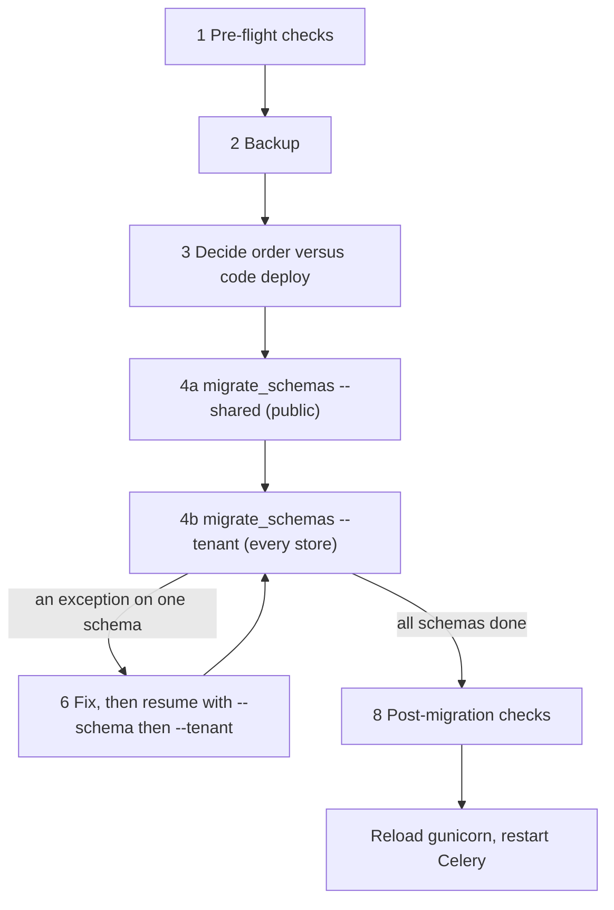

# Runbook — applying migrations across tenant schemas

> **Source**: DOC-510 · inventory A.9, A.10 · INT-001 → INT-049 (Phase 002 migrations)
> **Owner**: fares · **Last dry run**: not dry-run in step 39 (no environment was available; every command below was derived from code and library source, none was executed)

> **Acceptance not met.** The roadmap "Done when" for DOC-510 asks for the runbook to be *executed once on staging and timings recorded*. That was **NOT done** in step 39. The timings table in [Step 5](#5-long-backfills-and-timings) is empty on purpose. Treat every command marked "unverified" as a proposal until fares has run it. All SQL and shell snippets here are untested.

## When to use

- A release contains new files under `products/migrations/` (tenant schema), `tenants/migrations/`, `billing/migrations/`, `sharwapay/migrations/` or `appstore/migrations/` (public schema), and the database must be brought up to date.
- A new environment is being built from scratch. Only the shared run is needed for existing stores. New stores get every migration at provisioning time (see Step 6).
- A single store schema is behind (a failed provisioning or an interrupted bulk run) and must be caught up.

The migration set this runbook was written for is the Phase 002 range listed in [`../migrations/phase-002-ledger.md`](../migrations/phase-002-ledger.md): 32 files in 0211–0236 / tenants 0026–0027 / billing / sharwapay / appstore (26 run per store schema, 6 run once in `public`). Data steps are described in [`../migrations/backfills.md`](../migrations/backfills.md).

## Impact and risk

| Aspect | What happens |
|---|---|
| Schemas touched | `public` once (shared apps), then every store schema once (tenant apps). Work grows linearly with the number of stores. |
| Where each app lives | Shared: `tenants`, `core`, `billing`, `sharwapay`, `appstore`, `marketing`, `sharwa_ship` (`config/settings.py:121-150`). Tenant: `products`, `api` (`:152-161`). Router: `TenantSyncRouter` (`:117-119`). |
| Transactions | Each migration is atomic on PostgreSQL and none of the Phase 002 files sets `atomic = False`. A failing migration rolls back its own changes in that schema. Earlier migrations and earlier schemas stay committed. |
| Failure mode of the bulk run | The standard executor loops over store schemas with no per-schema `try/except`. The first exception aborts the whole run, so the schemas after the failing one are untouched. |
| Locks | Adding NOT NULL columns, indexes and constraints takes table locks per store. Index creation is not `CONCURRENTLY` (e.g. the `db_index` on 0211). Run during a quiet window. |
| Reversibility | Mostly reversible (see [Roll back](#roll-back)), but backfill reverses are no-ops and four files cannot be reversed once NULL rows exist (0222, 0223, 0225, 0229). A restore from backup is the real undo. |
| Duration | **Not measured.** No timings exist. |
| Maintenance mode | None exists. `deploy/nginx` has no maintenance switch and nothing in `deploy/` toggles one. Requests keep flowing during a migrate. |

## Prerequisites

- Shell on the server with the virtualenv active and `DJANGO_SETTINGS_MODULE` pointing at the production settings. Run every `python manage.py` command from the backend root.
- django-tenants **3.14.0** (`requirements.txt:5`). All flags below were read from that version's `migrate_schemas` command. Re-check with `python manage.py migrate_schemas --help` if the pin changes.
- A database role that can run DDL in every schema, and `pg_dump` / `pg_restore` / `psql` on the PATH of the machine that takes the backup. Credentials come from your own `~/.pgpass` or `PGPASSWORD` in the session. Never paste a password into a command line or a ticket.
- Values to have ready: `<SCHEMA>` (a store schema, e.g. `noor`), `<PREV>` (the migration name to roll back to), `<DBNAME>`, `<DBUSER>`, `<DBHOST>`.
- Celery worker and Beat status known (Step 3). A migration does not need them running, but the deploy restarts them afterwards.

## Steps



### 1. Pre-flight

1. Confirm there are no model changes without a migration file (unverified, not run in step 39).

   ```bash
   python manage.py makemigrations --check --dry-run
   ```

   ```bat
   python manage.py makemigrations --check --dry-run
   ```

   Expected: `No changes detected` and exit code 0.

2. Production safety check and Celery queue check (the same two commands `deploy/deploy.sh` runs at lines 35-36). Run on the Step 51 verification stack: both exit 0. Plain `check --deploy` prints about 980 `drf_spectacular.W001/W002` warnings (unresolved type hints in the schema generator); they are expected — read only the `security.*` lines ([`../_verification.md`](../_verification.md#o-1)).

   ```bash
   python manage.py check --deploy --fail-level ERROR
   python deploy/check_celery_queues.py
   ```

3. Show what would run. `--plan` exists in 3.14.0 (unverified output).

   ```bash
   python manage.py migrate_schemas --shared --plan
   python manage.py migrate_schemas --tenant --plan
   ```

4. Find stores that would break the bulk run. The bulk `--tenant` loop has no `schema_exists` check, so a `tenants_client` row whose schema was never created (pending or failed provisioning) is expected to raise partway through (inferred from library code at `migrate_schemas.py:99-107` and `base.py:50-52`, not reproduced). Untested SQL:

   ```sql
   -- stores that are not ready
   SELECT schema_name, provisioning_status
   FROM tenants_client
   WHERE schema_name <> 'public' AND provisioning_status <> 'ready'
   ORDER BY schema_name;

   -- stores whose schema does not exist
   SELECT c.schema_name, c.provisioning_status
   FROM tenants_client c
   LEFT JOIN information_schema.schemata s ON s.schema_name = c.schema_name
   WHERE c.schema_name <> 'public' AND s.schema_name IS NULL;
   ```

   Resolve every row of the second query before Step 4 (finish provisioning from the console, or remove the dead row). See [Troubleshooting](#troubleshooting).

### 2. Backup

> Unverified. The repository has no backup script (nothing under `deploy/` or `docs/` takes a dump). The commands below are standard PostgreSQL tooling and have not been run against this database.

One dump covers `public` and every store schema.

```bash
pg_dump -h <DBHOST> -U <DBUSER> -Fc -f sharwa-before-migrate.dump <DBNAME>
pg_restore -l sharwa-before-migrate.dump | head
```

```bat
pg_dump -h <DBHOST> -U <DBUSER> -Fc -f sharwa-before-migrate.dump <DBNAME>
pg_restore -l sharwa-before-migrate.dump
```

For a single store (before catching up one schema):

```bash
pg_dump -h <DBHOST> -U <DBUSER> -Fc -n <SCHEMA> -f <SCHEMA>-before-migrate.dump <DBNAME>
```

Expected: the file is non-empty and `pg_restore -l` lists tables of the schema. Keep the dump until the post-migration checks pass.

### 3. Order versus code deploy

`deploy/deploy.sh` (`set -euo pipefail` at line 15) runs in this order:

| Line | Action |
|---|---|
| 27 | `git pull` |
| 31 | `pip install` |
| 35 | `python manage.py check --deploy` |
| 36 | `deploy/check_celery_queues.py` |
| 40 | `migrate_schemas --shared` |
| 42 | `migrate_schemas --tenant` |
| 46 | `migrate_passwords` |
| 47 | `migrate_merchant_phone` |
| 51 | `collectstatic` |
| 55 | `systemctl reload gunicorn` |
| 57 | restart `celery-sharwa` |
| 58 | restart `celery-sharwa-beat` |

The Docker path does the same through a one-shot `release` service (`docker-compose.prod.yml:44-52`). The `web`, `worker` and `beat` services declare `depends_on: release: condition: service_completed_successfully` (`:69-71`, `:96-98`, `:108-110`), so nothing new starts if the release step fails.

So the rule is **migrate first, reload the app after**. Consequences, all inferred from code and not reproduced:

- **Old code against new schema.** Between line 42 and line 55 the running gunicorn still serves the old code. Django drops the database default after an `AddField` of a NOT NULL column with a default. An old-code `INSERT` into such a table can then fail with a NOT NULL violation. Tables affected in Phase 002: 0211 (`updated_at`), 0221 (`kind`), 0229 (`version`), 0230 and 0234. Keep the window short and expect a few errors on writes to those tables.
- **Abort after `git pull`.** If the script stops at 40 or 42, the new code is on disk but gunicorn has not been reloaded. `preload_app=False` and `max_requests=1000` with 100 jitter (`gunicorn.conf.py:38-41`) mean a recycled worker imports the new code from disk before any reload, so new code can run against an unmigrated schema. After a failed migrate, fix and finish the run promptly, or `git checkout` the previous revision.
- **No maintenance page.** See Impact and risk. If writes must stop, stop traffic at the load balancer or nginx by hand. That procedure is not documented in the repo.

Manual variant (no `deploy.sh`): run Steps 4 and 8 yourself, then the reload and restarts from lines 55-58.

### 4. Apply

1. Shared apps, in `public`:

   ```bash
   python manage.py migrate_schemas --shared
   ```

   ```bat
   python manage.py migrate_schemas --shared
   ```

2. Every store schema:

   ```bash
   python manage.py migrate_schemas --tenant
   ```

   ```bat
   python manage.py migrate_schemas --tenant
   ```

   Plain `python manage.py migrate_schemas` (neither flag) runs both phases, shared first. `deploy.sh` runs them as two commands, which is easier to read in logs.

   Expected output: one block per schema, `=== Starting migration`, then one `Applying products.02xx_...  OK` line per migration. The `[idx/N (pct%) standard:<schema>]` prefix is printed **only when stdout is a terminal** (Django's `OutputWrapper` applies the style function on a TTY only); in `deploy.sh` logs, journald or a redirected file the schema name is not printed (verified in Step 51, [`../_verification.md`](../_verification.md#o-3)).

Flags in 3.14.0 (read from the command source): `--shared`, `--tenant`, `-s` / `--schema`, `--executor`, `--fake`, `--fake-initial`, `--plan`, `--check`, `--prune`, `--run-syncdb`, `--parallel`, `--noinput`. In django-tenants 3.14.0 `migrate` is an alias of `migrate_schemas` (`management/commands/migrate.py` assigns `Command = MigrateSchemasCommand`), but only when `django_tenants` comes before the Django apps in `INSTALLED_APPS`. Use the explicit `migrate_schemas` name so the intent is clear. The alias was read from library source, not run.

### 5. Long backfills and timings

Row-by-row loops run inside the migration for 0214, 0215 and 0221 (see [`backfills.md`](../migrations/backfills.md)). The cost scales with orders and ledger rows per store. Nothing was measured.

`--executor=multiprocessing` and `--executor=subprocess` with `--parallel` exist in 3.14.0 and could shorten the bulk run, but they are untested here and give interleaved output, which makes the resume step in Step 6 harder. No `EXECUTOR` or `TENANT_*` setting exists in the repo, so the default `standard` executor is what runs. Do not switch without a staging run.

Timings to record on the first staging run (empty on purpose):

| Item | Value |
|---|---|
| Stores in the database | |
| `--shared` total | |
| `--tenant` total | |
| Slowest schema | |
| Slowest migration (expected: 0214, 0215, 0221) | |
| Date, environment, operator | |

### 6. Failure on one schema, and resuming

What a failure looks like: the traceback ends the command. On a terminal, the last prefix printed before it, `[n/N (pct%) standard:<schema>]`, names the schema that was being migrated — **except** when the failing schema does not exist: django-tenants creates the schema's `django_migrations` table (`ensure_schema()`) before it prints the prefix, so a missing schema fails with `MigrationSchemaMissing: Unable to create the django_migrations table (no schema has been selected to create in …)` and the last prefix on screen belongs to the **previous, successful** schema (reproduced in Step 51, [`../_verification.md`](../_verification.md#p2-3)). Off a terminal there is no prefix at all. In both cases find the culprit with the Step 1.4 queries, or run `migrate_schemas --schema=<SCHEMA>` per suspect.

State after a failure (from the executor source and Django's atomic migrations):

- Schemas before the failing one are fully migrated and committed.
- In the failing schema, migrations before the failing one are committed. The failing migration is rolled back and not recorded.
- Schemas after the failing one have not been touched.

Resume:

1. Read the error. Fix the cause in the data or the environment. **Do not edit a migration file that has already been applied anywhere.**
2. Re-run only the failed schema to see the fix work:

   ```bash
   python manage.py migrate_schemas --schema=<SCHEMA>
   ```

   ```bat
   python manage.py migrate_schemas --schema=<SCHEMA>
   ```

   For a schema other than `public` the command checks that it exists and otherwise raises `Schema "<SCHEMA>" does not exist` (`migrate_schemas.py:73-75`).
3. Continue with everyone else. Schemas already up to date are no-ops, so just re-run:

   ```bash
   python manage.py migrate_schemas --tenant
   ```

4. List what is still pending in one schema (unverified):

   ```bash
   python manage.py tenant_command showmigrations products --schema=<SCHEMA>
   ```

   Plain `showmigrations` reads `public` only, so it never reports store schemas. `all_tenants_command` runs a command in every schema.

**Stores that are not `ready`.** If a `tenants_client` row has no schema, the bulk run fails on it (Step 1.4; reproduced in Step 51 with `MigrationSchemaMissing`, exit 1). `tenants/provisioning.py:184-193` shows the intended recovery: when the schema exists it runs `migrate_schemas` for that one tenant (`tenant=True, schema_name=..., interactive=False`), otherwise it calls `client.create_schema(check_if_exists=True)`. The console action *reprovision* (`tenants/console_service.py:459`) goes through that path. Use it for a store stuck in provisioning rather than editing rows by hand.

New stores are not affected by this procedure: `Client.auto_create_schema = True` (`tenants/models.py:57`) and provisioning applies every tenant migration to a fresh schema.

### 7. Console behaviour while a schema is broken

If one store's schema is behind or broken, the platform console must still load. The reads that touch store schemas are wrapped so that a database error costs one store's data, not the page. Traced in `tenants/console_service.py`:

| Function (line) | Guard | On failure |
|---|---|---|
| `sharwa_ship_active` (224-233) | `with transaction.atomic(), schema_context(client.schema_name):` at 229, `except DatabaseError` at 231 | returns `False`, logs «تعذّرت قراءة حالة شروة شيب \| schema=%s» |
| `_installations` (386-406) | atomic at 393 | returns `[]`, logs «تعذّرت قراءة تثبيتات المتجر \| schema=%s» (396) |
| `tenant_custody_blocker` (761-780) | atomic at 767 | logs «تعذّر فحص عهدة المتجر \| schema=%s» (774) and returns the blocker string «تعذّر فحص عهدة المتجر الآن — حاول مجدداً.» (775), so the store cannot be closed while the check fails |

Why the savepoint matters: `ATOMIC_REQUESTS` is not set (`config/settings.py:106-115`), so `transaction.atomic()` opens a transaction, or a savepoint when nested inside one. A failed statement on PostgreSQL poisons the surrounding transaction (`current transaction is aborted`). With the savepoint the failure is rolled back to the savepoint and the next store's read runs clean. Without it, every later read in the same request would fail too. `schema_context.__exit__` (django-tenants `utils.py:129-133`) only resets attributes through `set_tenant` and issues no SQL, so it cannot restore the search path after an error by itself. `DatabaseWrapper.rollback()` (`base.py:86-94`) drops the cached search path, which makes the next query set it again.

All three guards first test `provisioning_status == Client.PROVISIONING_READY` (`:225`, `:387`, `:763`), so a store that is not ready is skipped, not read. `sharwa_ship_active` feeds `store_row` (`:262`, through `sharwa_ship_state` at `:236-245`) and so `list_stores` (`:294-323`). Two more guarded count paths exist: `console_money_service._pending_counts` (`:121-153`, one `UNION ALL` query with a per-store atomic fallback) and `console_billing_service._installation_counts` (`:341-368`).

> ⚠️ Discrepancy — roadmap says "every tenant-schema read wrapped in a savepoint" (`documentation-roadmap.md:3018`) / code does: `console_money_service.dues_detail` (`:254`) and `due_action` (`:334`) use a bare `schema_context` with no `transaction.atomic()` and no `except DatabaseError`. For a ready store whose schema is missing they return a 500. Already recorded at `docs/architecture/13-cross-schema-access.md:201`. Reported in step 39.

None of the five tables read by the guarded console paths (`DeliveryMethod`, `StoreAppInstallation`, `ShipmentOrder`, `PlatformCommissionRecord`, `AppBillingCharge`) is altered by the 32 Phase 002 migrations, so a half-migrated store is not expected to trigger these log lines because of Phase 002. Searching the logs for the three strings above is the way to spot a broken schema (see [Troubleshooting](#troubleshooting)). See also [`../../architecture/13-cross-schema-access.md`](../../architecture/13-cross-schema-access.md).

### 8. Post-migration checks

Run these after Step 4 and before reloading gunicorn.

1. Nothing pending in `public`, and nothing pending in a sample store (unverified):

   ```bash
   python manage.py showmigrations tenants billing sharwapay appstore
   python manage.py tenant_command showmigrations products --schema=<SCHEMA>
   ```

   Expected: every line is `[X]`. A full "matches `showmigrations` on a fresh database" comparison was **not run** in step 39.

2. Per store: permission seed, role names, notifications tables. Untested Django shell snippet (`python manage.py shell`):

   ```python
   from django.db import DatabaseError, transaction
   from django_tenants.utils import schema_context
   from tenants.models import Client
   from products.models import Permission, Notification, NotificationRead

   for c in Client.objects.exclude(schema_name="public").order_by("schema_name"):
       try:
           with transaction.atomic(), schema_context(c.schema_name):
               codes = set(Permission.objects.filter(
                   code__in=["catalog.manage", "expenses.manage"]
               ).values_list("code", flat=True))
               print(c.schema_name, c.provisioning_status,
                     "expenses.manage" in codes,
                     Notification.objects.count(),
                     NotificationRead.objects.count())
       except DatabaseError as exc:
           print(c.schema_name, "ERROR", type(exc).__name__)
   ```

   Expected for every store: `expenses.manage` is `True` (seeded by `products/0235_seed_expenses_permission`), and the two counts print without error (zero is fine). `ERROR` means the schema lacks `products_notification` or `products_notificationread`, i.e. a Phase 002 migration did not reach it.

3. Notifications tables per schema, from SQL (untested):

   ```sql
   SELECT c.schema_name,
          to_regclass(format('%I.products_notification', c.schema_name))     IS NOT NULL AS has_notification,
          to_regclass(format('%I.products_notificationread', c.schema_name)) IS NOT NULL AS has_read
   FROM tenants_client c
   WHERE c.schema_name <> 'public'
   ORDER BY c.schema_name;
   ```

   Expected: `t` in both columns for every store.

4. The `pos` feature seed lives in `public` (`billing/0013`). Untested shell check:

   ```python
   from billing.models import Feature
   print(Feature.objects.filter(code="pos").values(
       "code", "is_active_globally", "requires_plan", "module_group"))
   ```

   Expected: one row with `is_active_globally=True`, `requires_plan=True`, `module_group='merchant_sections'`.

5. Permission seed across all stores in one query (untested; generates the `UNION ALL` first, then run its output):

   ```sql
   SELECT string_agg(
     format('SELECT %L AS schema_name, count(*) AS n FROM %I.products_permission WHERE code = %L',
            schema_name, schema_name, 'expenses.manage'),
     E'\nUNION ALL\n' ORDER BY schema_name)
   FROM tenants_client WHERE schema_name <> 'public';
   ```

   Expected: every row returns `n = 1`. System roles (the four defaults from `0144_seed_staff_rbac.py:36-41`) are unrelated to this seed and are not re-created by Phase 002.

6. Spot-check the data steps that ran: use the verification queries in [`backfills.md`](../migrations/backfills.md), notably the 0221 query (wallet transaction `kind`) for a store that has wallet history.

### 9. Process note: who runs this

Fares runs migrations himself when Claude cannot reach the database or the server. In that situation Claude supplies the exact commands above, fares runs them and reports the output, and Claude does **not** mark the migration step as done until that output has been seen. The same applies to tests and checks. This runbook follows that rule: nothing in it was executed by the author.

## Verify

- `migrate_schemas --shared` and `--tenant` both finish with exit code 0.
- Step 8.1 shows no unchecked line for `public` and for each sampled store.
- Step 8.2 prints `True` for `expenses.manage` and no `ERROR` for any store.
- Step 8.3 shows both tables present for every store.
- Step 8.4 returns the `pos` feature row.
- After reload, the platform console store list loads and the logs show none of the three console strings from Step 7.

## Roll back

Reverse a single store schema to a named migration (unverified):

```bash
python manage.py migrate_schemas --schema=<SCHEMA> products <PREV>
```

```bat
python manage.py migrate_schemas --schema=<SCHEMA> products <PREV>
```

Caveats, all from the ledger and the migration code:

- Backfill reverses are no-ops. Rolling back does not undo rewritten data, it only drops columns and tables.
- 0222, 0223, 0225 and 0229 have a reverse that is blocked once rows contain NULLs in the affected columns. Reversing them after the store has written data is not safe.
- Tables created by Phase 002 (nine in store schemas, two in `public`) are dropped by the reverse, with their data.
- Do not use `--fake` or `--fake-initial` to "fix" a failed run. They record migrations as applied without running them and leave the schema out of step with the code.
- The dependable undo is a restore from the Step 2 dump, with the code reverted to the previous revision at the same time. Restore procedures were not exercised.

## Troubleshooting

| Symptom | Likely cause | Fix |
|---|---|---|
| `--tenant` stops on a schema, later schemas untouched | Exception in one schema, no per-schema `try/except` in the standard executor | Step 6: fix the cause, `--schema=<SCHEMA>`, then `--tenant` again |
| `Schema "<SCHEMA>" does not exist` | `Client` row without a created schema | Step 1.4, then reprovision from the console (Step 6) |
| Bulk `--tenant` fails on a store that is not `ready` (inferred) | Pending or failed provisioning leaves a `Client` with no schema | Resolve the rows from Step 1.4 first |
| `null value in column ... violates not-null constraint` on writes right after migrate | Old code still running, database defaults dropped by `AddField` (inferred) | Reload gunicorn immediately after migrate finishes |
| New code errors with `relation ... does not exist` on a store | That store was not reached by the bulk run | `showmigrations` for the store (Step 6.4), then `migrate_schemas --schema=<SCHEMA>` |
| Console store list shows a store with Sharwa Ship off and a warning in the logs | Guarded read failed for that schema | Search logs for «تعذّرت قراءة حالة شروة شيب \| schema=%s», check the schema with Step 8.3 |
| Console dues detail or due action returns 500 for one store | Unguarded `schema_context` reads at `console_money_service.py:254` and `:334` | Fix the schema; code gap recorded in `13-cross-schema-access.md:201` |
| Store cannot be closed: «تعذّر فحص عهدة المتجر الآن — حاول مجدداً.» | Custody check failed on that schema (`console_service.py:775`) | Repair the schema, retry |
| `plain showmigrations` shows all applied but a store is behind | `showmigrations` reads `public` only | Use `tenant_command showmigrations products --schema=<SCHEMA>` |
| Reverse migration raises an error about NULL values | 0222, 0223, 0225 or 0229 reverse with data present | Restore from the Step 2 dump instead |

## Related

- [`../migrations/phase-002-ledger.md`](../migrations/phase-002-ledger.md) — every Phase 002 migration, placement, reversibility
- [`../migrations/backfills.md`](../migrations/backfills.md) — data steps with source rules and verification queries
- [`../management-commands.md`](../management-commands.md) — project management commands
- [`celery.md`](celery.md) — restarting workers and Beat after the deploy
- [`switch-module-live.md`](switch-module-live.md) — runbook that depends on these migrations
- [`../deployment/go-live-checklist.md`](../deployment/go-live-checklist.md) — planned page (DOC-515 in the roadmap, `documentation-roadmap.md:5810`), not yet written
- [`../../architecture/10-multi-tenancy.md`](../../architecture/10-multi-tenancy.md)
- [`../../architecture/11-provisioning.md`](../../architecture/11-provisioning.md)
- [`../../architecture/13-cross-schema-access.md`](../../architecture/13-cross-schema-access.md)
