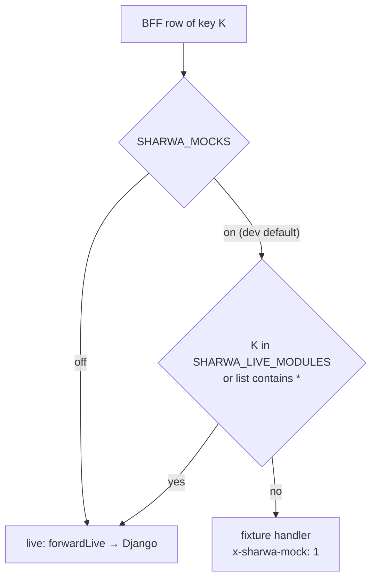

# Runbook — switch a module live / roll it back

> **Source**: DOC-460 · inventory A.1 (Step 4), A.2, A.3, A.5, A.8, A.9, A.12 · INT-001 → INT-049
> **Code**: `sharwa-frontend/src/mocks/runtime.ts` (`isMocksOn`, `isModuleLive`, `notAvailable`) · `src/lib/bff/live-route.ts` (`liveOrMock`, `forwardLive`) · `src/lib/bff/mock-route.ts` · `src/env.ts` · `.env.example`
> **Owner**: fares · **Last dry run**: not yet (dry runs are DOC-532). Commands checked against the code on 2026-10-27 (official Step 07).

## When to use

- A module was integrated (its `INT-0xx` task is ticked) and you want its BFF rows to answer from Django instead of the fixtures, on one development or staging server.
- A live module misbehaves and you want its screens back on the fixtures while you investigate.
- You are about to run a mock end-to-end script (`scripts/*-check.ts`) and the server has live modules switched on.

This runbook switches **one module key** at a time. The 39 keys, the rows each one routes and its Django provider are in [`../../api/overview/bff.md#live-keys`](../../api/overview/bff.md#live-keys); the design of the switch is in [`../../architecture/20-bff.md`](../../architecture/20-bff.md) and the register in [`../../architecture/22-live-module-keys.md`](../../architecture/22-live-module-keys.md).

## Impact and risk

| Item | Detail |
|---|---|
| What changes | Every BFF row of that key stops calling its fixture handler and forwards the request to Django `/api/v1/…` verbatim (`forwardLive`). Nothing changes in Django or in the browser code. |
| Who notices | Anyone using that module on this server: the data becomes the store's real data, and every gate (401/403/plan feature) is now Django's. |
| Reversible | Yes for the 39 switched keys (remove the key, restart). **No** for the Django-first rows (see *Roll back*). |
| Duration | Under five minutes for one key (timed checklist below). Running the module's Django suite beforehand takes longer and is done before the window. |
| Data risk | In live mode, writes are real writes in the store schema (orders, stock, wallet ledgers…). Use a test store. |

### How the switch decides



- `SHARWA_MOCKS` unset means `on` outside production and `off` when `NODE_ENV=production` (`isMocksOn()`; `src/env.ts` applies the same default).
- With `SHARWA_MOCKS=off` the list is **ignored**: every key is live.
- Keys are compared lower-case after trimming; `*` means all. A misspelt key is not rejected — it simply matches nothing and the module stays on fixtures.
- `none` is not a keyword; it behaves as an unused key. Leave the variable empty or unset to mean "no live module".

## Prerequisites

- **Access**: the Next.js repo (`C:\sharwa_front\sharwa-frontend`), the Django repo (`C:\sharwa_saas`) and a shell on the machine that runs them.
- **Services running**: Django (`python manage.py runserver` or gunicorn), PostgreSQL, Redis, Celery worker + Beat if the module has jobs (table below), Next.js (`npm run dev`, or `npm run build` + `npm run start`).
- **A test store** (for example `noor`) that is `ready`, and a **real Django session on that store host**: log in once at `http://<STORE>.localhost:8000/dashboard/login/` (owner: WhatsApp phone + password; staff: `auth/staff/login/`). Cookies are shared across ports on `localhost`, so the session also reaches `http://<STORE>.localhost:3000`. The fixture cookie `sharwa_mock_session` means nothing to Django.
- **Values to have ready**: `<KEY>` (the module key), `<STORE>` (test store slug), `<SESSIONID>` (the `sessionid` cookie value, from the browser's DevTools → Application → Cookies — never paste it into a ticket), `<ROUTE>` (one BFF row of the module, for example `search?q=ab`).

### Per-module preconditions

Check the row of `<KEY>` before the window. "—" means none is stated for that module in the inventory. Full registers: migrations [`../migrations/phase-002-ledger.md`](../migrations/phase-002-ledger.md) (inventory A.9), Celery jobs [`../../architecture/50-background-jobs.md`](../../architecture/50-background-jobs.md) (A.8), plan features [`../../architecture/15-plans-and-features.md`](../../architecture/15-plans-and-features.md) and [`../../api/overview/plan-features.md`](../../api/overview/plan-features.md) (A.5), permission keys [`../../api/overview/permissions.md`](../../api/overview/permissions.md), test suites [`../testing/django-suites.md`](../testing/django-suites.md) (A.12).

| Key | INT · module | Django suite (`python manage.py test …`) | Migrations to apply | Celery / Beat | Plan feature on the test store | Keys / identity to test with |
|---|---|---|---|---|---|---|
| `reports` | 027 · M25 | `api.test_reports_api` | — | — | `reports` (see the plans page) | `reports.export`, `reports.sales.view` |
| `catalog` | 006 · M05 | `api.test_catalog_api api.test_catalog_serializers` | `products/0208`–`0210` (not in the A.9 ledger) | — | — | `catalog.manage` for writes |
| `products` | 005 · M04 | `api.test_products_api` | `products/0211`–`0215` | — | — | `inventory.view`, `catalog.manage`, `inventory.adjust`, `discounts.manage` |
| `orders` | 007 · M06 | `api.test_orders_api` | — | — | — | `orders.view`, `orders.update_status`, `orders.refund` |
| `search` | 008 · M48 | `api.test_search_api` | — | — | — | any member; `orders.view` / `customers.view` trim groups |
| `notifications` | 009 · M49 | `api.test_notifications_api` | `products/0216_notifications` | — | — | owner and one staff member |
| `settings` | 010 · M34 | `api.test_settings_api` | `products/0217_storesetting_fx_rate_precision` | — | `contact_info`, `store_policies`, `shipping_settings`, `currency_settings`, `seo_settings`, `coupon`, `multi_location` | owner (money/structure sections are owner-only) |
| `pwa` | 016 · M44 | `api.test_pwa_push_api` | — | worker (`send_order_push`) | — | `reports.view` (stats); owner (test push) |
| `customers` | 017 · M07 | `api.test_customers_api` | `products/0218_customer_crm` | — | — | `customers.view`, `customers.edit_profile`, `customers.export` |
| `design` | 018 · M08 | `api.test_design_api` | `products/0219_theme_version_section_label` | — | `storefront_design` (`coupon` for the announcement bar) | owner only |
| `marketing` | 019 · M13 | `api.test_marketing_api` | `products/0220_marketing_api` | worker + Beat (`send_campaign`, `dispatch_scheduled_campaigns`) | `abandoned_carts`, `campaigns`, `timeline`, `loyalty_settings`, `gift_settings` | `discounts.apply`, `discounts.manage`; owner for carts/campaigns/timeline/loyalty/gifting |
| `payments` | 020 · M14 | `api.test_payments_api` | `products/0221_merchant_wallet_api` | — | `payment_gateways`, `local_wallets`, `bank_transfers`, `merchantwallet` | owner only |
| `shipping` | 021 · M15 | `api.test_shipping_api` | `products/0222_shipping_api` | — | `shipping_companies`, `pickuplocation`, `shipping_providers` | owner (settings) |
| `staff` | 022 · M18 | `api.test_staff_api` | `products/0223_staff_api` | — | `staff_rbac` | `staff.view`, `staff.manage`, `staff.manage_roles`, `staff.manage_assignments`, `staff.view_sessions` |
| `integrations` | 023 · M19 | `api.test_integrations_api` | `tenants/0026_customdomain` (public), `products/0224_webhooks` | worker + Beat (`deliver_webhook`, `dispatch-low-stock-webhooks`) | `tracking_tools` | owner only; `dnspython` installed for domain verify |
| `inventory` | 024 · M21 | `api.test_inventory_api` | `products/0225_inventory_api` | — | `inventory` | `inventory.view`, `inventory.adjust`, `inventory.writeoff`, `reports.export` |
| `locations` | 025 · M22 | `api.test_locations_api` | `products/0226_locations_api` | — | `multi_location` | owner (structure), `inventory.adjust`, `staff.manage_assignments` |
| `returns` | 026 · M24 | `api.test_returns_api` | — | — | `refunds` | `orders.process_returns`, `inventory.adjust`, `orders.refund` |
| `wallets` | 028 · M35 | `api.test_wallets_api` | `products/0227_wallets_api` | — | `customer_wallets`, `loyalty_settings` | `customers.view`, `customers.edit_profile` |
| `platform` | 030 · M20 | `api.test_platform_console_api` | `tenants/0027_platform_console_api`, `billing/0012_tenantfeatureoverride_updated_at` | worker (`queue_provisioning`, `provision_tenant_schema`, `process_carrier_webhook_event`) | n/a (console) | console session on the **console host** («مالك المنصة» / «مشرف تشغيلي») |
| `platform_money` | 031 · M45 | `api.test_platform_money_api` | `sharwapay/0003_console_review_fields` | — | n/a | console session |
| `platform_billing` | 032 · M46 | `api.test_platform_billing_api` | `appstore/0007_app_icon_name` | — | n/a | console session |
| `pos` | 033 · M16 | `api.test_pos_api` | `products/0229_pos_api`, `billing/0013_seed_pos_feature` | worker (force-close task) | `pos` | `discounts.apply` (POS ceiling per role); manager code via `manage.py set_pos_manager_code` |
| `affiliates` | 034 · M17 | `api.test_partners_api` | — | — | `affiliates`, `influencers` (see the plans page) | owner for writes |
| `procurement` | 035 · M23 | `api.test_procurement_api` | `products/0230_procurement_api` | — | none by design | `suppliers.manage`, `suppliers.approve` (no seed grant: assign them to the test role) |
| `bookings` | 036 · M26 | `api.test_bookings_api` | — | — | `bookings` | manager rows: see [`permissions.md`](../../api/overview/permissions.md) |
| `channels` | 037 · M27 | `api.test_channels_api` | `products/0231_inbox_api` | worker (`dispatch_channel_message`, `sync_channel_catalog`, `sync_channel_product`, health) | `social_channels` | `channels.inbox.access`; owner for channel settings |
| `marketplaces` | 038 · M28 | `api.test_marketplaces_api` | — | worker (push, `order_pull`, `fba_inventory`, `retry_failed_confirmation`) | `marketplaces` | `channels.marketplaces.manage` |
| `dropshipping` | 039 · M29 | `api.test_dropshipping_api` | `products/0232_dropshipping_api` | worker + Beat (self-chaining jobs, hourly catalog beat, `fetch_scheduled_feeds_for_tenant`) | `dropshipping` | `channels.dropshipping.manage` |
| `apps` | 040 · M30 | `api.test_apps_api` | `products/0233_app_store_api` | worker (`dispatch_whatsapp_message`, `send_whatsapp_notification_async`) | `app_marketplace` | owner for installs and template edits |
| `sharwa_ai` | 041 · M31 | `api.test_sharwa_ai_api` | — | — | `app_marketplace` | owner for writes; `SHARWA_AI_CONSOLE_URL` + SSO keys in Django (503 without them) |
| `support` | 042 · M32 | `api.test_support_api` | `products/0234_support_api` | worker (`deliver_staff_reply`) | none by design | `support.takeover_session` |
| `expenses` | 043 · M33 | `api.test_expenses_api` | `products/0235_seed_expenses_permission` | — | none by design | `expenses.manage` |
| `b2b` | 044 · M36 | `api.test_b2b_api` | — | — | — | `orders.create_b2b`, `orders.approve_b2b` (a staff session: an owner cannot create a draft) |
| `advanced_products` | 045 · M37 | `api.test_product_extras_api` | `products/0236_advanced_products_api` | none (CSV import runs on run/poll) | — | `inventory.view`, `catalog.manage` |
| `courier` | 046 · M38 | `api.test_courier_api` | — | — | — | a staff session whose `shipping_provider_profile` is an active agent (owner → 403) |
| `sharwa_ship` | 047 · M39 | `api.test_sharwa_ship_api` | — | worker (`retry_pending_awb_issuance_for_tenant`) | `sharwa_ship` (supervision rows also open with `shipping_providers`) | `orders.view`; owner for writes and supervision |
| `sharwa_pay` | 048 · M40 | `api.test_sharwa_pay_api` | — | — | n/a | Sharwa Pay OTP session on the **platform origin** |
| `rollup` | 049 · M43 | `api.test_rollup_api` | — | — | — | owner of a store linked to a `MerchantAccount` |

> Migrations under `products/` are tenant migrations: apply them with `python manage.py migrate_schemas` (every schema), not plain `migrate`. Procedure: [`migrations.md`](migrations.md).

## Steps

Times are wall-clock targets; the whole forward + back fits in five minutes once the prerequisites hold.

| T+ | Step | Done when |
|---|---|---|
| 0:00 | 1. Check the key's row above (migrations applied, jobs running, feature on, test identity ready) | every cell is ✔ |
| 0:30 | 2. Add `<KEY>` to `SHARWA_LIVE_MODULES` | the variable shows the key |
| 1:00 | 3. Restart Next | `Ready` in the Next console |
| 1:30 | 4. Verify the header is gone on one row of the module | no `x-sharwa-mock` |
| 2:00 | 5. Live smoke test: one read and one write on the screen | Django's access log shows both requests |
| 3:00 | 6. Confirm a 401/403 comes from Django | the denial appears in Django's log |
| 3:30 | Roll back: remove the key, restart, verify `x-sharwa-mock: 1` | header back |

### 1. Check the preconditions

Use the table above. Run the module's Django suite **before** the window (tenant tests create schemas and take longer than five minutes):

```bash
cd /path/to/sharwa_saas
python manage.py test api.test_<x>_api
```

```bat
:: Windows cmd
cd C:\sharwa_saas
python manage.py test api.test_<x>_api
```

Expected output: `OK` (a failure means the module is not ready to go live; stop here).

### 2. Add the key

Recommended: edit `.env.local` in the Next repo (copied from `.env.example`):

```dotenv
SHARWA_MOCKS=on
SHARWA_LIVE_MODULES=reports,catalog,products,<KEY>
```

Or set it only for this run of the dev server:

```bash
# Linux / macOS
SHARWA_LIVE_MODULES=reports,catalog,products,<KEY> npm run dev
```

```bat
:: Windows cmd — no space between the value and &&, or the space becomes part of the value
set SHARWA_LIVE_MODULES=reports,catalog,products,<KEY>&& npm run dev
```

```powershell
# Windows PowerShell
$env:SHARWA_LIVE_MODULES = "reports,catalog,products,<KEY>"; npm run dev
```

Notes:

- A variable set in the shell **wins over `.env.local`** (Next.js does not overwrite an environment variable that is already set). If you set it in the shell before, editing `.env.local` changes nothing.
- `*` switches every key at once; `SHARWA_MOCKS=off` makes everything live and ignores the list (the production value).
- Allowed characters: letters, digits, `_`, `*`, `,`, `-` and spaces. Anything else stops the server at boot with «SHARWA_LIVE_MODULES قائمة وحدات مفصولة بفواصل (مثال: reports)» (`src/env.ts`).
- Key pairs to know: `apps` and `sharwa_ai` share one route file (the first path segment picks the key); `products`, `b2b` and `advanced_products` are three independent switches over the product routes; the three `platform*` keys only act on the console host; `sharwa_pay` only on the platform origin.

### 3. Restart Next

Stop the dev server (`Ctrl+C`) and start it again (`npm run dev`). In production-like runs: `npm run build` once, then restart `npm run start` (or the service that runs it). `src/env.ts` validates the values at boot.

### 4. Verify the module answers from Django

The header `x-sharwa-mock` tells the three kinds of answer apart (`src/mocks/runtime.ts`):

| `x-sharwa-mock` | Meaning |
|---|---|
| `1` | a fixture answered — the module is **not** live |
| `0` | mocks are off and that row has no Django endpoint (`501` «غير متاح بعد.») |
| absent | Django answered — the module **is** live |

Browser: open the module's screen on `http://<STORE>.localhost:3000`, DevTools → Network → pick an `/api/bff/…` request → Response headers.

Command line (sends your real session; `--resolve` makes `*.localhost` work on every curl build):

```bash
# Linux / macOS
curl -s -o /dev/null -D - --resolve <STORE>.localhost:3000:127.0.0.1 \
  -H "Cookie: sessionid=<SESSIONID>" \
  "http://<STORE>.localhost:3000/api/bff/<ROUTE>" | grep -i -E "^HTTP|x-sharwa-mock"
```

```bat
:: Windows cmd
curl.exe -s -o NUL -D - --resolve <STORE>.localhost:3000:127.0.0.1 -H "Cookie: sessionid=<SESSIONID>" "http://<STORE>.localhost:3000/api/bff/<ROUTE>" | findstr /i "HTTP x-sharwa-mock"
```

```powershell
# Windows PowerShell — call curl.exe explicitly (in Windows PowerShell 5.1 `curl` is an alias of Invoke-WebRequest)
curl.exe -s -o NUL -D - --resolve "<STORE>.localhost:3000:127.0.0.1" -H "Cookie: sessionid=<SESSIONID>" "http://<STORE>.localhost:3000/api/bff/<ROUTE>" | Select-String -Pattern "HTTP|x-sharwa-mock"
```

Expected: an `HTTP/1.1 200` line and **no** `x-sharwa-mock` line. Example for `search`: `<ROUTE>` = `search?q=ab`.

### 5. Live smoke test

On the module's screen, do one read (open the list) and one harmless write on the test store (for example rename a test category back and forth). Each request must appear in the Django console as an access-log line such as `"GET /api/v1/search/?q=ab HTTP/1.1" 200`. A request that never reaches that log was answered by Next.

### 6. Check that 401/403 come from Django

The Arabic bodies do **not** tell you who answered: the fixture path (`mockRoute`) answers `401` «انتهت جلستك، سجّل الدخول مجدداً.» and `403` «ليست لديك صلاحية لهذا الإجراء.», the same sentences most Django mixins use. The fixture `403` does carry `x-sharwa-mock: 1` (built with `mockJson`), but the fixture `401` does not (built with `jsonResponse`), so a `401` looks the same from both sides. Use one of these instead:

1. **Django log**: repeat step 4 without the cookie (or with a staff session that lacks the key). The `401`/`403` must appear as a line in Django's console. No line ⇒ Next answered.
2. **Stop Django** for ten seconds and repeat: a live row answers `502` `{"detail": "الخادم غير متاح حالياً."}`; a fixture row still answers `401` or `200` with `x-sharwa-mock: 1`.

Some modules use their own Django sentences, which also prove the origin: `MerchantAPIMixin` (B2B drafts) «غير مصرح لك بالوصول.» / «لا تملك صلاحية تنفيذ هذا الإجراء.»; the courier reads «لم تُقدَّم بيانات الاعتماد.».

## Verify

- `x-sharwa-mock` is absent on the module's `/api/bff/…` rows (step 4).
- Django's access log shows the module's requests (step 5).
- The module's Django suite passed before the window (step 1).

## Roll back

1. Remove `<KEY>` from `SHARWA_LIVE_MODULES` (`.env.local`), or clear the shell variable:

   ```bash
   # Linux / macOS
   unset SHARWA_LIVE_MODULES
   ```

   ```bat
   :: Windows cmd — "set X=" deletes the variable
   set SHARWA_LIVE_MODULES=
   ```

   ```powershell
   Remove-Item Env:SHARWA_LIVE_MODULES
   ```

2. Restart Next (step 3).
3. Repeat step 4: the header must be back as `x-sharwa-mock: 1`.

What the switch **cannot** roll back:

- **Django-first rows** have no key: landing and tenant probe (INT-001/002), dashboard overview/counters/refresh and auth (INT-003), onboarding (INT-004), storefront catalogue/product/cart/checkout/tracking (INT-011 → INT-015), the PWA passthrough rows (INT-016), storefront rows of INT-028/029/034/036/045, B2B draft rows (INT-044) and courier actions (INT-046). They always call Django first and fall back to a fixture **only** when Django answers `404`/`405`/`501` or is unreachable, and only while `SHARWA_MOCKS=on` ([`bff.md#django-first`](../../api/overview/bff.md#django-first), [`bff.md#passthrough`](../../api/overview/bff.md#passthrough)). To take one of them off Django you must change code, not the environment.
- **Writes already made** in live mode stay in the database. Rolling back the switch does not undo them.
- **Production** runs `SHARWA_MOCKS=off`, where the list is ignored. Rolling back one module there means `SHARWA_MOCKS=on` plus `SHARWA_LIVE_MODULES` listing the other 38 keys — and then every row that has **no** Django provider answers its fixture instead of `501` «غير متاح بعد.», and Django-first rows may show fixtures when Django answers `404`. Treat that as an emergency measure, not a routine rollback.

## Troubleshooting

| Symptom | Likely cause | Fix |
|---|---|---|
| Header still `x-sharwa-mock: 1` after the switch | Next not restarted; key misspelt (no error is raised); the variable is set in the shell and wins over `.env.local` | restart; compare the key with [`bff.md#live-keys`](../../api/overview/bff.md#live-keys); check `echo %SHARWA_LIVE_MODULES%` (cmd) / `$env:SHARWA_LIVE_MODULES` (PowerShell) / `echo $SHARWA_LIVE_MODULES` |
| Every live request answers `401` | no real Django session on this store host (only the fixture cookie), or the owner session is pinned to another store | log in at `http://<STORE>.localhost:8000/dashboard/login/`; see [`../../api/overview/auth.md`](../../api/overview/auth.md) |
| Live writes answer `403` with a CSRF error | the CSRF pair is stale after switching | reload the page (the dashboard fetches `/api/bff/auth/csrf` and retries once) — [`../../api/overview/csrf.md`](../../api/overview/csrf.md) |
| `502` «الخادم غير متاح حالياً.» | Django is down or `API_INTERNAL_URL` points to the wrong origin | start Django; check `API_INTERNAL_URL` in `.env.local` |
| `403` «هذه الميزة غير متاحة في باقتك الحالية» (or the module's own feature sentence) | plan feature off for the test store | enable it from the console or with an override — [`../../architecture/15-plans-and-features.md`](../../architecture/15-plans-and-features.md) |
| Server does not start: «SHARWA_LIVE_MODULES قائمة وحدات مفصولة بفواصل (مثال: reports)» | a character outside letters, digits, `_`, `*`, `,`, `-`, space | fix the value |
| Variable has a trailing space in cmd (`"<KEY> "`) | `set X=<KEY> && npm run dev` with a space before `&&` | write `set X=<KEY>&& npm run dev` |
| A mock end-to-end script fails with `401` far from the cause | a module it touches is live; the scripts use the fixture cookie | restart with no live modules (`set SHARWA_LIVE_MODULES=&& npm run dev`); `scripts/b2b-check.ts` shows the `requireMocks()` pre-flight to copy |
| Celery-driven effects never happen (campaign sent, webhook delivered, provisioning…) | worker or Beat not running | [`celery.md`](celery.md) |
| A screen of a live module breaks with a parse error | Django changed a shape the Zod schema does not accept | stop, roll back, record the row; contract checks are in [`../../architecture/23-ready-api-v1-audit.md`](../../architecture/23-ready-api-v1-audit.md) for the passthrough rows |

## Related

- Design of the switch: [`../../architecture/20-bff.md`](../../architecture/20-bff.md) · mock runtime: [`../../architecture/21-mock-runtime.md`](../../architecture/21-mock-runtime.md) · key register: [`../../architecture/22-live-module-keys.md`](../../architecture/22-live-module-keys.md)
- API reference: [`../../api/overview/bff.md`](../../api/overview/bff.md) (`#liveormock`, `#mock-runtime`, `#live-keys`, `#django-first`)
- Environment variables: [`../environment.md`](../environment.md) (`#live-modules`)
- Integration protocol (Step 4 QA gates): [`../../architecture/02-integration-protocol.md`](../../architecture/02-integration-protocol.md)
